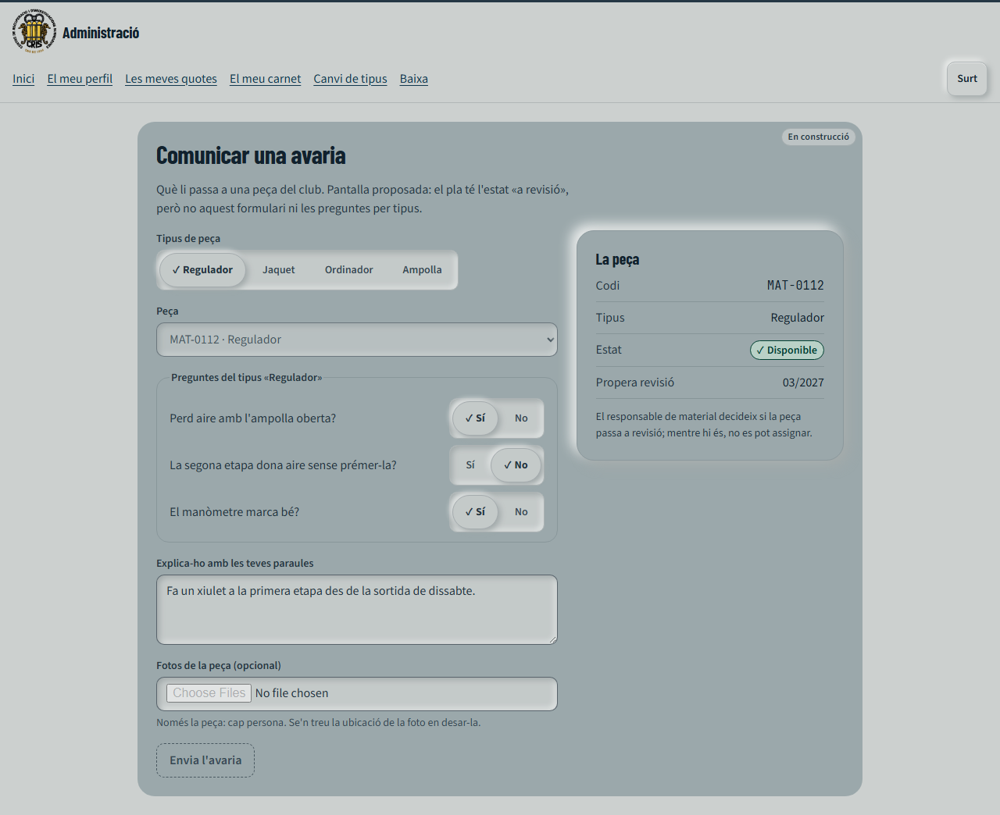

# T-DX-32 · Averia: comunicar una avaria del material (en construcció)

| Data i hora (Europa/Madrid) | Commit | Proves | CI |
|---|---|---|---|
| 16/11/2026 21:25 | 0041fdf | Cap de nova (les comunes la troben sola) | [A comprovar] (PR #95) |

**En tres línies:** hi ha la pantalla «Comunicar una avaria» en construcció: el tipus de peça, les preguntes que porta aquell tipus, la descripció i les fotos, i al costat la fitxa de la peça. És una pantalla **proposada**: el pla té l'estat «a revisió» d'una peça, però no aquest formulari ni les preguntes per tipus (D1). Passar la peça a revisió continua sent del responsable de material.

## Què s'ha fet
- `apps/previews/screens/avaries_material.py`: títol i contingut d'exemple (un regulador inventat, `MAT-0112`, i tres preguntes).
- `templates/previews/avaries_material.html` (administració, `cos-ample`) i `static/css/averia.css`.
- Subsecció [T-DX-32](../design-system.md#t-dx-32-averia-comunicar-una-avaria-del-material) al sistema de disseny i fila a [`estat/DX.md`](../estat/DX.md).

## Decisions i perquè
- **Només components que ja hi ha:** `segmentat` per al tipus i per a cada resposta «Sí / No», `camp`, `targeta` i `dades-soci` per a la fitxa de la peça.
- **Les fotos amb un camp de fitxer normal:** la zona per pujar fitxers (`zona-magnetica`) la munta el JavaScript; per a una pantalla desactivada n'hi ha prou amb el camp. L'ajuda diu el que farà el servidor: només la peça, sense persones, i sense la ubicació de la foto.
- **Del recurs no s'hi fa** la franja de visita ni el folio: són d'un servei tècnic, no del club.

## Problemes trobats
- Cap de visible a les captures. El text del camp de fitxer («Choose Files») el posa el navegador en la seva llengua, no la plantilla.

## Com se sap que funciona
- `apps/previews/tests/test_screens.py` (parametritzada): títol i plantilla, etiqueta amb `aria-describedby`, cap `style=`, un POST torna 405 i sense accés respon 404.
- `apps/core/tests/e2e/test_previews.py -k avaries_material`: etiqueta i títol visibles i captures a 1280, 390 i 320 px, en clar i en fosc, mirades.

## Evidències
- «Comunicar una avaria» a 1280 px: `captures/2026-11-16_2125_T-DX-32_avaries_material-1280.png`

  

  *16/11/2026 21:25 (Europa/Madrid) · local, prova e2e, contingut d'exemple · commit 0041fdf*
- A 320 px, en fosc: `captures/2026-11-16_2125_T-DX-32_avaries_material-320-fosc.png`

  *16/11/2026 21:25 (Europa/Madrid) · local, prova e2e · commit 0041fdf*
- Sortida de proves · executada el 16/11/2026 en local (PostgreSQL 16):
  ```
  $ pytest apps/previews apps/core/tests/test_under_construction.py -q
  18 passed
  $ pytest -m e2e apps/core/tests/e2e/test_previews.py -k avaries_material -q
  1 passed, 1 deselected
  ```
