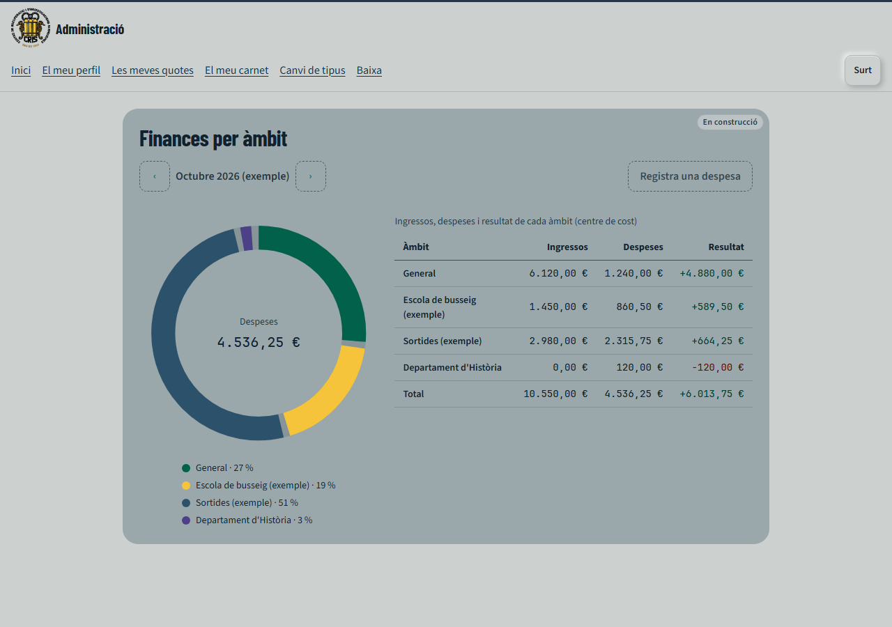

# T-DX-33 · Gastos: finances per àmbit (en construcció)

| Data i hora (Europa/Madrid) | Commit | Proves | CI |
|---|---|---|---|
| 16/11/2026 21:30 | 16317d6 | 2 noves (format dels imports i totals de l'exemple) | [A comprovar] (PR #96) |

**En tres línies:** hi ha la pantalla «Finances per àmbit» en construcció: l'anell de les despeses del mes repartides per àmbit (centre de cost), amb el total al mig, i la taula d'ingressos, despeses i resultat de cada àmbit. Els imports surten en format català (`1.234,56 €`) a partir de cèntims. Els àmbits són d'exemple: la llista de departaments encara no és fixada (Q-17).

## Què s'ha fet
- `apps/previews/screens/finances_ambit.py`: títol i contingut d'exemple en cèntims; el percentatge i el segment de l'anell de cada àmbit es calculen a partir dels imports, com ho farà el servidor.
- `templates/previews/finances_ambit.html` (administració, `cos-ample`) i `static/css/gastos.css`.
- `apps/previews/tests/test_finances_ambit.py`: el format català dels imports i que els totals de l'exemple quadren.
- Subsecció [T-DX-33](../design-system.md#t-dx-33-gastos-finances-per-àmbit) al sistema de disseny i fila a [`estat/DX.md`](../estat/DX.md).

## Decisions i perquè
- **L'anell amb atributs d'SVG** (`pathLength`, `stroke-dasharray`, `stroke-dashoffset`): els valors els posa el servidor sense cap `style=`.
- **Mai només color:** cada àmbit surt amb el nom i el percentatge a la llegenda i amb els imports a la taula; el resultat porta signe «+» o «−».
- **Sense moviment:** el total que roda, la porció que se separa i el filtre amb FLIP no tenen cap funció aquí (D20).
- **«Resultat», no «marge»:** el marge del pla és el d'una activitat (ingressos − despeses − cost de material); per àmbit, la pantalla diu el resultat.

## Problemes trobats
- A 320 px, la fletxa del mes següent saltava de línia sola; ara les fletxes i el mes van juntes i «Registra una despesa» passa a sota.
- Al tema fosc, el segment de «General» (`--c-mari`) contrasta poc amb el fons; la informació també és a la llegenda i a la taula, però caldria un token de gràfic per als dos temes [A completar].

## Com se sap que funciona
- `apps/previews/tests/test_finances_ambit.py` i la prova comuna `apps/previews/tests/test_screens.py` (títol i plantilla, etiqueta amb `aria-describedby`, cap `style=`, un POST torna 405 i sense accés respon 404).
- `apps/core/tests/e2e/test_previews.py -k finances_ambit`: etiqueta i títol visibles i captures a 1280, 390 i 320 px, en clar i en fosc, mirades.

## Evidències
- «Finances per àmbit» a 1280 px: `captures/2026-11-16_2130_T-DX-33_finances_ambit-1280.png`

  

  *16/11/2026 21:30 (Europa/Madrid) · local, prova e2e, contingut d'exemple · commit 16317d6*
- A 320 px, en fosc: `captures/2026-11-16_2130_T-DX-33_finances_ambit-320-fosc.png`

  *16/11/2026 21:30 (Europa/Madrid) · local, prova e2e · commit 16317d6*
- Sortida de proves · executada el 16/11/2026 en local (PostgreSQL 16):
  ```
  $ pytest apps/previews apps/core/tests/test_under_construction.py -q
  20 passed
  $ pytest -m e2e apps/core/tests/e2e/test_previews.py -k finances_ambit -q
  1 passed, 1 deselected
  ```
