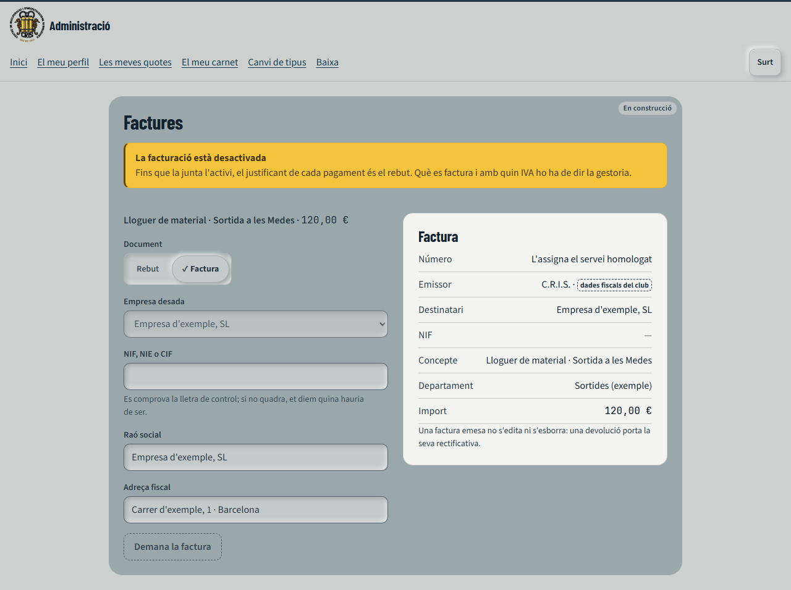

# T-DX-34 · Emisor: factures (en construcció)

| Data i hora (Europa/Madrid) | Commit | Proves | CI |
|---|---|---|---|
| 16/11/2026 21:37 | f6a33bb | Cap de nova (les comunes la troben sola) | [A comprovar] (PR #100) |

**En tres línies:** hi ha la pantalla «Factures» en construcció: el formulari per emetre la factura d'un càrrec (rebut o factura, empresa desada, identificador fiscal, raó social i adreça) i, al costat, la fulla que s'omple, en paper clar com el rebut. A dalt, l'avís que la facturació està desactivada fins que la gestoria respongui (P-02, P-47). És la part de factures d'Emisor que la P-93 (resposta C) deixa per al 09.

## Què s'ha fet
- `apps/previews/screens/factures.py`: títol i contingut d'exemple (un càrrec, una empresa i una adreça inventats; el NIF, buit).
- `templates/previews/factures.html` (administració, `cos-ample`) i `static/css/emisor.css`.
- Subsecció [T-DX-34](../design-system.md#t-dx-34-emisor-factures) al sistema de disseny i fila a [`estat/DX.md`](../estat/DX.md).

## Decisions i perquè
- **El NIF de l'exemple, buit:** un número inventat amb la lletra de control bona podria ser el d'una empresa real.
- **La fulla, sense segell ni número:** la plataforma no numera (RN-M09-17) i la factura encara no existeix; el número diu «L'assigna el servei homologat».
- **Paper clar als dos temes,** amb els colors secundaris del paper i no del tema (també la marca `a-validar` de les dades fiscals del club), perquè al tema fosc no es perdin.
- **Del recurs no s'hi fa** el RUT xilè (aquí NIF, NIE o CIF) ni desar les empreses al navegador: es desaran al servidor, amb permís.

## Problemes trobats
- Cap de visible a les captures.

## Com se sap que funciona
- `apps/previews/tests/test_screens.py` (parametritzada): títol i plantilla, etiqueta amb `aria-describedby`, cap `style=`, un POST torna 405 i sense accés respon 404.
- `apps/core/tests/e2e/test_previews.py -k factures`: etiqueta i títol visibles i captures a 1280, 390 i 320 px, en clar i en fosc, mirades.

## Evidències
- «Factures» a 1280 px: `captures/2026-11-16_2137_T-DX-34_factures-1280.png`

  

  *16/11/2026 21:37 (Europa/Madrid) · local, prova e2e, contingut d'exemple · commit f6a33bb*
- A 320 px, en fosc: `captures/2026-11-16_2137_T-DX-34_factures-320-fosc.png`

  *16/11/2026 21:37 (Europa/Madrid) · local, prova e2e · commit f6a33bb*
- Sortida de proves · executada el 16/11/2026 en local (PostgreSQL 16):
  ```
  $ pytest apps/previews apps/core/tests/test_under_construction.py -q
  18 passed
  $ pytest -m e2e apps/core/tests/e2e/test_previews.py -k factures -q
  1 passed, 1 deselected
  ```
