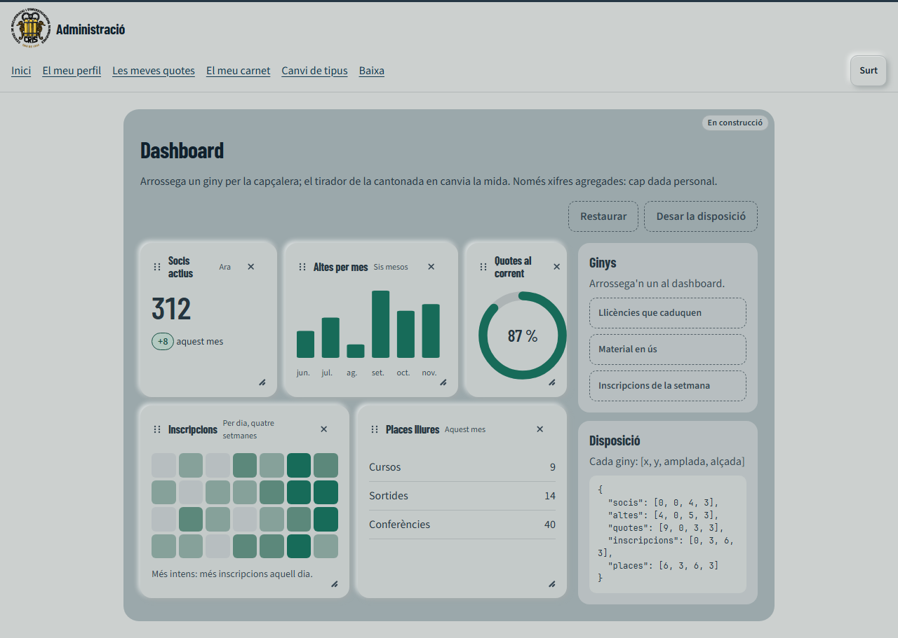

# T-DX-35 · Parrilla: dashboard (en construcció)

| Data i hora (Europa/Madrid) | Commit | Proves | CI |
|---|---|---|---|
| 16/11/2026 20:20 | fcc0614 | cap de nova (les comunes la troben sola) | [A comprovar] (PR #86) |

**En tres línies:** hi ha la pantalla «Dashboard», en construcció, a l'administració. Del recurs Parrilla té la reixa de ginys de dotze columnes, la capçalera de cada giny (agafador, nom, «Treure») i el tirador de la mida, la paleta de ginys i la disposició com a dades. Tot el que mostra són xifres agregades d'exemple: cap nom ni cap dada d'una persona.

## Què s'ha fet
- `apps/previews/screens/dashboard.py`: el títol i les xifres d'exemple (socis actius, altes per mes, percentatge de quotes al corrent, inscripcions per dia i places lliures).
- `templates/previews/dashboard.html` i `templates/previews/_parrilla_cap.html` (capçalera i tirador de cada giny).
- `static/css/parrilla.css`: reixa (una columna al mòbil, dues a la tauleta, dotze a l'escriptori), ginys, barres i anell en SVG, mapa de calor i el lateral. Detall: [design-system, T-DX-35](../design-system.md#t-dx-35-parrilla-dashboard).

## Decisions i perquè
- **Només agregats:** veure el dashboard no dona accés a cap dada personal (CLAUDE.md); els ginys d'exemple són recomptes i percentatges, i cap no enllaça a una fitxa.
- **Gràfics en SVG sense `style=`:** les alçades i el percentatge van com a atributs de l'SVG (`height`, `stroke-dasharray`), calculats del contingut d'exemple.
- **El marí per als gràfics:** no són estats; els colors d'estat queden per al que és un estat (la píndola «+8»).
- **Sense JavaScript:** arrossegar, encaixar i redimensionar arribaran quan el mòdul 08 funcioni.

## Problemes trobats
- La disposició com a dades es tallava a la dreta del lateral; ara el text salta de línia.

## Com se sap que funciona
- `apps/previews/tests/test_screens.py` (títol i plantilla, etiqueta, cap `style=`, només GET, 404 sense accés, a l'índex) i la prova comuna de només lectura: 18 passades.
- `apps/core/tests/e2e/test_previews.py -k dashboard`: etiqueta i títol visibles, captures a 1280, 390 i 320 px en clar i en fosc, sense desplaçament lateral. Captures mirades.

## Evidències
- «Dashboard» a 1280 px: `captures/2026-11-16_2020_T-DX-35_dashboard-1280.png`

  

  *16/11/2026 20:20 (Europa/Madrid) · local, prova e2e, contingut d'exemple · commit fcc0614*
- A 320 px, en fosc: `captures/2026-11-16_2020_T-DX-35_dashboard-320-fosc.png`

  *16/11/2026 20:20 (Europa/Madrid) · local, prova e2e · commit fcc0614*
- Sortida de proves · executada el 16/11/2026 en local (PostgreSQL 16):
  ```
  $ pytest apps/previews apps/core/tests/test_under_construction.py -q
  18 passed
  $ pytest -m e2e apps/core/tests/e2e/test_previews.py -k dashboard -q
  1 passed, 1 deselected
  ```
