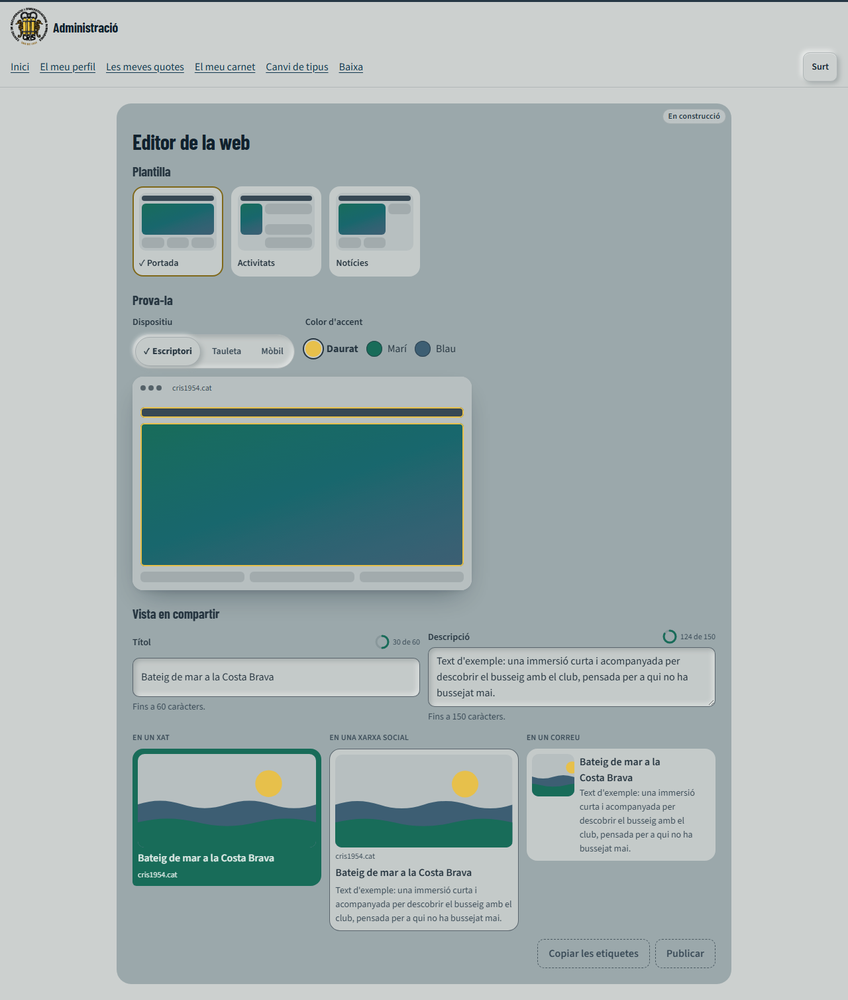

# T-DX-36 · Probador i Pregon: editor de la web (en construcció)

| Data i hora (Europa/Madrid) | Commit | Proves | CI |
|---|---|---|---|
| 16/11/2026 21:25 | 01ecbe9 | cap de nova (les comunes la troben sola) | [A comprovar] (PR #89) |

**En tres línies:** hi ha la pantalla «Editor de la web», en construcció, a l'administració. De Probador té la galeria de plantilles com a miniatures, el marc d'escriptori, el dispositiu i el color d'accent; de Pregon, la vista en compartir amb el comptador de caràcters en anell i les targetes de xat, xarxa social i correu. Res no es desa ni es publica, i no hi ha cap imatge real.

## Què s'ha fet
- `apps/previews/screens/editor_web.py`: tres plantilles, tres colors d'accent (tokens) i un text d'exemple per compartir.
- `templates/previews/editor_web.html` i tres peces: `_probador_mini.html` (miniatura de blocs genèrics), `_pregon_compte.html` (comptador en anell) i `_pregon_imatge.html` (il·lustració decorativa).
- `static/css/probador.css` i `static/css/pregon.css`. Detall: [design-system, T-DX-36](../design-system.md#t-dx-36-probador-i-pregon-editor-de-la-web).

## Decisions i perquè
- **El color, només un token:** el recurs té un lliscador de matís lliure; aquí es tria entre tres tokens (pla dels recursos externs), amb anella i negreta, no només el color.
- **Anell amb `pathLength=100`:** el traç és el percentatge del màxim de caràcters calculat a la plantilla, sense `style=` ni JavaScript.
- **Il·lustració en lloc de foto:** mar, sol i onades amb els tokens; les imatges de debò demanaran consentiment (P-41).

## Problemes trobats
- A 320 px la pantalla es desplaçava 44 px de costat: el control de dispositiu no saltava de línia i les ràdios es veien. Ara el control salta de línia i les ràdios queden amagades visualment (continuen al teclat i al lector).
- El marc d'escriptori ocupava tota l'amplada; ara té una amplada màxima.

## Com se sap que funciona
- `apps/previews/tests/test_screens.py` (títol i plantilla, etiqueta, cap `style=`, només GET, 404 sense accés, a l'índex) i la prova comuna de només lectura: 18 passades.
- `apps/core/tests/e2e/test_previews.py -k editor_web`: etiqueta i títol visibles, captures a 1280, 390 i 320 px en clar i en fosc, sense desplaçament lateral. Captures mirades.

## Evidències
- «Editor de la web» a 1280 px: `captures/2026-11-16_2125_T-DX-36_editor_web-1280.png`

  

  *16/11/2026 21:25 (Europa/Madrid) · local, prova e2e, contingut d'exemple · commit 01ecbe9*
- A 320 px, en fosc: `captures/2026-11-16_2125_T-DX-36_editor_web-320-fosc.png`

  *16/11/2026 21:25 (Europa/Madrid) · local, prova e2e · commit 01ecbe9*
- Sortida de proves · executada el 16/11/2026 en local (PostgreSQL 16):
  ```
  $ pytest apps/previews apps/core/tests/test_under_construction.py -q
  18 passed
  $ pytest -m e2e apps/core/tests/e2e/test_previews.py -k editor_web -q
  1 passed, 1 deselected
  ```
