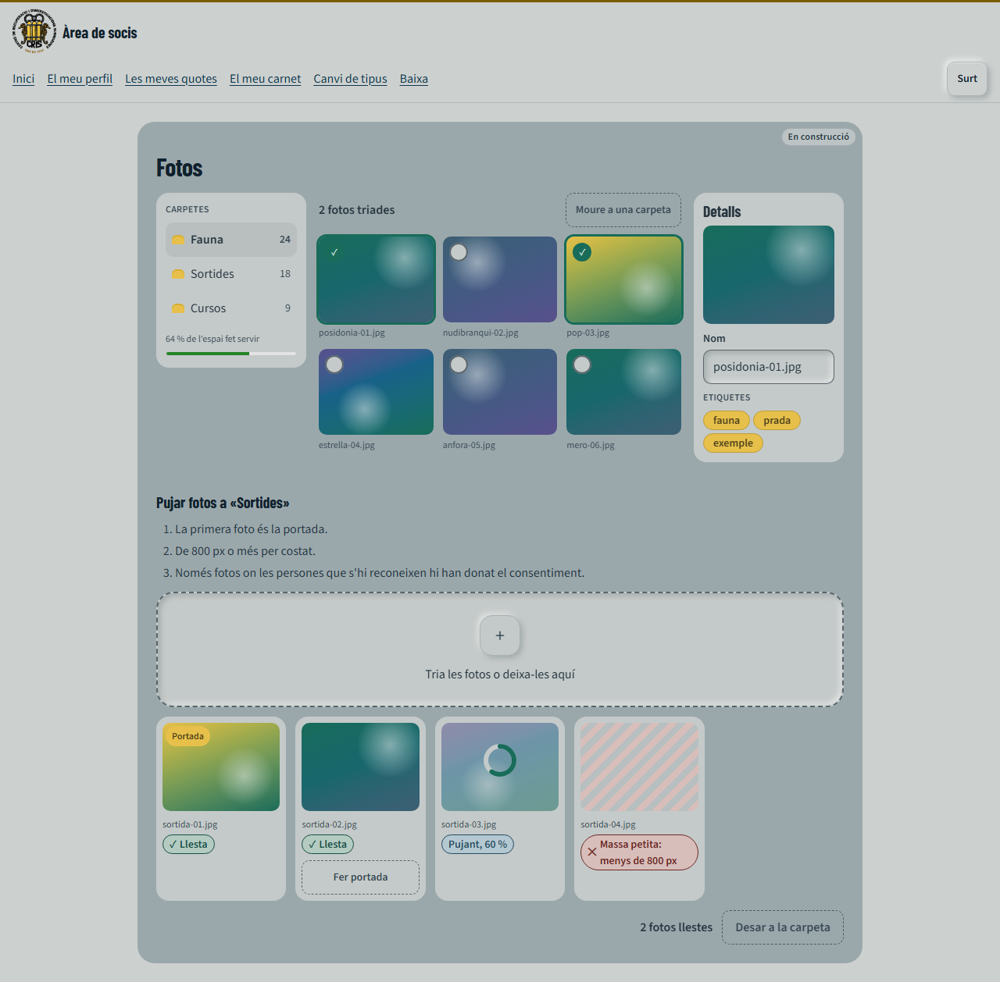

# T-DX-37 · Fototeca i Expositor: fotos (en construcció)

| Data i hora (Europa/Madrid) | Commit | Proves | CI |
|---|---|---|---|
| 16/11/2026 21:30 | 0ec0303 | cap de nova (les comunes la troben sola) | [A comprovar] (PR #97) |

**En tres línies:** hi ha la pantalla «Fotos», en construcció, a l'àrea del soci. De Fototeca té les carpetes amb els comptadors i l'espai, la graella amb la selecció marcada i el panell de detalls; d'Expositor, la graella de pujada amb l'anell, la foto massa petita ratllada amb el motiu escrit, la portada i el recompte de fotos llestes. No hi ha cap foto: són degradats decoratius.

## Què s'ha fet
- `apps/previews/screens/fotos.py`: tres carpetes, sis fotos i quatre pujades d'exemple (noms de fitxer inventats, sense persones).
- `templates/previews/fotos.html`: biblioteca i pujada, tot dins de `fieldset disabled`; la zona de pujada és la `zona-magnetica` del sistema.
- `static/css/fototeca.css` i `static/css/expositor.css`. Detall: [design-system, T-DX-37](../design-system.md#t-dx-37-fototeca-i-expositor-fotos).

## Decisions i perquè
- **Cap foto:** les del recurs són de la demostració (D11) i les del club demanen consentiment; abans de fer-la funcional cal la resposta de P-41 (drets d'imatge).
- **Estat amb text i símbol:** «Llesta», «Pujant, 60 %» i «Massa petita: menys de 800 px» són `estat` amb text; la ratllada no és l'únic senyal.
- **La regla del consentiment a la vista:** és la tercera regla de la pujada, perquè el soci la vegi abans de triar fotos.

## Problemes trobats
- La píndola «Massa petita» no saltava de línia i eixamplava la cel·la; ara salta de línia.
- Al mòbil, la graella feia una sola columna de fotos molt grans; ara en fa dues.

## Com se sap que funciona
- `apps/previews/tests/test_screens.py` (títol i plantilla, etiqueta, cap `style=`, només GET, 404 sense accés, a l'índex) i la prova comuna de només lectura: 18 passades.
- `apps/core/tests/e2e/test_previews.py -k fotos`: etiqueta i títol visibles, captures a 1280, 390 i 320 px en clar i en fosc, sense desplaçament lateral. Captures mirades.

## Evidències
- «Fotos» a 1280 px: `captures/2026-11-16_2130_T-DX-37_fotos-1280.png`

  

  *16/11/2026 21:30 (Europa/Madrid) · local, prova e2e, contingut d'exemple · commit 0ec0303*
- A 320 px, en fosc: `captures/2026-11-16_2130_T-DX-37_fotos-320-fosc.png`

  *16/11/2026 21:30 (Europa/Madrid) · local, prova e2e · commit 0ec0303*
- Sortida de proves · executada el 16/11/2026 en local (PostgreSQL 16):
  ```
  $ pytest apps/previews apps/core/tests/test_under_construction.py -q
  18 passed
  $ pytest -m e2e apps/core/tests/e2e/test_previews.py -k fotos -q
  1 passed, 1 deselected
  ```
