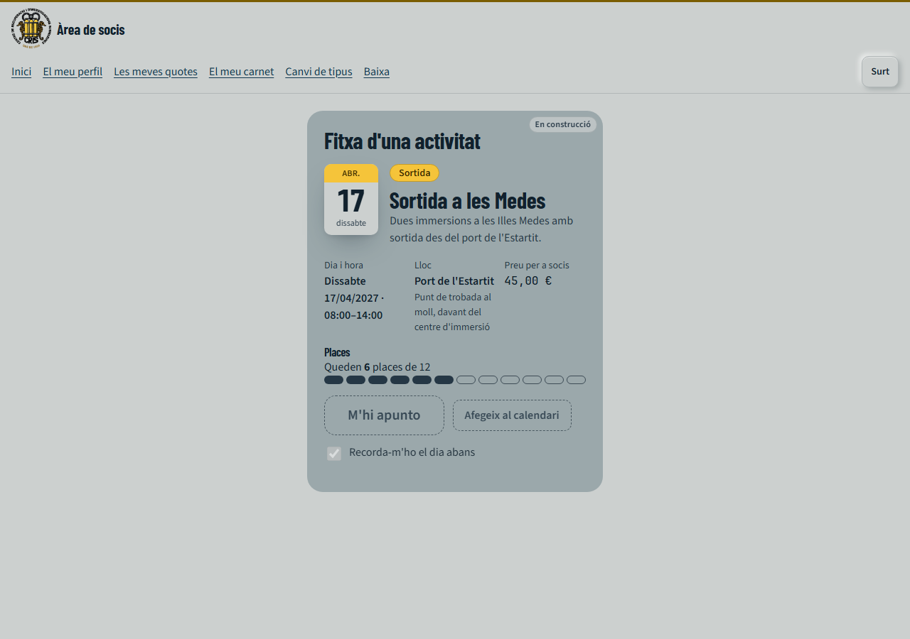

# T-DX-38 · Convite: capçalera de la fitxa d'una activitat (en construcció)

| Data i hora (Europa/Madrid) | Commit | Proves | CI |
|---|---|---|---|
| 16/11/2026 21:43 | b570bc1 | cap de nova (les comunes la troben sola) | [A comprovar] (PR #102) |

**En tres línies:** hi ha la pantalla «Fitxa d'una activitat» de l'àrea del soci, en construcció, amb la capçalera de Convite (P-99, resposta A). La data és un full de calendari, les places que queden es veuen en una barra sense cap nom i «M'hi apunto» és l'acció principal. Sense fotos, mapa ni «La meva hora».

## Què s'ha fet
- `apps/previews/screens/fitxa_activitat.py` (la Sortida a les Medes, 6 places de 12), `templates/previews/fitxa_activitat.html` i `static/css/convite.css`.
- Subsecció «T-DX-38 Convite: capçalera de la fitxa d'una activitat» al [sistema de disseny](../design-system.md).

## Decisions i perquè
- **P-99, resposta A:** Convite és la capçalera de la fitxa; les fotos del lloc són de Fototeca i Expositor.
- **Places en comptador i caselles, sense noms:** el pla dels recursos externs ho demana; la barra és decorativa i el text diu el nombre.
- **El full de calendari, `aria-hidden`:** la data completa ja és a «Dia i hora».
- **Fora «La meva hora»:** totes les activitats són en hora local.
- **Una sola entrada animada (el full), amb la molla:** D20 i B5.

## Problemes trobats
- Cap de rellevant.

## Com se sap que funciona
- Proves comunes de les pantalles en construcció: 18 passades.
- `pytest -m e2e apps/core/tests/e2e/test_previews.py -k fitxa`: etiqueta i títol visibles, captures a 1280, 390 i 320 px en clar i en fosc, sense desplaçament lateral. Mirades.

## Evidències
- «Fitxa d'una activitat» a 1280 px: `captures/2026-11-16_2143_T-DX-38_fitxa_activitat-1280.png`

  

  *16/11/2026 21:43 (Europa/Madrid) · local, prova e2e, contingut d'exemple · commit b570bc1*
- A 320 px, en fosc: `captures/2026-11-16_2143_T-DX-38_fitxa_activitat-320-fosc.png`

  *16/11/2026 21:43 (Europa/Madrid) · local, prova e2e · commit b570bc1*
- Sortida de proves · executada el 16/11/2026 en local (PostgreSQL 16):
  ```
  $ pytest apps/previews apps/core/tests/test_under_construction.py -q
  18 passed
  $ pytest -m e2e apps/core/tests/e2e/test_previews.py -k fitxa -q
  1 passed
  ```
