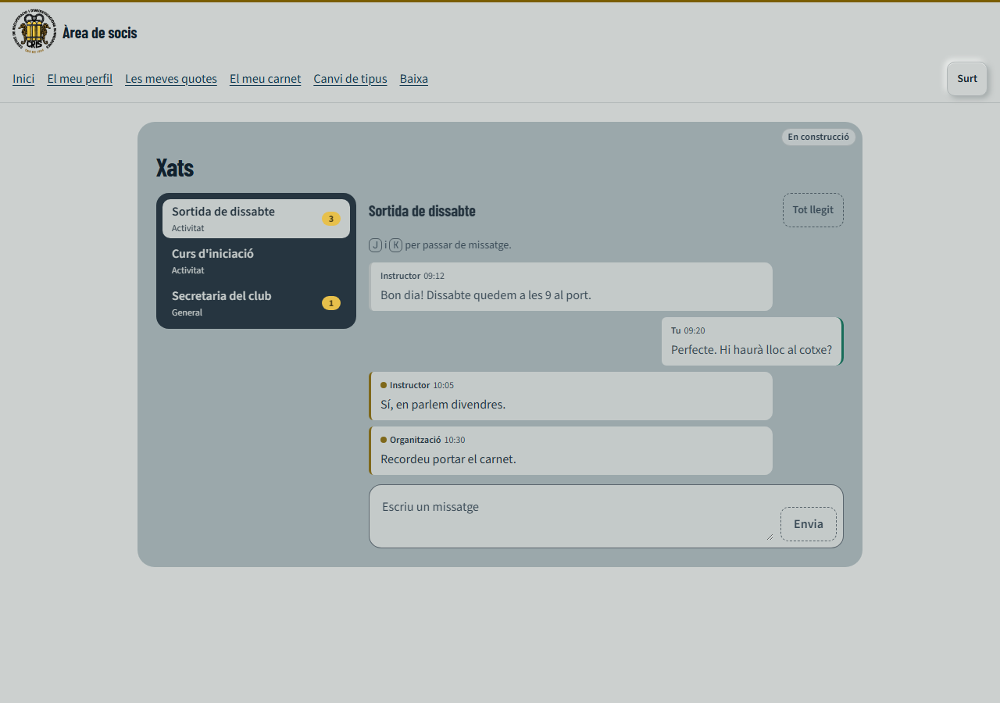

# T-DX-39 · Teletipo i Amanuense: xats (en construcció)

| Data i hora (Europa/Madrid) | Commit | Proves | CI |
|---|---|---|---|
| 16/11/2026 21:37 | 879705d | 1 nova | [A comprovar] (PR #99) |

**En tres línies:** hi ha la pantalla «Xats», en construcció, a l'àrea del soci. De Teletipo té la carcassa (P-97, A): les converses amb els comptadors, el rotlle de missatges en tires, «Tot llegit» i J/K. D'Amanuense, només el caixó d'escriure, sense micròfon ni dictat (P-95), i una prova ho comprova.

## Què s'ha fet
- `apps/previews/screens/xats.py`: tres converses (dues d'activitat i una general) i quatre missatges d'exemple, amb rols i no noms.
- `templates/previews/xats.html`: el lateral, el rotlle i el caixó d'escriure, tot dins de `fieldset disabled`.
- `static/css/teletipo.css` i `static/css/amanuense.css`. Detall: [design-system, T-DX-39](../design-system.md#t-dx-39-teletipo-i-amanuense-xats).
- `apps/previews/tests/test_xats.py`: la pantalla té el caixó d'escriure i cap rastre de micròfon, dictat ni reconeixement de veu.

## Decisions i perquè
- **Sense veu:** el reconeixement de veu del navegador envia l'àudio fora de la UE a Chrome (P-95). Ni el botó hi és: el dictat, si arriba, serà amb un reconeixement al servidor de la UE i amb el sí del propietari.
- **Res del lector de canals:** de Teletipo només es fa servir la carcassa (P-97, A).
- **Nous, amb text:** un missatge nou porta el punt i «Nou:» per al lector de pantalla, no només el color.
- **Una sola entrada per tira:** l'animació és curta i no es repeteix (D20).

## Problemes trobats
- Cap de destacable: les captures es van veure bé a la primera.

## Com se sap que funciona
- `apps/previews/tests/test_screens.py` i la prova comuna de només lectura: 18 passades; `apps/previews/tests/test_xats.py`: 1 passada.
- `apps/core/tests/e2e/test_previews.py -k xats`: etiqueta i títol visibles, captures a 1280, 390 i 320 px en clar i en fosc, sense desplaçament lateral. Captures mirades.

## Evidències
- «Xats» a 1280 px: `captures/2026-11-16_2137_T-DX-39_xats-1280.png`

  

  *16/11/2026 21:37 (Europa/Madrid) · local, prova e2e, contingut d'exemple · commit 879705d*
- A 320 px, en fosc: `captures/2026-11-16_2137_T-DX-39_xats-320-fosc.png`

  *16/11/2026 21:37 (Europa/Madrid) · local, prova e2e · commit 879705d*
- Sortida de proves · executada el 16/11/2026 en local (PostgreSQL 16):
  ```
  $ pytest apps/previews apps/core/tests/test_under_construction.py -q
  18 passed
  $ pytest apps/previews/tests/test_xats.py -q
  1 passed
  $ pytest -m e2e apps/core/tests/e2e/test_previews.py -k xats -q
  1 passed, 1 deselected
  ```
