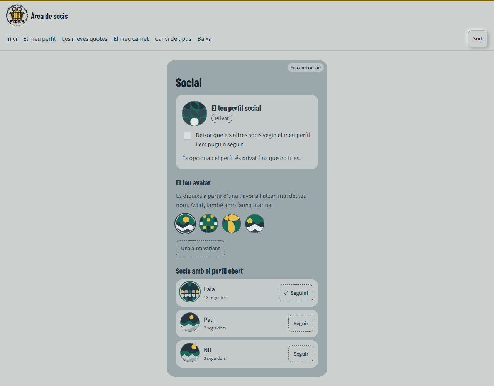

# T-DX-40 · Seguir i Monograma: social (en construcció)

| Data i hora (Europa/Madrid) | Commit | Proves | CI |
|---|---|---|---|
| 16/11/2026 21:52 | 3eb9df9 | cap de nova (les comunes la troben sola) | [A comprovar] (PR #107) |

**En tres línies:** hi ha la pantalla «Social», en construcció, a l'àrea del soci. Del recurs Seguir té el botó «Seguir» que passa a «✓ Seguint», el recompte de seguidors i l'anell de l'avatar; els avatars són el Monograma de la T-DX-18, dibuixats a partir de llavors d'exemple i mai del nom. El perfil social és privat fins que el soci ho tria.

## Què s'ha fet
- `apps/previews/screens/social.py`: llavors d'exemple per als avatars i tres socis d'exemple (un nom inventat i el recompte de seguidors).
- `templates/previews/social.html`: el perfil (privat, amb la casella per obrir-lo), les variants de l'avatar i la llista de socis, tot dins de `fieldset disabled`. Els avatars, amb l'etiqueta `` de la T-DX-18.
- `static/css/seguir.css`. Detall: [design-system, T-DX-40](../design-system.md#t-dx-40-seguir-i-monograma-social).

## Decisions i perquè
- **Reutilitzar el Monograma:** la T-DX-18 ja era a master en començar, així que els avatars fan servir la seva etiqueta i les seves classes en lloc de cercles nous; les llavors són d'exemple i no tenen res a veure amb cap persona.
- **Privat per defecte:** el pla dels recursos diu que seguir és opcional i que els perfils són privats per defecte; la pantalla ho mostra i ho explica.
- **Seguit amb text:** «✓ Seguint» i `aria-pressed`, no només l'anell de color.
- **Fauna marina, més endavant:** els avatars de fauna són de la 12; la pantalla només ho anuncia.

## Problemes trobats
- Cap de destacable: les captures es van veure bé a la primera.

## Com se sap que funciona
- `apps/previews/tests/test_screens.py` (títol i plantilla, etiqueta, cap `style=`, només GET, 404 sense accés, a l'índex) i la prova comuna de només lectura: 18 passades.
- `apps/core/tests/e2e/test_previews.py -k social`: etiqueta i títol visibles, captures a 1280, 390 i 320 px en clar i en fosc, sense desplaçament lateral. Captures mirades.

## Evidències
- «Social» a 1280 px: `captures/2026-11-16_2152_T-DX-40_social-1280.png`

  

  *16/11/2026 21:52 (Europa/Madrid) · local, prova e2e, contingut d'exemple · commit 3eb9df9*
- A 320 px, en fosc: `captures/2026-11-16_2152_T-DX-40_social-320-fosc.png`

  *16/11/2026 21:52 (Europa/Madrid) · local, prova e2e · commit 3eb9df9*
- Sortida de proves · executada el 16/11/2026 en local (PostgreSQL 16):
  ```
  $ pytest apps/previews apps/core/tests/test_under_construction.py -q
  18 passed
  $ pytest -m e2e apps/core/tests/e2e/test_previews.py -k social -q
  1 passed, 1 deselected
  ```
