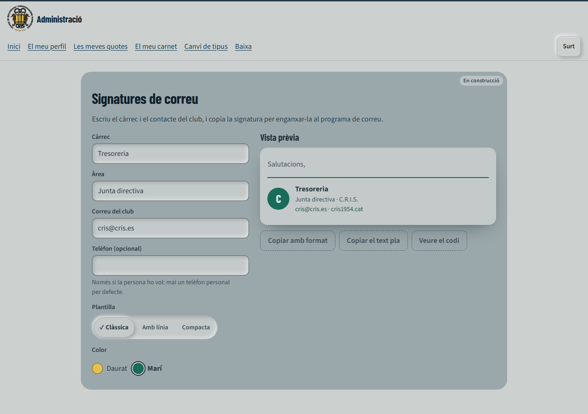

# T-DX-41 · Antefirma: signatures de correu (en construcció)

| Data i hora (Europa/Madrid) | Commit | Proves | CI |
|---|---|---|---|
| 16/11/2026 21:43 | b75ca76 | cap de nova (les comunes la troben sola) | [A comprovar] (PR #103) |

**En tres línies:** hi ha la pantalla «Signatures de correu», en construcció, a l'administració (P-92, A). Del recurs Antefirma té les dades de la signatura, la plantilla, el color, la vista prèvia en un full de correu i els botons de copiar. L'exemple és la signatura d'un càrrec amb el contacte del club: cap nom ni telèfon personal.

## Què s'ha fet
- `apps/previews/screens/signatures.py`: el càrrec, l'àrea i el contacte del club d'exemple, tres plantilles i dos colors (tokens).
- `templates/previews/signatures.html`: dades, plantilla (`segmentat`), color, vista prèvia i botons, tot dins de `fieldset disabled`.
- `static/css/antefirma.css`. Detall: [design-system, T-DX-41](../design-system.md#t-dx-41-antefirma-signatures-de-correu).

## Decisions i perquè
- **Càrrec i no persona:** el pla dels recursos demana només dades de càrrec i de contacte del club; el telèfon és opcional i l'ajuda recorda que mai és el personal per defecte.
- **Vista prèvia amb tokens:** només el text copiat (quan funcioni) portarà estils en línia, perquè és per als programes de correu.
- **Una sola entrada:** la signatura apareix una vegada, sense moviment continu (D20).

## Problemes trobats
- L'ordre de shell amb diversos fitxers d'una tirada va fallar en analitzar-se; els fitxers es van escriure un per un. No afecta el resultat.

## Com se sap que funciona
- `apps/previews/tests/test_screens.py` (títol i plantilla, etiqueta, cap `style=`, només GET, 404 sense accés, a l'índex) i la prova comuna de només lectura: 18 passades.
- `apps/core/tests/e2e/test_previews.py -k signatures`: etiqueta i títol visibles, captures a 1280, 390 i 320 px en clar i en fosc, sense desplaçament lateral. Captures mirades.

## Evidències
- «Signatures de correu» a 1280 px: `captures/2026-11-16_2143_T-DX-41_signatures-1280.png`

  

  *16/11/2026 21:43 (Europa/Madrid) · local, prova e2e, contingut d'exemple · commit b75ca76*
- A 320 px, en fosc: `captures/2026-11-16_2143_T-DX-41_signatures-320-fosc.png`

  *16/11/2026 21:43 (Europa/Madrid) · local, prova e2e · commit b75ca76*
- Sortida de proves · executada el 16/11/2026 en local (PostgreSQL 16):
  ```
  $ pytest apps/previews apps/core/tests/test_under_construction.py -q
  18 passed
  $ pytest -m e2e apps/core/tests/e2e/test_previews.py -k signatures -q
  1 passed, 1 deselected
  ```
