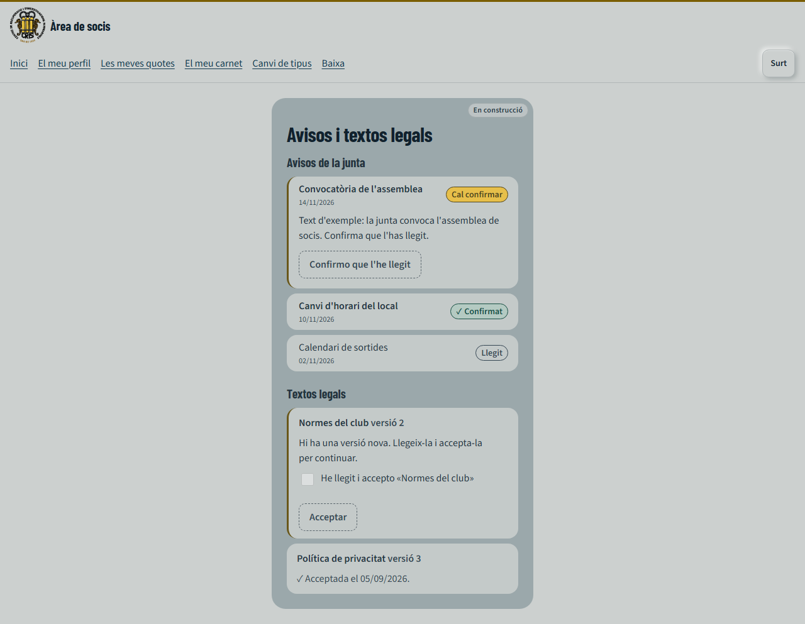

# T-DX-42 · Apoderado: avisos i textos legals (en construcció)

| Data i hora (Europa/Madrid) | Commit | Proves | CI |
|---|---|---|---|
| 16/11/2026 21:47 | 0583cd3 | cap de nova (les comunes la troben sola) | [A comprovar] (PR #106) |

**En tres línies:** hi ha la pantalla «Avisos i textos legals», en construcció, a l'àrea del soci (P-91, A). Del recurs Apoderado té l'avís que passa a llegit, el que demana confirmar la lectura i el ja confirmat amb el dia i l'hora, i l'acceptació d'un text legal que no es fa dues vegades. No hi ha signatura amb el dit: les autoritzacions d'activitat són de la 02.

## Què s'ha fet
- `apps/previews/screens/avisos_junta.py`: tres avisos de la junta i dos textos legals d'exemple.
- `templates/previews/avisos_junta.html`: un `details` per avís i una fitxa per text legal, tot dins de `fieldset disabled`.
- `static/css/apoderado.css`. Detall: [design-system, T-DX-42](../design-system.md#t-dx-42-apoderado-avisos-i-textos-legals).

## Decisions i perquè
- **Estats amb text:** «Cal confirmar», «✓ Confirmat» i «Llegit» són `estat` amb text; la vora de color és un reforç.
- **Nom de la pantalla `avisos_junta`:** evita xocar amb altres pantalles del carril fetes alhora.
- **Sense la resta del recurs:** el calendari de proves i l'assistència són d'una app de tutor; la signatura amb el dit, de les autoritzacions de la 02.

## Problemes trobats
- Cap de destacable: les captures es van veure bé a la primera.

## Com se sap que funciona
- `apps/previews/tests/test_screens.py` (títol i plantilla, etiqueta, cap `style=`, només GET, 404 sense accés, a l'índex) i la prova comuna de només lectura: 18 passades.
- `apps/core/tests/e2e/test_previews.py -k avisos_junta`: etiqueta i títol visibles, captures a 1280, 390 i 320 px en clar i en fosc, sense desplaçament lateral. Captures mirades.

## Evidències
- «Avisos i textos legals» a 1280 px: `captures/2026-11-16_2147_T-DX-42_avisos_junta-1280.png`

  

  *16/11/2026 21:47 (Europa/Madrid) · local, prova e2e, contingut d'exemple · commit 0583cd3*
- A 320 px, en fosc: `captures/2026-11-16_2147_T-DX-42_avisos_junta-320-fosc.png`

  *16/11/2026 21:47 (Europa/Madrid) · local, prova e2e · commit 0583cd3*
- Sortida de proves · executada el 16/11/2026 en local (PostgreSQL 16):
  ```
  $ pytest apps/previews apps/core/tests/test_under_construction.py -q
  18 passed
  $ pytest -m e2e apps/core/tests/e2e/test_previews.py -k avisos_junta -q
  1 passed, 1 deselected
  ```
