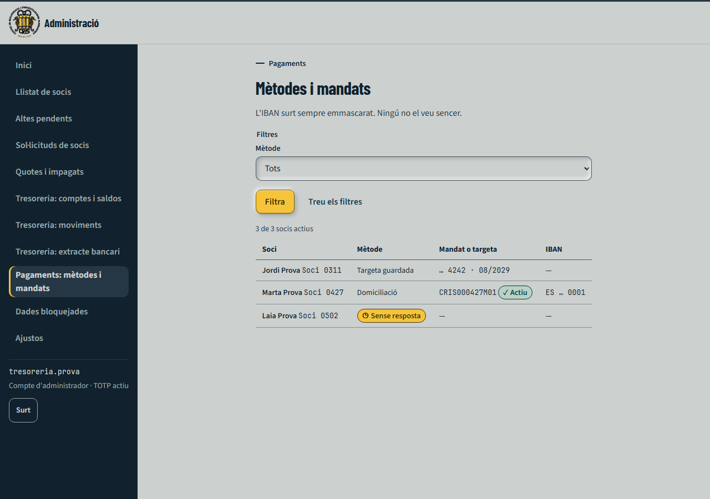

# T-DX-43 · «Pagaments: mètodes i mandats» al menú de l'administració

| Data i hora (Europa/Madrid) | Commit | Proves | CI |
|---|---|---|---|
| 16/11/2026 22:20 | fcf2994 | 2 e2e ampliades | [A comprovar] (PR #111) |

**En tres línies:** la pantalla de mètodes i mandats (T-M05a-14, #108) ja existia, però no tenia entrada al menú. Ara n'hi ha una, «Pagaments: mètodes i mandats», que només veu qui té el permís de veure mandats (A4): d'entrada, el tresorer i l'administrador. La navegació comuna és del carril de disseny; la tasca la va demanar el pilot.

## Què s'ha fet
- `apps/accounts/navigation.py`: l'entrada nova, després de les de tresoreria, i el permís que la ruta declara (`payments.mandates.view`, lectura), el mateix que comprova la vista.
- `apps/core/tests/e2e/test_mandats.py`: el tresorer hi arriba pel menú (l'entrada queda marcada com a actual). `apps/core/tests/e2e/test_navegacio.py`: la secretària no la veu.
- Fila nova a [`estat/DX.md`](../estat/DX.md).

## Decisions i perquè
- **El menú no és cap control:** amagar l'enllaç només evita ensenyar una ruta que respondria «no trobat». La vista torna a comprovar el permís (`permission_required`).
- **El nom de l'entrada** segueix el patró «Àmbit: pantalla» de les de tresoreria.

## Problemes trobats
- Cap.

## Com se sap que funciona
- `apps/accounts/tests/test_navigation.py` recorre totes les entrades del menú amb cada rol: l'entrada surt si, i només si, el compte té el permís, i la vista respon 200 o 404 igual. Cobreix l'entrada nova sense canvis (59 proves amb les de mandats).
- Les dues e2e passen (3), amb les captures de «Mètodes i mandats» a 1280, 390 i 320 px, en clar i en fosc.

## Evidències
- El menú amb l'entrada, a 1280 px: `captures/2026-11-16_2220_T-DX-43_menu-mandats-1280.png`

  

  *16/11/2026 22:20 (Europa/Madrid) · local, prova e2e, socis inventats · commit fcf2994*
- A 320 px, en fosc: `captures/2026-11-16_2220_T-DX-43_menu-mandats-320-fosc.png`

  *16/11/2026 22:20 (Europa/Madrid) · local, prova e2e · commit fcf2994*
- Sortida de proves · executada el 16/11/2026 en local (PostgreSQL 16):
  ```
  $ pytest apps/accounts/tests/test_navigation.py apps/payments/tests -k "navigation or mandate" -q
  59 passed
  $ pytest -m e2e apps/core/tests/e2e/test_mandats.py apps/core/tests/e2e/test_navegacio.py -q
  3 passed
  ```
