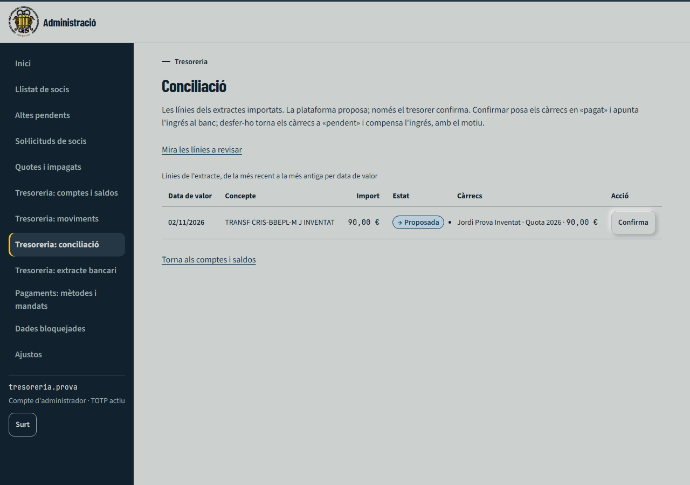

# T-DX-44 · «Tresoreria: conciliació» al menú de l'administració

| Data i hora (Europa/Madrid) | Commit | Proves | CI |
|---|---|---|---|
| 16/11/2026 23:13 | 1eccb15 | 2 e2e ampliades | [A comprovar] (PR #116) |

**En tres línies:** la pantalla de conciliació del tresorer (#115) ja existia, però no tenia entrada al menú. Ara n'hi ha una, «Tresoreria: conciliació», entre «moviments» i «extracte bancari», que només veu qui pot veure la tresoreria (T1). De pas, la T-DX-20 queda marcada com a «no cal», perquè la pantalla d'ajustos real ja existeix.

## Què s'ha fet
- `apps/accounts/navigation.py`: l'entrada i el permís que la ruta declara (`treasury.view`, lectura), el mateix que comprova la vista.
- `apps/core/tests/e2e/test_tresoreria.py`: el tresorer hi arriba pel menú, i l'entrada queda marcada com a actual. `test_navegacio.py`: la secretària no la veu.
- [`estat/DX.md`](../estat/DX.md): fila nova i la T-DX-20 a «no cal».

## Decisions i perquè
- **El menú no és cap control:** la vista torna a comprovar el permís (`permission_required`).
- **T-DX-20, no cal:** la T-AJ-02 (#48) ja va fer la pantalla d'ajustos real. Una pantalla en construcció al costat de dades reals aniria contra el §6.9 (ho va detectar l'agent A).

## Problemes trobats
- Cap.

## Com se sap que funciona
- `apps/accounts/tests/test_navigation.py` (24) cobreix l'entrada per a cada rol: surt si, i només si, hi ha el permís, i la vista respon igual.
- Les e2e de tresoreria i de navegació passen (5), amb captures a 1280, 390 i 320 px, en clar i en fosc.

## Evidències
- El menú amb l'entrada, a 1280 px: `captures/2026-11-16_2313_T-DX-44_menu-conciliacio-1280.png`

  

  *16/11/2026 23:13 (Europa/Madrid) · local, prova e2e, persona inventada · commit 1eccb15*
- A 320 px, en fosc: `captures/2026-11-16_2313_T-DX-44_menu-conciliacio-320-fosc.png`

  *16/11/2026 23:13 (Europa/Madrid) · local, prova e2e · commit 1eccb15*
- Sortida de proves · executada el 16/11/2026 en local (PostgreSQL 16):
  ```
  $ pytest apps/accounts/tests/test_navigation.py -q
  24 passed
  $ pytest -m e2e apps/core/tests/e2e/test_tresoreria.py apps/core/tests/e2e/test_navegacio.py -q
  5 passed
  ```
