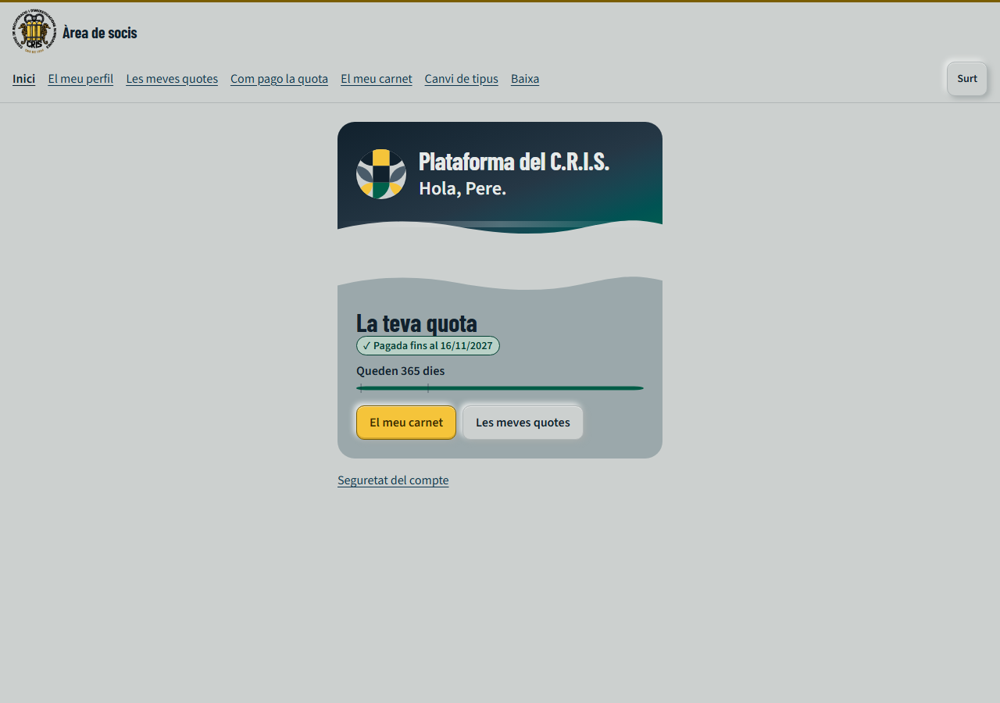

# T-DX-45 · «Com pago la quota» i «Mandat de domiciliació» al menú del soci

| Data i hora (Europa/Madrid) | Commit | Proves | CI |
|---|---|---|---|
| 16/11/2026 23:50 | f5a44de | 3 noves, 1 e2e ajustada | [A comprovar] (PR #120) |

**En tres línies:** el pilot ha fet dues pantalles noves per al soci: triar com es paga la quota (#117) i signar el mandat de domiciliació (#113). Ara totes dues tenen entrada al menú, a la capçalera i al ventall de Ramillete del mòbil. «Com pago la quota» la veuen tots els socis; «Mandat de domiciliació» només surt quan la signatura està encesa, que a producció no ho estarà fins que la junta aprovi el text.

## Què s'ha fet
- `templates/members/_personal_nav.html` i `templates/members/_ramillete.html`: les dues entrades, amb les mateixes condicions als dos llocs.
- `apps/payments/templatetags/payments_nav.py`: `mandate_signing_enabled`, perquè la plantilla sàpiga si l'ajust està encès sense tocar la configuració comuna.
- `apps/core/tests/e2e/test_ramillete.py`: el primer element del ventall ara és «Com pago la quota».
- Fila nova a [`estat/DX.md`](../estat/DX.md).

## Decisions i perquè
- **Amagar no és cap control:** totes dues vistes ja exigeixen ser soci, i la del mandat respon «no trobat» amb l'ajust apagat (T-M05a-09). El menú només evita ensenyar un enllaç que no portaria enlloc.
- **On va cada entrada:** a la capçalera, «Com pago la quota» va just després de «Les meves quotes»; al mòbil, al ventall de les pàgines menys freqüents (B15), i no a la barra.

## Problemes trobats
- L'e2e de Ramillete esperava el focus a «Canvi de tipus» en obrir el ventall. Ara és el segon element.

## Com se sap que funciona
- `apps/payments/tests/test_member_nav_payments.py`: amb l'ajust apagat, el soci veu «Com pago la quota» i no el mandat; encès, totes dues, a la capçalera i al ventall. Una persona que no és sòcia no en veu cap.
- Les e2e de navegació, Ramillete i portada passen (5), amb captures a 1280, 390 i 320 px, en clar i en fosc.

## Evidències
- La capçalera amb «Com pago la quota», a 1280 px: `captures/2026-11-16_2350_T-DX-45_menu-soci-1280.png`

  

  *16/11/2026 23:50 (Europa/Madrid) · local, prova e2e, soci inventat · commit f5a44de*
- A 320 px, en fosc: `captures/2026-11-16_2350_T-DX-45_menu-soci-320-fosc.png`

  *16/11/2026 23:50 (Europa/Madrid) · local, prova e2e · commit f5a44de*
- Sortida de proves · executada el 16/11/2026 en local (PostgreSQL 16):
  ```
  $ pytest apps/payments/tests/test_member_nav_payments.py apps/members/tests/test_personal_area.py -q
  40 passed
  $ pytest -m e2e apps/core/tests/e2e/test_navegacio.py apps/core/tests/e2e/test_ramillete.py apps/core/tests/e2e/test_oleaje.py -q
  5 passed
  ```
