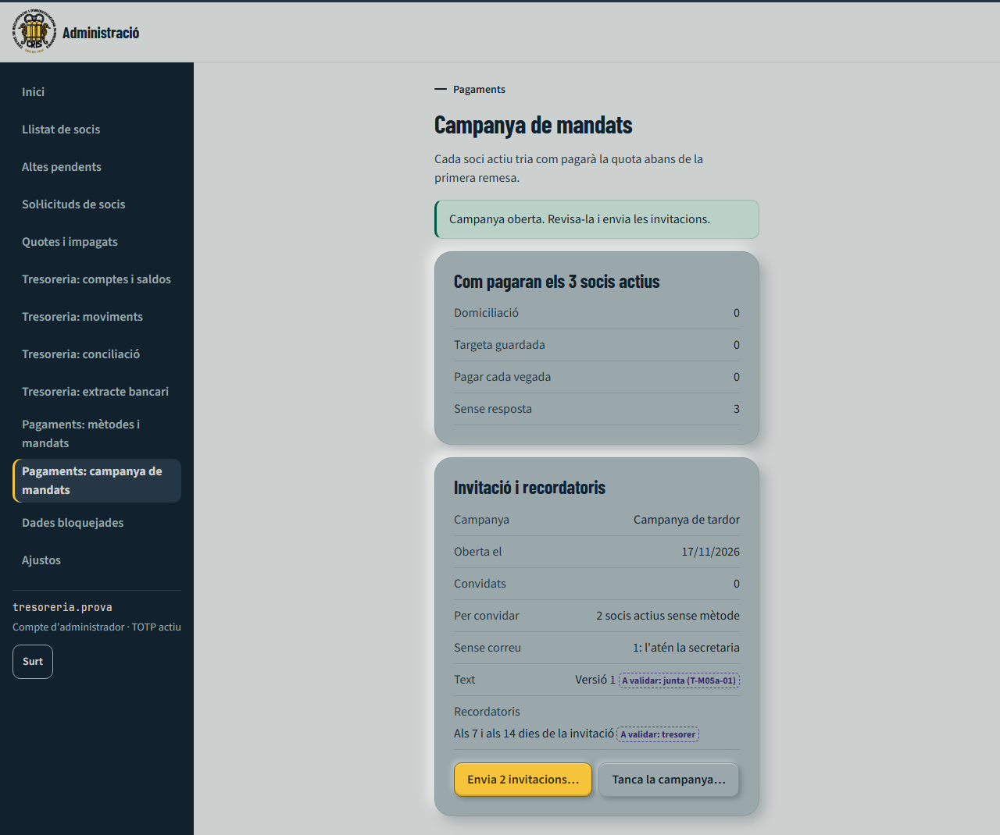

# T-DX-46 · «Pagaments: campanya de mandats» al menú de l'administració

| Data i hora (Europa/Madrid) | Commit | Proves | CI |
|---|---|---|---|
| 17/11/2026 01:31 | 3e83f99 | 2 e2e ampliades | [A comprovar] (PR #128) |

**En tres línies:** la pantalla de la campanya de mandats (#125) ja existia, però no tenia entrada al menú. Ara n'hi ha una, «Pagaments: campanya de mandats», sota «mètodes i mandats», que veu qui pot veure els mandats (A4). Obrir, enviar i tancar la campanya demana un altre permís (A5), que la pantalla comprova a dins.

## Què s'ha fet
- `apps/accounts/navigation.py`: l'entrada i el permís que la ruta declara (`payments.mandates.view`, lectura), el mateix que comprova la vista.
- `apps/core/tests/e2e/test_campanya_mandats.py`: el tresorer hi arriba pel menú. `test_navegacio.py`: la secretària no la veu.
- Fila nova a [`estat/DX.md`](../estat/DX.md).

## Decisions i perquè
- **A4 i no A5:** el menú mostra la pantalla si es pot veure; les accions de dins tenen el seu permís (A5), que comprova el servidor. El permís de la ruta el va confirmar el pilot.
- **El menú no és cap control:** la vista torna a comprovar el permís.

## Problemes trobats
- Cap.

## Com se sap que funciona
- `apps/accounts/tests/test_navigation.py` (24) cobreix l'entrada per a cada rol.
- Les e2e de la campanya i de navegació passen (3), amb captures a 1280, 390 i 320 px, en clar i en fosc.

## Evidències
- La campanya amb l'entrada al menú, a 1280 px: `captures/2026-11-17_0131_T-DX-46_menu-campanya-1280.png`

  

  *17/11/2026 01:31 (Europa/Madrid) · local, prova e2e, socis inventats · commit 3e83f99*
- A 320 px, en fosc: `captures/2026-11-17_0131_T-DX-46_menu-campanya-320-fosc.png`

  *17/11/2026 01:31 (Europa/Madrid) · local, prova e2e · commit 3e83f99*
- Sortida de proves · executada el 17/11/2026 en local (PostgreSQL 16):
  ```
  $ pytest apps/accounts/tests/test_navigation.py -q
  24 passed
  $ pytest -m e2e apps/core/tests/e2e/test_campanya_mandats.py apps/core/tests/e2e/test_navegacio.py -q
  3 passed
  ```
