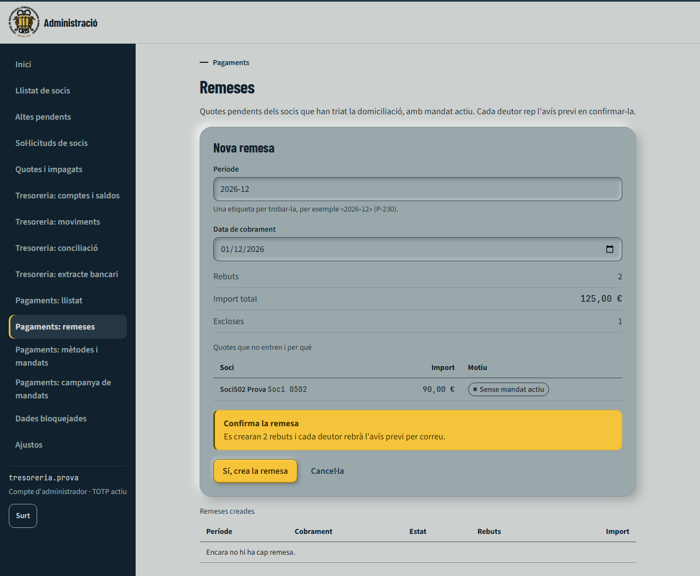

# T-DX-47 · «Pagaments: llistat» i «Pagaments: remeses» al menú de l'administració

| Data i hora (Europa/Madrid) | Commit | Proves | CI |
|---|---|---|---|
| 17/11/2026 06:43 | a28e1db | 3 e2e ampliades | [A comprovar] (PR #146) |

**En tres línies:** dues pantalles de pagaments del pilot ja existien sense entrada al menú: el llistat de pagaments i «a revisar» (#140) i les remeses de domiciliacions (#142). Ara totes dues hi són, al capdavant del grup «Pagaments». El llistat el veu qui té el permís de veure pagaments (B6); les remeses, qui les gestiona (B3).

## Què s'ha fet
- `apps/accounts/navigation.py`: les dues entrades i els permisos que declaren les rutes, els mateixos que comproven les vistes.
- `apps/core/tests/e2e/test_pagaments_llistat.py` i `test_remeses.py`: el tresorer hi arriba pel menú. `test_navegacio.py`: la secretària no les veu.
- Fila nova a [`estat/DX.md`](../estat/DX.md).

## Decisions i perquè
- **El menú no és cap control:** les vistes tornen a comprovar el permís (`permission_required`). Les accions de les remeses (crear, descarregar) demanen escriure, i ho comprova el servidor.
- **Ordre:** primer el llistat i les remeses, que són de cada dia, i després mètodes, mandats i campanya.

## Problemes trobats
- Cap.

## Com se sap que funciona
- `apps/accounts/tests/test_navigation.py` (24) cobreix totes dues entrades per a cada rol.
- Les e2e del llistat, de remeses i de navegació passen (4), amb captures a 1280, 390 i 320 px, en clar i en fosc.

## Evidències
- Remeses amb el menú, a 1280 px: `captures/2026-11-17_0643_T-DX-47_menu-pagaments-1280.png`

  

  *17/11/2026 06:43 (Europa/Madrid) · local, prova e2e, socis inventats · commit a28e1db*
- A 320 px, en fosc: `captures/2026-11-17_0643_T-DX-47_menu-pagaments-320-fosc.png`

  *17/11/2026 06:43 (Europa/Madrid) · local, prova e2e · commit a28e1db*
- Sortida de proves · executada el 17/11/2026 en local (PostgreSQL 16):
  ```
  $ pytest apps/accounts/tests/test_navigation.py -q
  24 passed
  $ pytest -m e2e apps/core/tests/e2e/test_pagaments_llistat.py apps/core/tests/e2e/test_remeses.py apps/core/tests/e2e/test_navegacio.py -q
  4 passed
  ```
