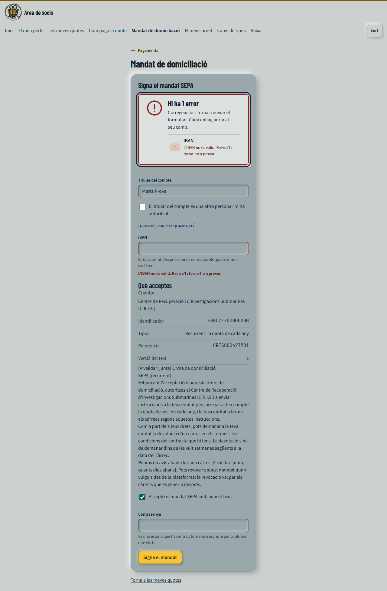

# T-DX-48 · Contrast de Ramillete (P-283), Errata als formularis del mandat i `.codi` que parteix

| Data i hora (Europa/Madrid) | Commit | Proves | CI |
|---|---|---|---|
| 17/11/2026 08:38 | d077e26 | 1 xfail convertida, 3 e2e ajustades | [A comprovar] (PR #154) |

**En tres línies:** la revisió d'accessibilitat del pilot (#150) va trobar que les pestanyes de la barra inferior del mòbil no arribaven al contrast mínim al tema fosc (P-283). Ara sí. A més, els formularis del mandat porten Errata, el resum d'errors que agafa el focus, i els codis llargs (com una clau d'ajust) es parteixen en lloc de desbordar a 320 px.

## Què s'ha fet
- `static/css/ramillete.css`: les pestanyes inactives, amb `color-mix(in oklch, var(--c-text-2) 55%, var(--c-text))`.
- `templates/payments/mandate.html`, `mandate_revoke.html`, `mandate_admin_revoke.html` i `campaign.html`: ``, que substitueix l'avís separat dels errors generals. `static/css/errata.css`: el text del resum, amb la mateixa barreja.
- `static/css/tokens.css`: `.codi` amb `overflow-wrap: anywhere` (la #151 tenia una clau d'ajust que desbordava 4 px a 320 px).
- `apps/core/tests/e2e/test_accessibilitat_mandat.py`: fora l'`xfail` i la «incidència coneguda». `test_mandats.py` i `test_mandat_signatura.py`: el missatge d'error es busca al costat del camp.
- [design-system §6.10 i §6.12](../design-system.md#612-ramillete-la-navegació-de-làrea-del-soci-t-dx-08) i fila nova a [`estat/DX.md`](../estat/DX.md).

## Decisions i perquè
- **Barrejar en lloc de canviar de token:** `--c-text-2` és correcte sobre el fons, però no sobre una superfície més clara al fosc. La barreja passa de 4,5:1 als dos temes i manté la diferència amb la pestanya activa.
- **Fora la «incidència coneguda»:** si no, la prova continuaria amagant qualsevol problema de contrast de la barra.
- **Un sol avís:** amb Errata, l'avís separat dels errors generals feia que el lector de pantalla llegís el mateix dues vegades (dos `role="alert"`).
- **«Com pago la quota» no porta Errata:** no té formulari de Django; l'error és un missatge després de redirigir.

## Problemes trobats
- En posar Errata dins d'una targeta, el seu text tampoc no arribava a 4,5:1 al fosc (ho va trobar axe). Arreglat amb la mateixa barreja.
- Tres e2e buscaven el missatge d'error amb `get_by_text`; amb Errata surt dues vegades (resum i camp), i ara el busquen al camp.

## Com se sap que funciona
- `test_accessibilitat_mandat.py` (axe en clar i en fosc, a 1280, 390 i 320 px) passa sense cap excepció, també la prova de la barra que abans era `xfail`.
- Les e2e de mandats, signatura, campanya, Errata, accessibilitat (028) i Ramillete passen (16). Les de pagaments unitàries (665), ajustos, rebut i transferència també.

## Evidències
- El mandat amb un IBAN no vàlid, a 1280 px: `captures/2026-11-17_0838_T-DX-48_mandat-errata-1280.png`

  

  *17/11/2026 08:38 (Europa/Madrid) · local, prova e2e, soci inventat · commit d077e26*
- A 320 px, en fosc, amb la barra inferior: `captures/2026-11-17_0838_T-DX-48_mandat-errata-320-fosc.png`

  *17/11/2026 08:38 (Europa/Madrid) · local, prova e2e · commit d077e26*
- Sortida de proves · executada el 17/11/2026 en local (PostgreSQL 16):
  ```
  $ pytest apps/payments/tests -q
  665 passed
  $ pytest -m e2e apps/core/tests/e2e/test_accessibilitat_mandat.py apps/core/tests/e2e/test_mandats.py apps/core/tests/e2e/test_mandat_signatura.py apps/core/tests/e2e/test_campanya_mandats.py apps/core/tests/e2e/test_errata.py apps/core/tests/e2e/test_accessibilitat_028.py apps/core/tests/e2e/test_ramillete.py -q
  16 passed
  ```
