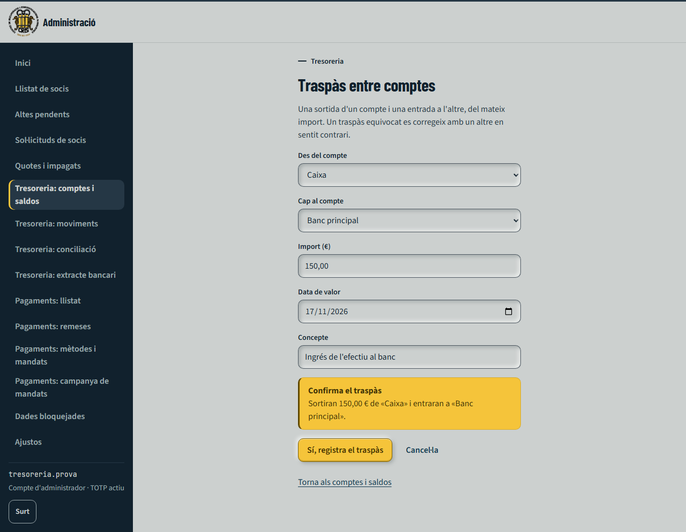

# T-DX-49 · Les pantalles de tresoreria marquen l'entrada del menú d'on surten

| Data i hora (Europa/Madrid) | Commit | Proves | CI |
|---|---|---|---|
| 17/11/2026 09:26 | 14968b4 | 5 noves | [A comprovar] (PR #155) |

**En tres línies:** el pilot ha fet pantalles noves de tresoreria (traspàs, arqueig i liquidacions, #152), que s'obren des de «Comptes i saldos». No tenen entrada pròpia al menú, però quan s'hi és, el menú marca l'entrada d'on surten, i així es veu on s'és. Igual per a les de moviments i de conciliació.

## Què s'ha fet
- `apps/accounts/navigation.py`: rutes filles a `ENTRIES`. Traspàs, arqueig, liquidacions i confirmar una liquidació → «Tresoreria: comptes i saldos». Exportar i anul·lar un moviment → «moviments». Confirmar, desfer, «a revisar» i excloure → «conciliació».
- `apps/accounts/tests/test_navigation_children.py` i fila nova a [`estat/DX.md`](../estat/DX.md).

## Decisions i perquè
- **Sense entrades noves:** el menú d'administració ja té quinze entrades, i aquestes pantalles són tasques que s'obren des de la seva pantalla mare (Hick: menys opcions, tria més ràpida).
- **Només presentació:** les rutes filles no canvien cap permís; cada vista continua comprovant el seu.

## Problemes trobats
- Cap.

## Com se sap que funciona
- `test_navigation_children.py`: cada ruta filla és d'una sola entrada, i el tresorer veu l'entrada mare marcada a traspàs, arqueig, liquidacions i «a revisar». `test_navigation.py` continua passant (29 en total).
- Les e2e de tresoreria (entrades i conciliació) i de navegació passen (7).

## Evidències
- Traspàs amb «Comptes i saldos» marcada, a 1280 px: `captures/2026-11-17_0926_T-DX-49_traspas-menu-1280.png`

  

  *17/11/2026 09:26 (Europa/Madrid) · local, prova e2e, dades inventades · commit 14968b4*
- A 320 px, en fosc: `captures/2026-11-17_0926_T-DX-49_traspas-menu-320-fosc.png`

  *17/11/2026 09:26 (Europa/Madrid) · local, prova e2e · commit 14968b4*
- Sortida de proves · executada el 17/11/2026 en local (PostgreSQL 16):
  ```
  $ pytest apps/accounts/tests/test_navigation_children.py apps/accounts/tests/test_navigation.py -q
  29 passed
  $ pytest -m e2e apps/core/tests/e2e/test_tresoreria_entrades.py apps/core/tests/e2e/test_tresoreria.py apps/core/tests/e2e/test_navegacio.py -q
  7 passed
  ```
