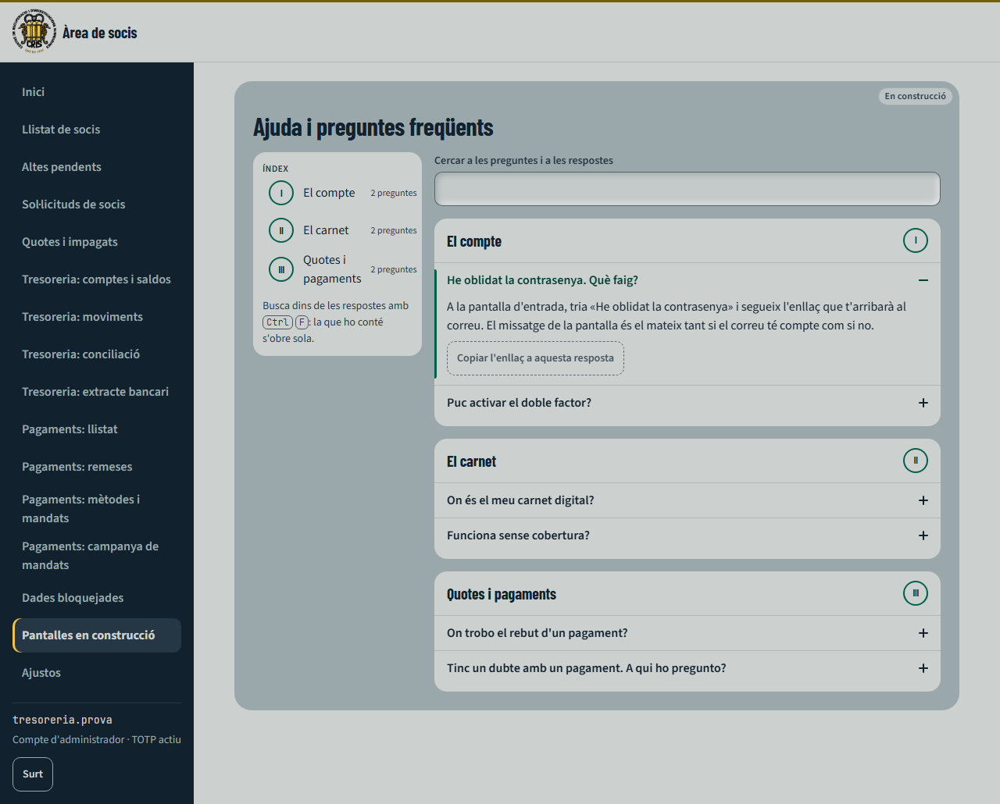

# T-DX-50 · «Pantalles en construcció» al menú de l'administració

| Data i hora (Europa/Madrid) | Commit | Proves | CI |
|---|---|---|---|
| 17/11/2026 12:27 | 916bc079 | 7 noves | [A comprovar] (PR #174) |

**En tres línies:** el menú de l'administració té una entrada nova, «Pantalles en construcció», que només surt amb el permís DX1 (P-90). Fent-la, ha sortit un error de la T-DX-03: a producció només un compte d'administrador pot tenir aquest permís, però les pantalles eren a la zona de socis i li responien 401. Ara també es munten dins l'administració.

## Què s'ha fet
- `apps/accounts/navigation.py`: entrada `administration:previews:index`, amb DX1, i cada pantalla com a ruta filla (la marca com a actual).
- `apps/accounts/admin_urls.py`: `en-construccio/` dins l'administració (espai de noms `administration:previews`). `/en-construccio/` es queda per a local i l'entorn de proves (`SHOW_UNDER_CONSTRUCTION`).
- `apps/previews/views.py` i `templates/previews/index.html`: l'índex enllaça les pantalles del mateix espai de noms d'on s'obre.
- Proves: `test_navigation_previews.py` (nou), `test_navigation.py` (l'administrador de la prova té DX1), e2e a `test_previews.py` i `test_navegacio.py`. Sistema de disseny §16 i fila a [`estat/DX.md`](../estat/DX.md).

## Decisions i perquè
- **Només amb el permís, també en local:** el menú no fa servir `SHOW_UNDER_CONSTRUCTION`. Així es veu igual que a producció (petició del propietari).
- **Muntar-les dues vegades, i no moure-les:** les proves i les pantalles de soci en local continuen a `/en-construccio/`, sense tocar el middleware d'entrada (la zona surt de l'espai de noms, com a la resta de l'administració).

## Problemes trobats
- Un compte d'administrador a `/en-construccio/` rebia 401 (zona de socis): el permís P-90 no servia a producció. Arreglat amb el muntatge dins l'administració. La prova que ho cobreix és l'e2e «com a producció».

## Com se sap que funciona
- `test_navigation_previews.py`: l'entrada només hi és amb DX1, amb `SHOW_UNDER_CONSTRUCTION` encès i apagat; queda marcada a totes les pantalles; l'índex enllaça dins l'administració. Comptes, navegació i pantalles: 605 passen.
- e2e: un tresorer amb DX1, sense `SHOW_UNDER_CONSTRUCTION`, hi arriba pel menú i obre una pantalla; la secretària (sense DX1) no veu l'entrada.

## Evidències
- Una pantalla oberta des del menú, amb l'entrada marcada, a 1280 px: `captures/2026-11-17_1227_T-DX-50_en-construccio-menu-1280.png`

  

  *17/11/2026 12:27 (Europa/Madrid) · local, prova e2e, dades inventades · commit 916bc079*
- A 320 px, en fosc: `captures/2026-11-17_1227_T-DX-50_en-construccio-menu-320-fosc.png`

  *17/11/2026 12:27 (Europa/Madrid) · local, prova e2e · commit 916bc079*
- Sortida de proves · executada el 17/11/2026 en local (PostgreSQL 16):
  ```
  $ pytest apps/accounts apps/core/tests/test_under_construction.py apps/previews -q
  605 passed
  $ pytest -m e2e apps/core/tests/e2e/test_previews.py apps/core/tests/e2e/test_navegacio.py -k "menu or dx1" -q
  3 passed
  ```
