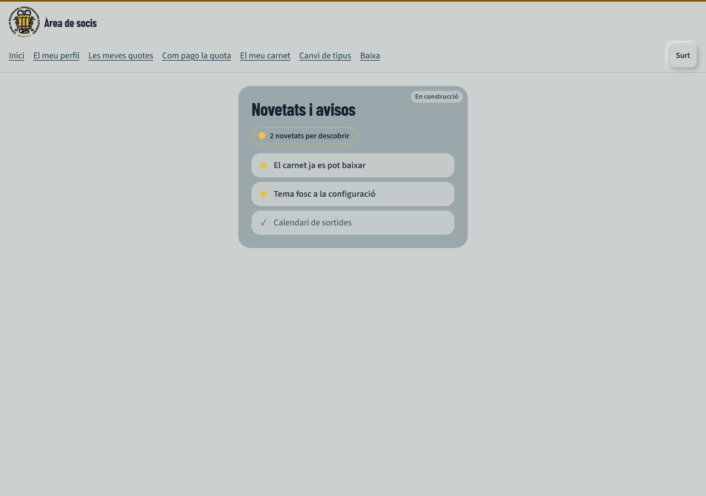

# T-DX-51 · Logotips ajustats i només el del tema que es veu

| Data i hora (Europa/Madrid) | Commit | Proves | CI |
|---|---|---|---|
| 17/11/2026 14:01 | 7b19e24b | 6 noves | [A comprovar] (PR #181) |

**En tres línies:** cada pàgina descarregava els dos logotips originals, de 501 i 344 KB, també el del tema que no es veu (F5 de la revisió de les portes del nivell 2, T-M05b-19). Ara es descarrega només el logotip del tema visible, de 192 px i en AVIF o WebP, amb un PNG de reserva: uns 14 KB per pàgina. El selector Sistema/Clar/Fosc i les mides de la T-DX-01 no canvien.

## Què s'ha fet
- `static/img/marca/`: `cris-clar-192` i `cris-fosc-192` (192 × 205 px) en AVIF (14 i 16 KB), WebP (18 KB) i PNG (42 i 44 KB). Fets amb Pillow 13 a partir dels originals d'`assets/marca/` (LANCZOS; AVIF de qualitat 70, WebP de qualitat 88), que no canvien.
- `templates/base.html` i `templates/500.html`: un `<picture>` per tema, amb la classe `logo-clar` o `logo-fosc`, i la imatge amb `loading="lazy"`, `decoding="async"`, `width` i `height`.
- `static/css/tokens.css`: la imatge de dins del `<picture>`, en bloc.
- Proves: `apps/core/tests/test_logotip.py` i `apps/core/tests/e2e/test_logotip.py`. Sistema de disseny §8 i fila a [`estat/DX.md`](../estat/DX.md).

## Decisions i perquè
- **`loading="lazy"` i no `<source media="(prefers-color-scheme)">`:** el tema el pot triar el soci («cris-tema», `data-theme`), i un `media` només sap el del sistema. Un navegador no descarrega una imatge diferida que no es pinta (`display: none`), i la classe ja l'amaga segons el tema. Així no cal JavaScript nou.
- **Una sola mida, de 192 px:** ara només la capçalera de 56 px fa servir aquests fitxers (192 px = 56 px a 3x, amb marge). Les mides més grans de la T-DX-01 (`--logo-publica`, `--logo-peu`) són per a pantalles que encara no existeixen; quan arribin, s'hi afegeix una versió de 320 px amb `srcset`.
- **La classe al `<picture>`, no a la imatge:** la capçalera és flex, i un `<picture>` buit hi deixaria l'espai del `gap`.

## Problemes trobats
- Cap.

## Com se sap que funciona
- e2e: amb el sistema en clar i en fosc, i amb el tema triat a mà en contra del sistema, es fa **una sola** descàrrega de logotip, la del tema que es veu i en un format modern (Chromium tria l'AVIF). Abans se'n feien dues, dels originals.
- Unitària: la base i la pàgina d'error no citen cap original, i porten AVIF, WebP, PNG, `lazy` i les mides.
- Captures: el logotip es veu igual a la capçalera, en clar i en fosc.

## Evidències
- Capçalera amb el logotip ajustat, a 1280 px: `captures/2026-11-17_1401_T-DX-51_logotip-1280.png`

  

  *17/11/2026 14:01 (Europa/Madrid) · local, prova e2e, dades inventades · commit 7b19e24b*
- A 320 px, en fosc (logotip per a fons fosc): `captures/2026-11-17_1401_T-DX-51_logotip-320-fosc.png`

  *17/11/2026 14:01 (Europa/Madrid) · local, prova e2e · commit 7b19e24b*
- Sortida de proves · executada el 17/11/2026 en local (PostgreSQL 16):
  ```
  $ pytest apps/core/tests/test_logotip.py -q
  2 passed
  $ pytest -m e2e apps/core/tests/e2e/test_logotip.py -q
  4 passed
  ```
