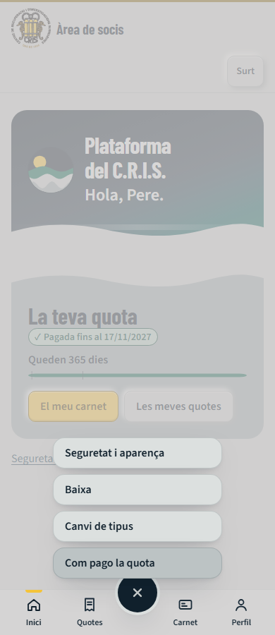

# T-DX-52 · Contrast que axe pot calcular: Ramillete i Errata en sRGB

| Data i hora (Europa/Madrid) | Commit | Proves | CI |
|---|---|---|---|
| 17/11/2026 14:22 | fbe6f2df | 1 comprovació nova en una prova existent | [A comprovar] (PR #185) |

**En tres línies:** l'auditoria axe de la 04 i la 05b (#184, del pilot) no va trobar cap violació, però va deixar quatre contrastos per a revisió manual. El de les pestanyes de Ramillete no el podia calcular: la barreja de dos grisos en oklch dona un to «none». Ara la barreja es fa en sRGB i axe la calcula: passa de 4,5:1. Els altres dos els he mesurat a mà i compleixen; el quart és decoratiu.

## Què s'ha fet
- `static/css/ramillete.css` i `static/css/errata.css`: `color-mix(in srgb, …)` en lloc d'`in oklch` per al color del text (la mateixa proporció).
- `apps/core/tests/e2e/test_accessibilitat_mandat.py`: cap pestanya de Ramillete no queda a «revisió manual» de contrast, en clar ni en fosc. Abans del canvi fallava (les quatre pestanyes, en fosc).
- Sistema de disseny §6.12 (regla: un color de text fet amb `color-mix()` es barreja en sRGB) i fila a [`estat/DX.md`](../estat/DX.md).

## Decisions i perquè
- **sRGB i no un color fix:** el color continua sortint dels tokens del tema (`--c-text-2` i `--c-text`), i axe el pot llegir. En sRGB la barreja surt una mica més clara al fosc: 9,4:1 sobre el fons, en lloc del mínim de 4,5:1.
- **Les ombres i els vels continuen en oklch:** no són text i axe no en mira el contrast.

## Problemes trobats
- Revisió manual (sense canvis):
  - **Segell del rebut** (`.rebut-segell`, amb opacitat 0,9 sobre `--paper`): 5,5:1 el de «Pagat» (`--posidonia`) i 6,7:1 el d'«Anul·lat» (`--grana`), també la data petita.
  - **Text secundari de la transferència** (`#contingut > .text-2`): 7,9:1 en clar i 6,7:1 en fosc sobre el fons. axe el veia «tapat» per la barra fixa del mòbil.
  - **Símbols `aria-hidden` de `.estat`:** són decoratius, i el text de l'estat ja té contrast.

## Com se sap que funciona
- `test_accessibilitat_mandat.py` i `test_ramillete.py`: 5 passen. La comprovació nova fallava abans del canvi.

## Evidències
- Barra i ventall de Ramillete, a 390 px: `captures/2026-11-17_1422_T-DX-52_ramillete-390.png`

  

  *17/11/2026 14:22 (Europa/Madrid) · local, prova e2e, dades inventades · commit fbe6f2df*
- A 320 px, en fosc: `captures/2026-11-17_1422_T-DX-52_ramillete-320-fosc.png`

  *17/11/2026 14:22 (Europa/Madrid) · local, prova e2e · commit fbe6f2df*
- Sortida de proves · executada el 17/11/2026 en local (PostgreSQL 16):
  ```
  $ pytest -m e2e apps/core/tests/e2e/test_accessibilitat_mandat.py -k tab_bar -q   # abans del canvi
  1 failed  (dark: 4 pestanyes a revisió manual de contrast)
  $ pytest -m e2e apps/core/tests/e2e/test_accessibilitat_mandat.py apps/core/tests/e2e/test_ramillete.py -q
  5 passed
  ```
