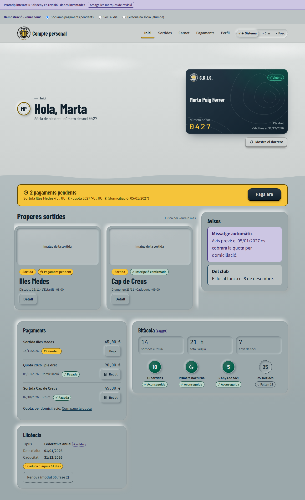

# T-DX-53 · Wireframes sense el diàleg antic «Paga ara»

| Data i hora (Europa/Madrid) | Commit | Proves | CI |
|---|---|---|---|
| 17/11/2026 14:35 | 03102fd9 | al navegador i axe | [A comprovar] |

**En tres línies:** el wireframe del soci encara tenia el diàleg de pagament d'abans de les pantalles reals: pujada del comprovant de la transferència, justificants numerats `JUS-` i un diàleg «Justificant». Ara «Paga ara» porta a la pantalla de pagar un càrrec i cada pagament fet porta al rebut, les dues de la T-M05b-02, que quadren amb `templates/payments/`. Una transferència es confirma quan arriba a l'extracte, no amb cap comprovant.

## Què s'ha fet
- `design/wireframes/socis.html`: «Paga ara» és un enllaç a `#pagaments-carrec`; el botó de cada pagament fet passa a «Rebut» i porta a `#pagaments-rebut`. Fora el diàleg de pagament (tria del mètode, zona del comprovant, impressora amb `JUS-`), el diàleg «Justificant», el seu JS i el CSS que només feien servir ells (`.concepte-pagament`, `.metode`, `.pas-impressio`).
- `design/wireframes/admin.html`: el rebut d'un participant d'una sortida fa servir números `R-2026-…` i diu «Rebut», com el de la pantalla del soci. La devolució ja no marca la P-311: el propietari l'ha resposta (decisió 096, es torna a demanar el codi TOTP).
- Fila nova a [`estat/DX.md`](../estat/DX.md).

## Decisions i perquè
- **`CRIS.impressora` i `CRIS.zonaMagnetica` es queden a `interaccions.js`:** `admin.html` encara les fa servir (rebut d'un participant; factures, extracte i importació de Cluber).
- **La T-DX-12 del sistema de disseny no es toca:** és una proposta de comprovant en una pantalla en construcció, no el diàleg antic del wireframe.

## Problemes trobats
- Cap. La captura de pàgina sencera a 390 px mostra el dock fix a mitja pàgina: és la manera de capturar, no la pantalla.

## Com se sap que funciona
- Playwright: «Paga ara» obre `#pagaments-carrec` i «Rebut de la quota 2026» obre `#pagaments-rebut`; el rebut d'un participant a `admin.html` s'obre amb `R-2026-000412`. Cap error de consola ni petició fallida.
- Sense desbordament horitzontal a 390 i 320 px a la portada i a les dues pantalles.
- axe (WCAG 2.2 AA) a la portada i a les dues pantalles, en clar i en fosc: 0 violacions.
- `python design/recorreguts/comprova.py`: correcte (7 recorreguts i 44 passos).

## Evidències
- Portada del soci amb «Paga ara» i els botons «Rebut», a 1280 px: `captures/2026-11-17_1435_T-DX-53_portada-paga-ara-1280.png`

  

  *17/11/2026 14:35 (Europa/Madrid) · local, wireframe, dades inventades · commit 03102fd9*
- Pantalla de pagar un càrrec a 390 px, en fosc: `captures/2026-11-17_1435_T-DX-53_pagaments-carrec-390-fosc.png`

  *17/11/2026 14:35 (Europa/Madrid) · local, wireframe, dades inventades · commit 03102fd9*
- Sortida de proves · executada el 17/11/2026 en local:
  ```
  $ python design/recorreguts/comprova.py
  Recorreguts correctes: 7 recorreguts i 44 passos.
  ```
