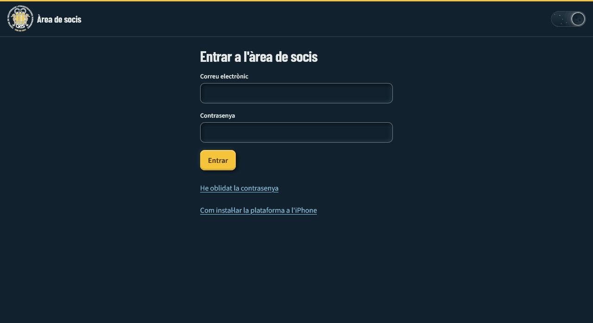

# T-DX-54 · Proves dels logotips també a Firefox i WebKit (Safari)

| Data i hora (Europa/Madrid) | Commit | Proves | CI |
|---|---|---|---|
| 17/11/2026 14:49 | 31bad555 | 4 casos nous (8 en total) | [A comprovar] (PR #194) |

**En tres línies:** la prova dels logotips de la T-DX-51 només corria a Chromium, i que el logotip amagat no es descarregui depèn del motor. Ara corre també a Firefox i a WebKit, el motor de Safari: als tres, en clar, en fosc i amb el tema triat a mà, es descarrega un sol logotip, el que es veu, en AVIF o WebP. El CI instal·la els tres motors.

## Què s'ha fet
- `apps/core/tests/e2e/test_logotip.py`: cada cas s'obre amb el seu motor (Chromium, Firefox i WebKit), sense canviar el navegador de la resta de proves. Són 4 casos de tema per 3 motors.
- `.github/workflows/ci.yml`: el job e2e instal·la també `firefox` i `webkit` de Playwright.
- En local, si a l'ordinador no hi ha Firefox o WebKit de Playwright, aquests casos se salten amb un avís. Al CI (`CI=true`), fallen.
- Sistema de disseny §8 i fila a [`estat/DX.md`](../estat/DX.md).

## Decisions i perquè
- **Firefox amb la preferència del navegador, no amb l'emulació:** les pàgines envien `Cross-Origin-Opener-Policy: same-origin`, i Firefox canvia de procés en obrir-les. Quan ho fa, Playwright perd l'emulació de `color_scheme`: la pàgina es veu en clar encara que el context sigui fosc. Sense la capçalera, l'emulació funciona i només es descarrega el logotip fosc. Per això, a Firefox el fosc del sistema es posa amb `ui.systemUsesDarkTheme`, com un ordinador en fosc de debò. És un límit de l'eina de proves, no del codi.
- **Saltar en local, fallar al CI:** el hook de fi de torn corre les e2e, i qui només té Chromium no ha de veure fallar una prova per un navegador que no té.

- **Menys casos a Firefox i WebKit:** amb els 12 casos, el job e2e del CI passava de 8 min 38 s a 10 min 45 s (56 s d'instal·lació i 59 s de proves), i el CI l'esperen totes les sessions. Amb 2 casos per motor s'estalvien uns 30 s de proves.

## Problemes trobats
- Firefox, en fosc del sistema, descarregava el logotip clar: era l'emulació perduda per la COOP (vegeu les decisions), comprovat amb la capçalera i sense.

## Com se sap que funciona
- `test_logotip.py`: 8 passen: els 4 casos a Chromium i, a Firefox i WebKit, els 2 que ho diuen tot, el fosc del sistema i el tema triat a mà contra el sistema (Windows, Windows, navegadors de Playwright a D:). Amb només Chromium: 1 passa i 2 se salten amb l'avís, per cas.

## Evidències
- Firefox, en fosc, a 1280 px: `captures/2026-11-17_1449_T-DX-54_firefox-1280-fosc.png`

  

  *17/11/2026 14:49 (Europa/Madrid) · local, Firefox de Playwright · commit 31bad555*
- WebKit (Safari), en fosc, a 390 px: `captures/2026-11-17_1449_T-DX-54_webkit-390-fosc.png`

  *17/11/2026 14:49 (Europa/Madrid) · local, WebKit de Playwright · commit 31bad555*
- Sortida de proves · executada el 17/11/2026 en local (PostgreSQL 16):
  ```
  $ PLAYWRIGHT_BROWSERS_PATH=D:/CRIS/pw-browsers pytest -m e2e apps/core/tests/e2e/test_logotip.py -q
  8 passed
  $ pytest -m e2e apps/core/tests/e2e/test_logotip.py -k light-None-clar -q -rs   # només Chromium
  1 passed, 2 skipped
  ```
