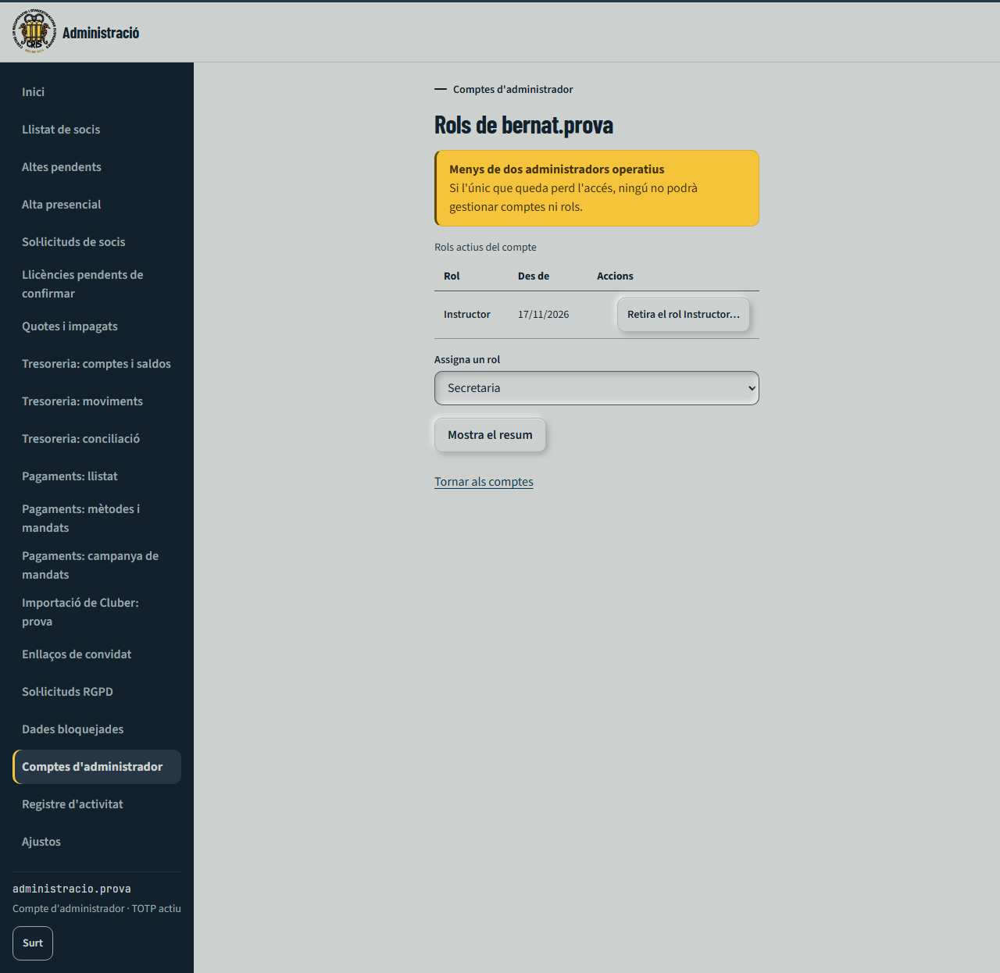

# T-DX-55 · La pantalla de rols marca «Comptes d'administrador» al menú

| Data i hora (Europa/Madrid) | Commit | Proves | CI |
|---|---|---|---|
| 17/11/2026 21:46 | bb5b7e53 | 1 nova i 1 comprovació e2e | [A comprovar] (PR #203) |

**En tres línies:** la pantalla per assignar i retirar rols d'un compte (T-RP-02, #202, del pilot) porta el compte a la ruta i s'obre des de «Comptes d'administrador». El menú només té entrades sense paràmetres, i per això no n'hi cap una de pròpia. Ara és ruta filla de «Comptes d'administrador», que queda marcada quan s'hi és.

## Què s'ha fet
- `apps/accounts/navigation.py`: `administration:account_roles` a les rutes filles de «Comptes d'administrador», com `reset_credentials`.
- `apps/accounts/tests/test_navigation_children.py`: l'administrador obre els rols d'un altre compte i el menú marca l'entrada.
- `apps/core/tests/e2e/test_rols.py`: la mateixa comprovació al navegador (`aria-current`).
- Fila a [`estat/DX.md`](../estat/DX.md).

## Decisions i perquè
- **Cap entrada nova:** la pantalla és d'un compte concret; sense compte no té sentit. Afegir una entrada seria un enllaç que no podria anar enlloc.
- **L'exemple «Avisador: rols i permisos» es queda:** és la matriu de permisos per rol, que serà l'editor de permisos (T-RP-03), no l'assignació de rols d'un compte.
- **Només presentació:** el permís de la pantalla (`core.accounts.manage`, només l'Administrador) el comprova la vista; el menú no canvia res.

## Problemes trobats
- Cap.

## Com se sap que funciona
- Navegació: 30 passen (`test_navigation.py` i `test_navigation_children.py`). e2e de rols: passa.

## Evidències
- Pantalla de rols amb «Comptes d'administrador» marcat, a 1280 px: `captures/2026-11-17_2146_T-DX-55_rols-menu-1280.png`

  

  *17/11/2026 21:46 (Europa/Madrid) · local, prova e2e, dades inventades · commit bb5b7e53*
- A 320 px, en fosc: `captures/2026-11-17_2146_T-DX-55_rols-menu-320-fosc.png`

  *17/11/2026 21:46 (Europa/Madrid) · local, prova e2e · commit bb5b7e53*
- Sortida de proves · executada el 17/11/2026 en local (PostgreSQL 16):
  ```
  $ pytest apps/accounts/tests/test_navigation_children.py apps/accounts/tests/test_navigation.py -q
  30 passed
  $ pytest -m e2e apps/core/tests/e2e/test_rols.py -q
  1 passed
  ```
