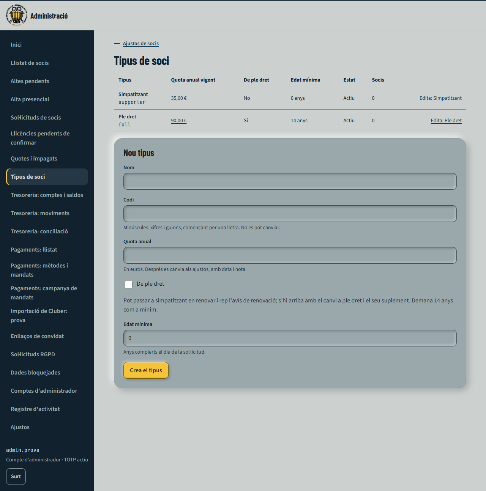

# T-DX-56 · «Tipus de soci» al menú de l'administració

| Data i hora (Europa/Madrid) | Commit | Proves | CI |
|---|---|---|---|
| 18/11/2026 11:57 | 60049f88 | 1 nova i 1 e2e pel menú | [A comprovar] (PR #223) |

**En tres línies:** la pantalla de tipus de soci (T-M01-52, del pilot) no tenia cap enllaç que hi portés. Ara té una entrada al menú de l'administració, després de «Quotes i impagats», que només surt a qui té el permís de la ruta. Editar un tipus la deixa marcada.

## Què s'ha fet
- `apps/accounts/navigation.py`: entrada `administration:membership_types`, amb `administration:membership_type_edit` com a ruta filla. El permís ja el declara la ruta a `apps/members/permissions.py` (`settings.section.members`, lectura).
- Proves: `test_navigation_children.py` (editar un tipus marca l'entrada) i `test_ajustos.py`, que ara hi arriba pel menú i en comprova `aria-current`. La prova general del menú comprova el permís per a cada rol.
- Fila a [`estat/DX.md`](../estat/DX.md).

## Decisions i perquè
- **Entrada pròpia i no filla d'«Ajustos»:** «Ajustos» no hi enllaça, i una ruta filla només marca l'entrada; no hi porta.
- **Al costat de «Quotes i impagats»:** és configuració dels socis i de la seva quota.

## Problemes trobats
- Cap.

## Com se sap que funciona
- Navegació: 36 passen. e2e de tipus de soci: passa, entrant pel menú.

## Evidències
- Tipus de soci amb l'entrada marcada, a 1280 px: `captures/2026-11-18_1157_T-DX-56_tipus-menu-1280.png`

  

  *18/11/2026 11:57 (Europa/Madrid) · local, prova e2e, dades inventades · commit 60049f88*
- A 320 px, en fosc: `captures/2026-11-18_1157_T-DX-56_tipus-menu-320-fosc.png`

  *18/11/2026 11:57 (Europa/Madrid) · local, prova e2e · commit 60049f88*
- Sortida de proves · executada el 18/11/2026 en local (PostgreSQL 16):
  ```
  $ pytest apps/accounts/tests/test_navigation_children.py apps/accounts/tests/test_navigation.py apps/accounts/tests/test_navigation_previews.py -q
  36 passed
  $ pytest -m e2e apps/core/tests/e2e/test_ajustos.py -k creates_a_type -q
  1 passed
  ```
