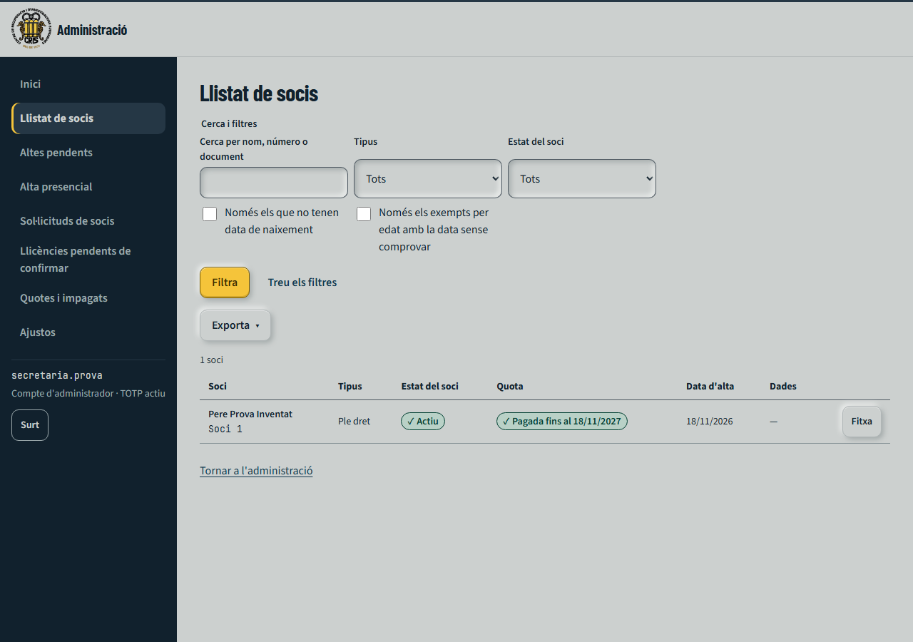

# T-DX-57 · Escriptori, PR 1: base de la disposició

| Data i hora (Europa/Madrid) | Commit | Proves | CI |
|---|---|---|---|
| 18/11/2026 13:40 | dd7e41ad | 1 e2e nova; 31 e2e i axe de pantalles representatives | [A comprovar] (PR #227) |

**En tres línies:** és la primera de les nou PR del programa que el propietari va aprovar el 18/11/2026: que a l'ordinador les pantalles aprofitin l'amplada, la navegació, el carnet en 3D i les activitats. Aquesta PR posa la base: el cos creix per trams (fins a 1200 px, i els llistats fins a 1440 px), les peces de disposició que faran servir les altres PR, i les taules amb capçalera fixa i fila clicable. El mòbil no canvia.

## Què s'ha fet
- `static/css/disposicio.css` (nou, enllaçat a la base després de `comptes.css`):
  - cos per trams;
  - contenidor per a container queries (C8);
  - paràgrafs, formularis i dades a amplada de lectura;
  - peces `capcalera-pagina`, `disposicio-pagina`, `graella-2` (5/7, 7/5 i 8/4), `amb-columna-lateral`, `graella-targetes` i `desplacable-x`;
  - taules amb capçalera fixa, fila ressaltada i fila sencera clicable amb `enllac-fila` (B14).
- `static/css/tokens.css`:
  - quatre amplades noves (`--amplada-ample`, `--amplada-tauleta`, `--amplada-formulari` i `--amplada-estreta`);
  - `.import` passa a xifres tabulars amb la lletra del text (D7; el monoespai queda per als codis).
- 19 plantilles d'entrada i pàgines soles amb `cos-estret`: entrar, codi TOTP, recuperació, invitació, sessió caducada, verificació del carnet, 403, 404, pagament de prova i ajuda d'instal·lació.
- Sistema de disseny 1.26, §5.3 i §4. `test_disposicio.py` al mapa e2e del hook. Fila a [`estat/DX.md`](../estat/DX.md).

## Decisions i perquè
- **`cos-estret` per a l'entrada i les pàgines soles:** són una sola peça centrada. Deixar-les a 40rem a l'esquerra d'un cos de 1200 px les faria semblar trencades.
- **Dades i formularis a amplada de lectura:** amb el cos ample, una etiqueta quedava a 900 px del seu valor (proximitat, Gestalt).
- **Cap animació d'entrada** (correcció del propietari: D20 i B10).

## Problemes trobats
- **Cos de 64 px:** amb `container-type: inline-size`, el cos dins de la graella de la barra lateral perdia l'amplada automàtica i quedava en 64 px (només el farciment). El contingut en sortia i la pàgina feia 1334 px a 1280.
  - **Com s'ha vist:** a la captura del llistat. La prova nova ho reproduïa (`assert 64 > 1000`).
  - **Arreglo:** `width: 100%`.
- **Pas intermedi:** fins que cada pantalla tingui la seva disposició (PR 3 a 9), les pantalles queden més amples amb el mateix ordre. El carnet, per exemple, a tota l'amplada.

## Com se sap que funciona
- e2e:
  - fumada, navegació, carnet, Oleaje, quotes, tresoreria, pagaments, fitxa, rebut, pàgines d'error i Errata: 31 passen;
  - axe del 01 i de la tresoreria en clar i en fosc: sense infraccions noves;
  - `test_disposicio.py`: el llistat de socis i el de pagaments fan més de 1000 px a 1280, l'entrada es queda a 28rem i a 390 i 320 px no hi ha desplaçament de costat.
- Unitàries de tokens, fulls d'estil i mapa e2e: 241 passen.
- Comprovació de §15.5:
  - **B:** cap moviment nou.
  - **C:** container queries (C8) i vora esvaïda (C2).
  - **D:** xifres tabulars (D7), espai i no caixes (D15), un sol botó principal (cap canvi).

## Evidències
- Llistat de socis a 1280 px, a l'amplada nova: `captures/2026-11-18_1340_T-DX-57_llistat-1280.png`

  

  *18/11/2026 13:40 (Europa/Madrid) · local, prova e2e, dades inventades · commit dd7e41ad*
- Fitxa del soci a 1280 px, amb les dades a amplada de lectura i les taules senceres: `captures/2026-11-18_1340_T-DX-57_fitxa-1280.png`
- La fitxa a 390 px, com abans: `captures/2026-11-18_1340_T-DX-57_fitxa-390.png`

  *18/11/2026 13:40 (Europa/Madrid) · local, prova e2e · commit dd7e41ad*
