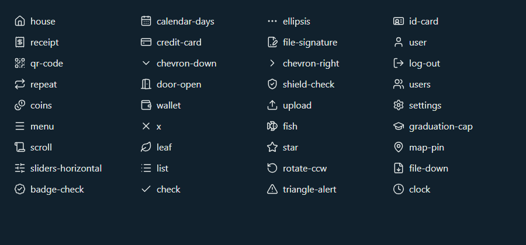

# T-DX-58 · Escriptori, PR 2: joc d'icones

| Data i hora (Europa/Madrid) | Commit | Proves | CI |
|---|---|---|---|
| 18/11/2026 13:46 | e604468b | 4 noves | [A comprovar] (PR #231) |

**En tres línies:** la plataforma no tenia cap joc d'icones: feia servir símbols de text i icones dibuixades a mà als wireframes. Ara té un sol joc, Lucide (llicència ISC), allotjat al servidor. L'sprite només porta les 36 icones que farà servir el programa (la navegació, els grups de l'administració, les activitats i el carnet), i es pinten amb ``.

## Què s'ha fet
- `static/img/icones.svg`: sprite de `<symbol>` amb les icones de `apps/core/icones.py`.
- `tools/icones/genera.py`: genera l'sprite a partir de la carpeta `icons/` del paquet oficial, i només accepta formes (cap script ni enllaç).
- `static/img/README.md` i `LICENSE-lucide.txt`: origen (registre npm, `lucide-static` 1.67.0, publicada el 03/11/2026), integritat de npm comprovada i SHA-256 del paquet.
- `apps/core/templatetags/icones.py`: ``, amb `aria-hidden` i `focusable="false`. Un nom desconegut fa fallar la plantilla.
- `tokens.css`: `.icona` (20 px), `--icona-nav` (24 px) i `--icona-gruix` (1,75, C9).
- Sistema de disseny 1.36, §6.20. Fila a [`estat/DX.md`](../estat/DX.md).

## Decisions i perquè
- **Lucide:** és la decisió del propietari (18/11/2026). Traç fi que lliga amb Source Sans; llicència ISC.
- **Versió de fa més de dues semanes** (la 1.67.0, i no la 1.75.0 d'avui), com la resta de dependències.
- **Sprite i `<use>`** en lloc d'SVG enganxats a cada plantilla: un sol fitxer, que el navegador desa a la memòria cau.
- **Sense color ni gruix a l'sprite:** els posa el CSS (`currentColor` i `--icona-gruix`), perquè segueixin el text i el tema.
- **Token `--icona-gruix`:** sense «ç» al nom, per no dependre de com cada eina llegeix els caràcters no ASCII al CSS.

## Problemes trobats
- Cap. **`risc:alt` (recurs extern nou):** s'ha obert com a esborrany perquè ja hi havia 5 `risc:alt` obertes entre les sessions. Es marca com a llesta quan en quedin menys de 4.

## Com se sap que funciona
- `test_icones.py` (4):
  - l'sprite porta exactament les icones de la llista i només formes, sense gruix;
  - la llicència i l'origen hi són;
  - l'etiqueta pinta una icona amagada al lector de pantalla;
  - un nom desconegut falla.
- Fulls d'estil i plantilles (`test_pages.py`): passen.
- Al navegador:
  - totes les icones pintades amb `tokens.css`, en clar i en fosc;
  - encara no les fa servir cap pantalla, i la PR 3 (navegació del soci) les comprovarà a les pantalles.

## Evidències
- Les 36 icones, en fosc: `captures/2026-11-18_1346_T-DX-58_icones-fosc.png`

  

  *18/11/2026 13:46 (Europa/Madrid) · local, pàgina de prova amb tokens.css · commit 7a9921d1*
- En clar: `captures/2026-11-18_1346_T-DX-58_icones-clar.png`
