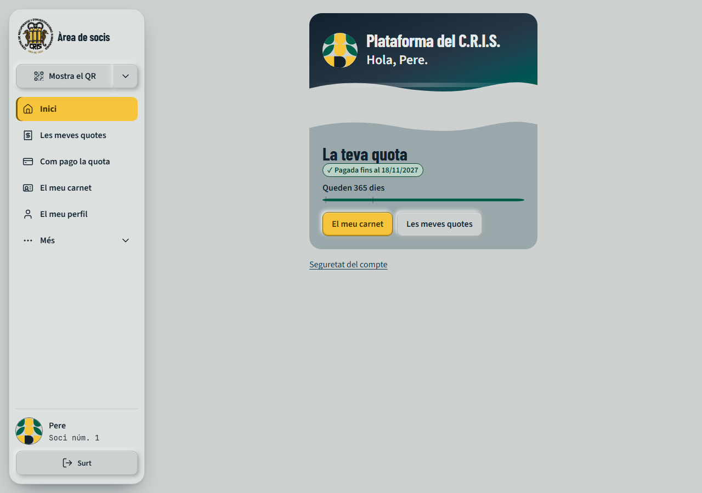

# T-DX-59 · Escriptori, PR 3: navegació de l'àrea del soci

| Data i hora (Europa/Madrid) | Commit | Proves | CI |
|---|---|---|---|
| 18/11/2026 14:21 | fefa697e | 4 noves, 1 e2e nova (2 casos) i 5 adaptades | [A comprovar] (PR #232) |

**En tres línies:** l'àrea del soci tenia una barra a baix només per sota de 600 px i, a partir d'aquí, una fila d'enllaços subratllats a la capçalera. Ara Ramillete és a totes les mides: la barra a baix fins a 1023 px (flotant i centrada a la tauleta) i, a l'escriptori, un panell lateral clar i flotant amb «Mostra el QR», les entrades i el compte. La fila d'enllaços només queda sense JavaScript.

## Què s'ha fet
- `templates/members/_ramillete.html`: dues llistes dins d'una sola navegació «Àrea de socis», una per mida (la barra i el panell). Icones del joc comú (``) en lloc dels SVG dibuixats a mà; icona nova `plus` a l'sprite.
- `templates/base.html`: Ramillete va abans de `<main>` (salt, navegació i contingut, a totes les mides).
- `static/css/ramillete.css`: la barra a la tauleta (`--ramillete-amplada`, 30rem, radi i ombra), el panell a partir de 1024 px (`--lateral-ample`, `--c-superficie-flotant`), l'entrada actual (fons de la zona, barra daurada i negreta) i el compte a baix. A la tauleta i al mòbil, «Surt» a la fila del logotip.
- `static/js/ramillete.js`: els desplegables del panell (`data-desplega`): la fletxa del QR i «Més».
- `apps/members/templatetags/member_nav.py`: `preview_url`, `has_pending_fee` i `may_request_new_card`.
- `tokens.css`: `--ramillete-amplada` i la classe `icona-nav`.
- Sistema de disseny 1.37 (§1, §5.1, §6.1, §6.12 i §6.20). Fila a [`estat/DX.md`](../estat/DX.md).

## Decisions i perquè
- **«Activitats» per defecte no hi és:** la pantalla «En construcció» encara no existeix i, a producció, un soci no les veu. Llavors la barra porta Inici, Perfil, Més, Carnet i Quotes, perquè «Més» quedi al centre.
- **L'acció partida fa servir el botó normal**, no el principal: el botó principal és el de cada pantalla (D19). A la portada ja n'hi ha un («El meu carnet»).
- **«Demana un carnet nou» amb la regla de la pàgina del carnet** (`cards.may_request_new_card`): una prova existent (`test_cards_079`) demanava que un soci pendent no el vegi. Sense «Paga ara» ni carnet nou, no hi ha fletxa.
- **«Paga ara» mira les quotes** (`AnnualFee` amb el càrrec pendent), no tots els càrrecs: porta a «Les meves quotes», que només mostra quotes.
- **«Més» del panell ja surt obert** si la pàgina actual hi és, perquè es vegi on ets.
- **Amplada del panell:** `--lateral-ample`, el de l'administració; `--lateral-soci` no existia (només `--c-lateral-soci`, un color).

- **Entrada actual del panell:** un to suau de la zona (24 %) i la barra daurada, no el fons daurat ple. Amb el fons ple, en clar semblava un segon botó principal al costat del de la pàgina (D19). Revisió de la sessió de disseny.

## Problemes trobats
- axe (fosc, 1280 px): «Soci núm. 1» amb `--c-text-2` sobre la superfície flotant feia 4,18:1, el mateix cas que la P-283. Arreglat amb la barreja en sRGB de les pestanyes.
- Dues proves unitàries comptaven un sol «Surt» i un sol avatar a l'HTML: ara n'hi ha un per mida (el CSS en deixa veure un). S'han adaptat.

## Com se sap que funciona
- `test_member_nav.py` (4): `preview_url` (ruta i ajust), `has_pending_fee` (una consulta, només el soci de la sessió, mai el compte d'administrador), l'ordre de la barra sense «Activitats» i les accions del carnet, i un compte sense soci.
- `test_navegacio_soci.py` (e2e, 2): panell a 1280 i 1024 px sense capçalera i sense tapar el contingut; barra a 800 px centrada i de 30rem com a màxim; a 390 px de vora a vora; a 320 px sense desplaçament lateral; teclat (fletxa del QR i «Més» amb Intro i Esc, el focus torna); `aria-current`; «Activitats» amagada amb `SHOW_UNDER_CONSTRUCTION=False`.
- `test_ramillete.py`, `test_navegacio.py`, `test_accessibilitat_028.py`, `test_accessibilitat_mandat.py`, `test_oleaje.py` i `test_smoke.py`: 18 e2e en verd. Unitàries de `apps/members` i `apps/core/tests`: 4.716 en verd.
- **§15.5:**
  1. Taula B: cap moviment nou llevat del gir de la fletxa (`--m-rapid`, en respondre a un clic); el ventall de sempre; `prefers-reduced-motion` ho atura. Àrees de 44 px.
  2. Taula C: vores amb `--c-linia`; icones del joc comú amb el traç del text.
  3. Taula D: cap insígnia decorativa; un sol botó principal per pantalla; contrast 4,5:1 als dos temes (axe).
  4. Tokens: només tokens, cap `style=`; un token nou (`--ramillete-amplada`).
  5. Captures a 1280, 1024, 800, 390 i 320 px, en clar i en fosc, de la portada i de «Les meves quotes», mirades.

## Evidències
- El panell a l'escriptori: `captures/2026-11-18_1421_T-DX-59_panell-inici-1280.png`

  

  *18/11/2026 14:21 (Europa/Madrid) · local, dades inventades · commit fefa697e*
- El menú de la fletxa del QR: `captures/2026-11-18_1421_T-DX-59_menu-qr-1280.png`
- La barra flotant a la tauleta, en fosc: `captures/2026-11-18_1421_T-DX-59_barra-quotes-800-fosc.png`
