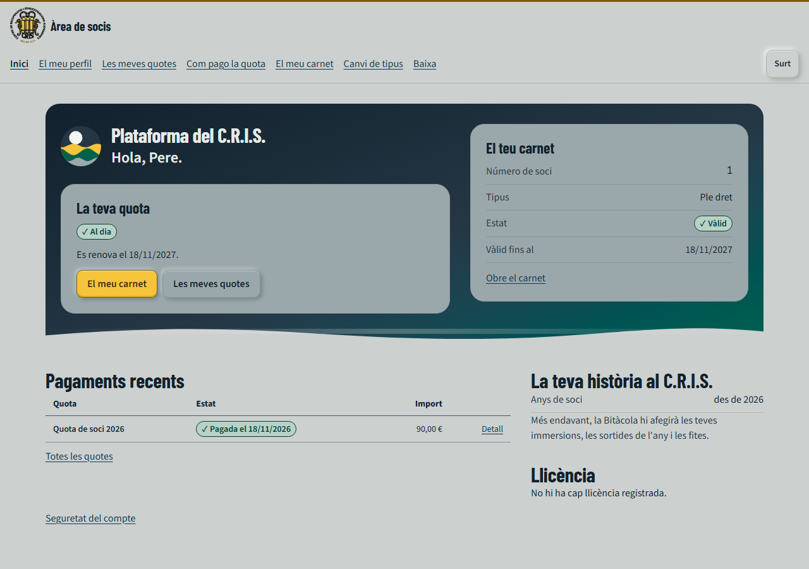
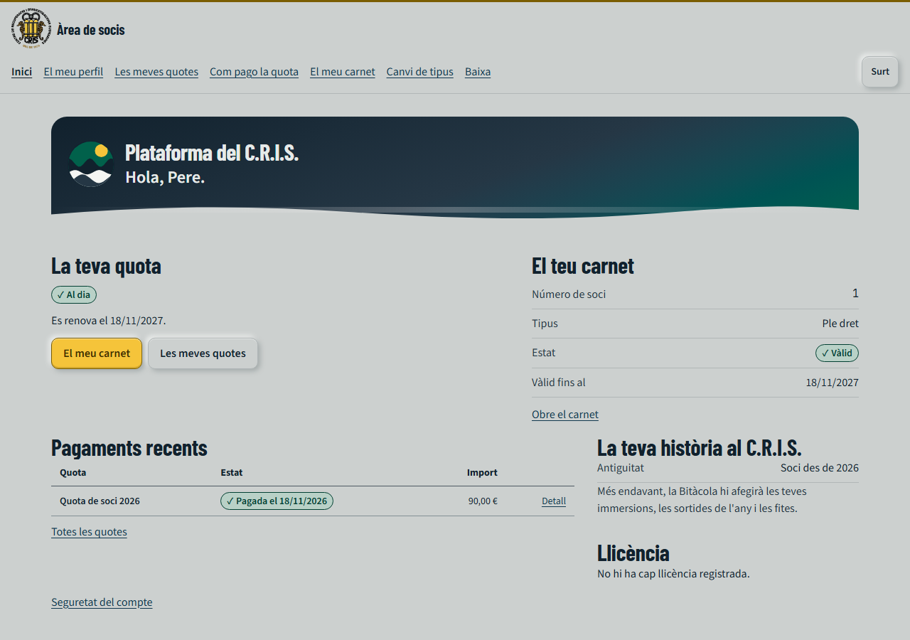

# T-DX-60 · Escriptori, PR 4: inici del soci

| Data i hora (Europa/Madrid) | Commit | Proves | CI |
|---|---|---|---|
| 18/11/2026 15:04 | 0e60ae1b (PR #239) | 4 unitàries noves i 2 e2e noves; 16 e2e (amb axe) i 4.684 unitàries del 00 i el 01 | [A comprovar] |
| 18/11/2026 16:40 | 15f6313d (PR #239), correccions del propietari | 6 unitàries noves; 16 e2e (amb axe i contrast mesurat) i 4.690 unitàries del 00 i el 01 | [A comprovar] |

**En tres línies:** és la quarta de les nou PR del programa de l'escriptori que el propietari va aprovar el 18/11/2026 (secció 3.6). L'inici del soci aprofita l'amplada: la portada amb la salutació i, a sota, la quota i el carnet en petit en dues columnes, la franja de pendents només si n'hi ha, i a sota els pagaments recents, la història al C.R.I.S. i la llicència. Al mòbil, el mateix ordre, l'un a sota de l'altre.

## Què s'ha fet
- `templates/core/home.html`, de dalt a baix:
  - portada (Oleaje) amb Monograma i salutació, res més;
  - `inici-portada`, sobre el fons de la pàgina: 7/5 a l'escriptori, dues columnes iguals a la tauleta, una a sota de l'altra al mòbil. A l'esquerra, «La teva quota»; a la dreta, el carnet en petit (número, tipus, estat i «vàlid fins al», sense QR);
  - «La teva quota»: «✓ Al dia» i «Es renova el dd/mm/aaaa» amb el mètode de «Com pago la quota». El compte enrere només des del primer dia d'avís. Si no està al dia, l'estat de sempre. «El meu carnet» és l'únic botó principal;
  - franja de pendents (`avis avis-avis franja-estat`), amb «Paga ara» de 56 px;
  - el lloc d'«Activitats per a tu» (PR 5), només com a comentari;
  - `inici-graella`, 8/4: «Pagaments recents» (3 quotes pagades i «Totes les quotes»); «La teva història al C.R.I.S.» (l'antiguitat amb el filtre `antiguitat`, insígnia de soci clàssic i una línia sobre la Bitàcola) i «Llicència» amb Vigencia.
- `apps/members/templatetags/member_notices.py`: `member_home` substitueix `member_home_summary` i torna les dades amb els serveis que ja existien (`roster.fee_state`, `preferences.fee_payment_method`, `cards`, `services.licence_record` i les files de «Les meves quotes»). `templates/members/_home_resum.html` s'esborra.
- `apps/members/templatetags/vigencia.py`: `in_fee_warning_window`, amb els dies d'avís de VC-02.
- `apps/members/templatetags/antiguitat.py`: el filtre `antiguitat`, un sol text per a l'inici i el carnet (el carnet l'adoptarà a la seva PR).
- `static/css/oleaje.css`: les dues graelles i la franja.
- Sistema de disseny 1.29: §5.1, §6.5 i §6.18. Mapa e2e del hook. Fila a [`estat/DX.md`](../estat/DX.md).

## Decisions i perquè
- **La quota i el carnet fora del degradat, sense caixes** (correcció del propietari): a la primera versió anaven dins de la portada, en dues caixes de superfície, perquè sobre el blau fosc els estats i Vigencia en avís perdien contrast. El propietari va triar treure-les: el degradat només decora la salutació i la quota i el carnet van a sota, sobre el fons de la pàgina, agrupats amb espai (D15).
- **Antiguitat en un sol filtre** (correcció del propietari): «Soci des de 2026» amb menys d'un any sencer, mai «0 anys»; «Soci des de 2025 (1 any)» a partir d'un; «~AAAA» amb la data aproximada. Amb `ngettext`, perquè el plural es pugui traduir. L'etiqueta de la fila passa a «Antiguitat».
- **Llindars propis (34rem i 56rem) en lloc dels de `graella-2` (45rem i 60rem):** a la tauleta el cos fa 42rem i no arribava mai a dues columnes, i a 1024 px amb barra de desplaçament fa una mica menys de 60rem.
- **«Paga ara» amb `boto-mari`, no `boto-principal`:** un sol botó principal per pantalla (D19), i el propietari va triar «El meu carnet».
- **Sense `oleaje-seccio` a l'inici:** la pujada en desplaçar era una animació d'entrada (D20, B10). La peça continua a la portada pública de prova.
- **Els pagaments recents són quotes pagades:** és el que el soci ja veu a «Les meves quotes». No hi ha cap altre càrrec propi encara.

## Problemes trobats
- **Fills del cos:** la regla de `comptes.css` per als fills directes del cos (gap de `--e-4`) és més específica que `.inici-graella`. **Arreglo:** el selector de 8/4 és `.cos-compte > div.inici-graella`.
- **Captures a pantalla sencera al mòbil:** Ramillete, fix a baix, surt al mig de la captura. És la captura, no la pàgina.

## Com se sap que funciona
- Unitàries:
  - `test_oleaje.py` (8): al dia sense compte enrere lluny de la renovació; compte enrere dins de la primera finestra (VC-02 canviat); pendent amb la franja i l'enllaç al càrrec; pagaments, anys i insígnia (VC-04); sense insígnia per sota del llindar o amb data aproximada; només el soci de la sessió; res per a un no soci ni per al compte d'administrador.
  - `test_vigencia.py`: la finestra segueix el primer dia d'avís, i sense dies d'avís no n'hi ha.
  - `test_antiguitat.py` (6): 0 anys (dos casos, un a un dia de fer l'any), 1 any, 2 anys, data aproximada i sense data.
  - 00 i 01: 4.684 passen a la primera versió (`test_mail_limit` va fallar una vegada en l'execució llarga i passa sol) i 4.690 després de les correccions.
- e2e: Oleaje (al dia i pendent: franja amb `role="status"` i «Paga ara» de 56 px, un sol botó principal, cap animació a la quota), Vigencia, quotes 079, fumada, disposició (1280: 7/5 i 8/4; 800: dues columnes iguals separades 24 px; 390: una columna; 320: res de costat), Monograma i axe del 01 en clar i en fosc: 16 passen.
- Contrast del text de l'inici (correccions), mesurat a la prova e2e amb el color del text contra el fons real, a 1280, 1024, 800, 390 i 320 px: el mínim és 7,3:1 en clar i 6,71:1 en fosc amb un soci al dia, i 6,73:1 en clar i 6,71:1 en fosc amb una quota pendent. El llindar de la prova és 4,5:1.
- Captures mirades: 1280, 1024, 800, 390 i 320, en clar i en fosc, amb un soci al dia i un amb la quota pendent.
- Comprovació de §15.5:
  - **B:** cap moviment nou; s'ha tret l'animació d'entrada de la quota. Botons de 44 px o més.
  - **C:** container queries (C8). Després de les correccions no hi ha cap caixa dins de la portada.
  - **D:** un sol botó principal; títols concrets; xifres tabulars (`import`); monoespai només al número de soci; espai i no línies entre els blocs de baix (D15); axe sense infraccions als dos temes.
  - **Tokens:** cap color, espai ni radi fora de `tokens.css`; cap `style=`.

## Evidències
- Primera versió (amb les caixes sobre el degradat), soci al dia a 1280 px: `captures/2026-11-18_1504_T-DX-60_inici-al-dia-1280.png`

  

  *18/11/2026 15:04 (Europa/Madrid) · local, prova e2e, dades inventades · commit 0e60ae1b*
- Soci amb la quota pendent a 800 px, en fosc: dues columnes iguals i la franja amb «Paga ara»: `captures/2026-11-18_1504_T-DX-60_inici-pendent-800-fosc.png`
- El mateix a 390 px, l'un a sota de l'altre: `captures/2026-11-18_1504_T-DX-60_inici-pendent-390.png`

  *18/11/2026 15:04 (Europa/Madrid) · local, prova e2e, dades inventades · commit 0e60ae1b*
- Després de les correccions del propietari, soci al dia a 1280 px: la salutació a la portada i, a sota, la quota i el carnet en 7/5, sense caixes: `captures/2026-11-18_1640_T-DX-60_inici-al-dia-1280.png`

  

  *18/11/2026 16:40 (Europa/Madrid) · local, prova e2e, dades inventades · commit 15f6313d*
- Quota pendent a 1024 px, en fosc: `captures/2026-11-18_1640_T-DX-60_inici-pendent-1024-fosc.png`
- Soci al dia a 390 px, en fosc: `captures/2026-11-18_1640_T-DX-60_inici-al-dia-390-fosc.png`

  *18/11/2026 16:40 (Europa/Madrid) · local, prova e2e, dades inventades · commit 15f6313d*
