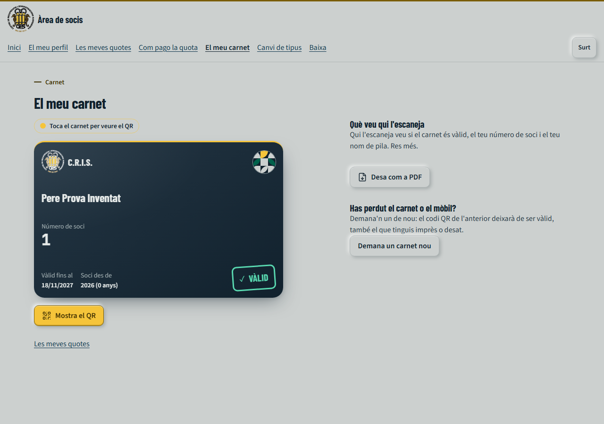
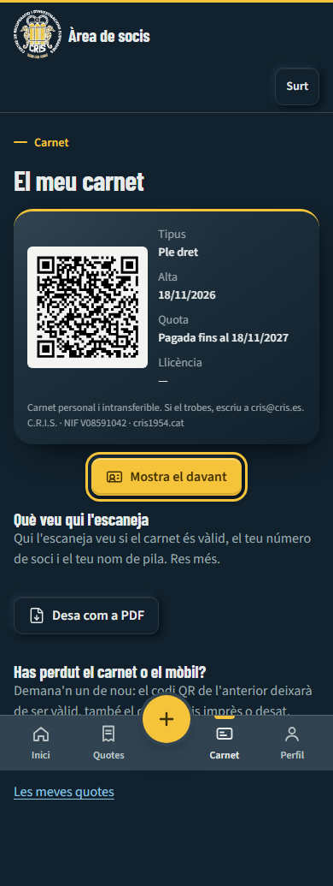
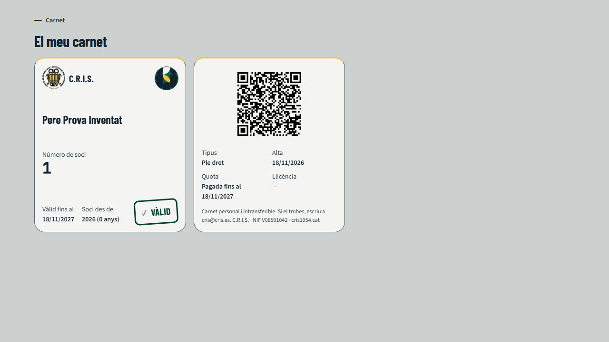

# T-DX-61 · Escriptori, PR 5: el carnet de soci en 3D

| Data i hora (Europa/Madrid) | Commit | Proves | CI |
|---|---|---|---|
| 18/11/2026 15:11 | 85b147e5 | 1 e2e nova (3 casos); 3 e2e i 2 unitàries adaptades | [A comprovar] (PR pendent) |

**En tres línies:** «El meu carnet» era una llista de dades amb el QR a sota. Ara és una targeta fosca, com la física, que s'inclina una mica amb el ratolí i es gira per veure el QR, amb el botó «Mostra el QR» o tocant-la. A l'escriptori el carnet va gran a l'esquerra i, a la dreta, què veu qui l'escaneja, «Desa com a PDF» i «Has perdut el carnet o el mòbil?». Les dades són les mateixes d'abans.

## Què s'ha fet
- `static/css/carnet.css`: l'escena, les dues cares (degradat en OKLCH amb l'alternativa en sRGB, franja daurada, reflex i ombra amb la llum de dalt a l'esquerra), el gir, el canvi d'icona del botó, la disposició amb `graella-7-5`, «més contrast» i la impressió.
- `static/js/carnet.js`: gir (botó, clic al carnet, `#qr`), `aria-pressed`, `aria-hidden` i `inert` a la cara amagada, inclinació amb `--rx` i `--ry`, i la pista de Baliza d'una sola vegada.
- `templates/members/personal_card.html`: davant i darrere; «Demana un carnet nou» passa a `members/_card_renew.html`, amb `id="carnet-nou"`.
- `tokens.css`: `--c-carnet-ok`, `--c-carnet-error` i `--ombra-carnet` (clar i fosc).
- `static/js/service-worker.js`: la còpia sense connexió també té els estils i el JavaScript del carnet.
- Sistema de disseny 1.38: §2.6, §6.8 i §6.21 nova. Fila a [`estat/DX.md`](../estat/DX.md).

## Decisions i perquè
- **Sense JavaScript, les dues cares a la vista:** el QR no depèn del gir. El JavaScript posa `es-3d` i llavors les cares comparteixen cel·la.
- **El segell d'Autentico, quiet i llegible:** a la verificació cau; al carnet no, perquè no respon a cap acció (D20). És l'únic lloc on es diu l'estat, i per això no és `aria-hidden`.
- **Tokens nous per a l'estat:** el carnet és fosc als dos temes, i `--c-ok-text` del tema clar no s'hi llegeix. `--c-carnet-ok` i `--c-carnet-error` són els valors del tema fosc.
- **Les cares s'estiren (`place-self: stretch`):** amb `aspect-ratio`, una cara no agafava l'alçada de l'altra i, si s'estirava només d'alt, es feia ampla i desbordava a 320 px.
- **Mòbil de 320 px:** el QR a dalt (10rem) i les dades en dues columnes, perquè el carnet no s'allargui massa.
- **Pista:** si el navegador no deixa desar, no surt; així no es repeteix a cada visita.
- **«Soci des de»:** l'any d'alta i els anys de soci («~any» si la data és aproximada), que abans eren «Anys de soci».

## Problemes trobats
- La primera prova de cada execució va fallar dues vegades en obrir `/entrar/` (30 s sense resposta) amb l'ordinador carregat per altres sessions. Tornant-la a passar, passa: no és del carnet.
- El comentari dins de la llista `ESTILS` del service worker trencava la prova que la llegeix (`test_pwa.py`): ara va a sobre.

## Com se sap que funciona
- `test_carnet_3d.py` (3):
  - el botó amb el teclat (Enter i espai), `aria-pressed`, la cara amagada amb `aria-hidden` i `inert`, el clic al carnet i la pista una sola vegada;
  - `#qr` obre pel darrere; la inclinació no passa de 6 graus i torna a 0; amb moviment reduït, `transition-duration` és 0 s i no s'inclina; a la impressió, les dues cares al costat i sense gir;
  - a 1280 px el carnet a l'esquerra i la columna a la dreta; a 390 px el carnet centrat; a 320 px no es desplaça de costat.
- `test_carnet_079.py`, `test_pwa_079.py` (la còpia sense connexió s'obre amb `#qr` i mostra el QR) i `test_accessibilitat_028.py` (axe en clar i en fosc i el tabulador): 11 de 11 passen.
- Unitàries d'`apps/members` i `apps/core/tests`: passen.
- Captures del davant i del darrere a 1280, 1024, 800, 390 i 320 px, en clar i en fosc, mirades.

## Comprovació de §15.5
1. **Taula B:** el gir dura 400 ms (`--m-gir`) i es pot desfer a mig camí; la inclinació va amb `--m-rapid`; amb moviment reduït no es mou res. Botó de 44 px d'alt. Una sola llum per a reflex i ombra (B11).
2. **Taula C:** radi del QR amb `--r-interior`; canvi d'icona amb desenfocament de 180 ms (C4); degradat en OKLCH amb alternativa (C7); la cara s'adapta amb container queries (C8); icones de Lucide.
3. **Taula D:** cap insígnia decorativa («Soci clàssic» té significat); un sol botó principal («Mostra el QR»); el número de soci en monoespai i les dates en xifres tabulars. Contrast sobre el carnet: text 11:1 o més, text secundari (`--c-carnet-text-2`) uns 5:1 sobre el degradat i l'estat 6,3:1 o més; axe sense violacions greus.
4. **Tokens:** cap color, radi, ombra, espai ni durada fora de `tokens.css`; cap `style=` a la plantilla (només `--rx` i `--ry` des del JavaScript).
5. **Captures:** a 1280, 1024, 800, 390 i 320 px, en clar i en fosc, del davant i del darrere, mirades.

## Evidències
- Davant a 1280 px, en clar: `captures/2026-11-18_1511_T-DX-61_davant-1280.png`

  

  *18/11/2026 15:11 (Europa/Madrid) · local, dades inventades · commit 85b147e5*
- Darrere a 390 px, en fosc: `captures/2026-11-18_1511_T-DX-61_darrere-390-fosc.png`

  

  *18/11/2026 15:11 (Europa/Madrid) · local, dades inventades · commit 85b147e5*
- Impressió («Desa com a PDF»): `captures/2026-11-18_1511_T-DX-61_impressio-1280.png`

  

  *18/11/2026 15:11 (Europa/Madrid) · local, mitjà d'impressió emulat · commit 85b147e5*
