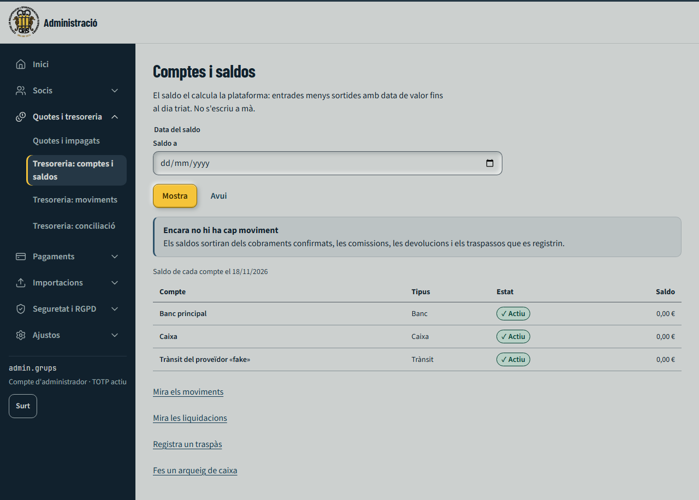

# T-DX-62 · Escriptori, PR 6: menú de l'administració agrupat

| Data i hora (Europa/Madrid) | Commit | Proves | CI |
|---|---|---|---|
| 18/11/2026 15:55 | b26808da | 1 e2e nova; 9 fitxers e2e adaptats | [A comprovar] (PR #238) |

**En tres línies:** el menú de l'administració tenia 22 entrades seguides. Ara té «Inici» solt i 6 grups plegables amb icona: Socis, Quotes i tresoreria, Pagaments, Importacions, Seguretat i RGPD, i Ajustos. El grup de la pantalla actual surt obert. A la tauleta, un carril de 72 px amb la icona de cada grup obre les entrades al costat, i l'inici de l'administració mostra les mateixes entrades, agrupades en targetes.

## Què s'ha fet
- `apps/accounts/navigation.py`: `ENTRIES` en l'ordre dels grups, `GROUPS` (nom, icona i entrades) i `AdminNav.groups`/`home`. El servidor continua filtrant cada entrada pel permís, i un grup buit no surt.
- `templates/accounts/_admin_nav.html`: «Inici» solt i grups amb `
`, que funcionen sense JavaScript.
- `static/css/comptes.css`: estils dels grups, el carril de la tauleta (600 a 1023 px) i les targetes de l'inici.
- `static/js/menu-admin.js`: al carril, tocar una icona n'obre les entrades al costat, d'un grup en un. Esc o tocar fora el tanca i el focus torna a la icona.
- `templates/accounts/admin_home.html`: una targeta per grup (`graella-targetes`, reixa de Parrilla). Cap xifra nova.
- Proves:
  - funció `menu_entry` al `conftest` de les e2e (obre el grup si l'entrada és plegada) i 9 fitxers adaptats;
  - prova nova `test_admin_menu_groups_and_tablet_rail`.
- Sistema de disseny 1.39, §6.1. Fila a [`estat/DX.md`](../estat/DX.md).

## Decisions i perquè
- **`
`:** és el plegable natiu, que es fa servir amb el teclat i sense JavaScript.
- **Carril només amb JavaScript:** sense, la barra sencera, com fins ara. Millora progressiva.
- **Noms de les entrades sense canviar** («Tresoreria: …», «Pagaments: …»): moltes proves i hàbits els fan servir. Escurçar-los dins del grup pot ser una tasca a part.
- **Nom accessible de la icona del carril:** el text del grup, amagat visualment (no un `aria-label` que el dupliqui).

## Problemes trobats
- **Proves que clicaven entrades del menú:** com que ara són dins de grups tancats, han deixat de trobar-les. S'han adaptat amb `menu_entry`.
  - Un enllaç d'un `
` tancat no és a l'arbre d'accessibilitat, de manera que el grup es busca pel text.
  - El recorregut amb el tabulador ara passa pels noms dels grups.
- **Prova del carril:** fallava perquè la captura (`review`) canvia la mida de la finestra. La captura va al final.

## Com se sap que funciona
- Unitàries de comptes i navegació: 526 passen.
- e2e:
  - navegació, ajustos, mandats, pagaments, remeses, tresoreria, pantalles en construcció, rols i fumada: 53 passen;
  - accessibilitat (01, tresoreria, 05b i mandat): passen. Una ha fallat una vegada per temps d'espera, amb la màquina carregada, i en repetir-la ha passat.

## Evidències
- Menú agrupat, a 1280 px: `captures/2026-11-18_1555_T-DX-62_menu-agrupat-1280.png`

  

  *18/11/2026 15:55 (Europa/Madrid) · local, prova e2e, dades inventades · commit b26808da*
- Carril de la tauleta amb «Pagaments» obert, a 800 px: `captures/2026-11-18_1555_T-DX-62_carril-800.png`
- Inici de l'administració en targetes, a 1280 px, en fosc: `captures/2026-11-18_1555_T-DX-62_inici-1280-fosc.png`
