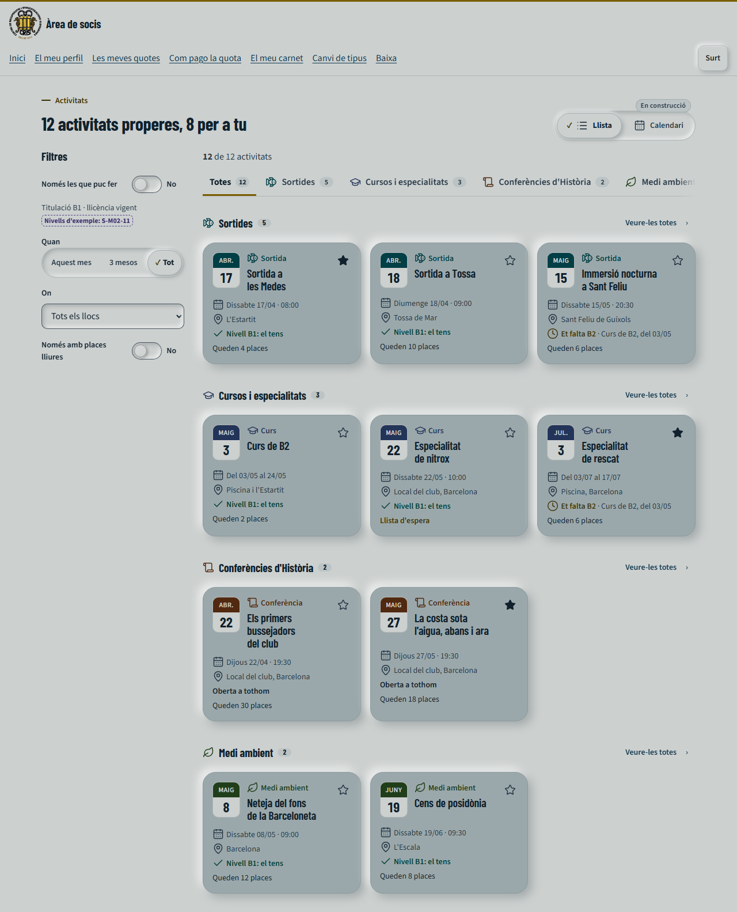

# T-DX-63 · Escriptori, PR 8: pàgina «Activitats» del soci (en construcció)

| Data i hora (Europa/Madrid) | Commit | Proves | CI |
|---|---|---|---|
| 18/11/2026 16:54 | f58790e1 | 2 noves (contrast) i 7 e2e noves; les comunes troben les dues pantalles | [A comprovar] (PR pendent) |

**En tres línies:** hi ha la pàgina «Activitats» de l'àrea del soci, en construcció: el recompte al títol, pestanyes per tipus amb Guardades, filtres («Només les que puc fer», «Quan», «On», «Només amb places lliures») i les targetes de Convite amb l'estrella de Marcador. A l'escriptori els filtres són una columna fixa a l'esquerra; al mòbil, una pantalla sencera amb «Fet». També hi ha el bloc «Activitats per a tu» per a la portada, que encara no s'hi inclou.

## Què s'ha fet
- `apps/previews/screens/activitats.py` (12 activitats d'exemple inventades; el soci d'exemple té B1 i la llicència vigent) i `templates/previews/activitats.html`.
- Peces: `_activitats_targeta.html`, `_activitats_buit.html`, `_activitats_per_a_tu.html`, `static/css/activitats.css` i `static/js/activitats.js` (propi, `defer`, sense xarxa).
- `apps/previews/screens/activitats_per_a_tu.py` i la seva plantilla: el bloc sol, per veure'l i provar-lo.
- `tokens.css`: `--c-tipus-sortida`, `--c-tipus-curs`, `--c-tipus-conferencia` i `--c-tipus-medi`, en clar i en fosc.
- Sistema de disseny 1.40, §16 «T-DX-63 Activitats». Pregunta [P-312](../decisions/pendents.md) i al tauler. Fila a [`estat/DX.md`](../estat/DX.md).

## Decisions i perquè
- **Pantalla proposada (D1):** el pla no la té; P-312 és reversible i l'opció per defecte és aquest disseny.
- **Els filtres al navegador:** el contingut és fix i petit; així es veu com funcionarà sense cap model. Quan sigui real, «per a tu» el calcularà el servidor.
- **L'estrella, desactivada:** guardar es desarà al servidor (§16: el que faria alguna cosa no es pot fer).
- **Pestanyes amb activació en enfocar** i sense el subratllat elàstic: no cal `interaccions.js`; la triada porta negreta i una ratlla.
- **Graella per contenidor (34rem i 50rem):** a 1280 px hi caben 3 targetes al costat de la columna de filtres; amb `graella-targetes` (18rem) n'hi cabrien 2.
- **El bloc «per a tu» en una pantalla pròpia:** la portada no s'edita en aquesta PR, i així les proves comunes el troben.
- **Els colors dels tipus fan 4,5:1 com a text** (no només 3:1): serveixen per al nom, la icona i la franja del mes.

## Problemes trobats
- El nom accessible de «Veure-les totes» porta un espai abans dels dos punts (el text amagat és `position: absolute`): la prova fa servir una expressió regular.

## Com se sap que funciona
- `test_tokens_color.py` (2 noves): els colors dels tipus fan ≥ 4,5:1 sobre el fons, el contenidor i el pou, en clar i en fosc.
- Proves comunes de les pantalles en construcció: les dues pantalles noves passen (títol, etiqueta, cap `style=`, només GET, 404 sense accés, a l'índex). En total, 131 passades.
- `test_activitats.py` (7 e2e):
  - les fletxes, Inici i Fi mouen `aria-selected` i el focus, i «Veure-les totes» obre la pestanya;
  - «Només les que puc fer» passa el recompte de 12 a 8, i filtrar no fa cap petició;
  - Cadaqués i «Aquest mes» donen l'estat buit, que diu quins filtres cal treure;
  - a 1280 px, la columna de filtres és a l'esquerra i `sticky`, amb 3 targetes per fila;
  - a 390 px, «Filtres» obre el panell a pantalla sencera i «Fet» el tanca i torna el focus;
  - cap desplaçament lateral a 1280, 1024, 800, 390 i 320 px, i axe sense violacions en clar i en fosc;
  - el carril «per a tu» compta «1 / 3» i «3 / 3» al mòbil.
- Captures a 1280, 1024, 800, 390 i 320 px, en clar i en fosc, mirades. S'hi ha corregit: el «Quan» que partia «Aquest mes» en dues línies a la tauleta, el «No» de l'interruptor lluny de la pista i la vora esvaïda del carril a l'escriptori quan hi caben les tres.

## Comprovació §15.5
1. **Taula B:** cap animació d'entrada; només canvien coses quan el soci actua. Àrees de 44 px (estrella, pestanyes, botons). Un sol focus al panell del mòbil (la resta és `inert`).
2. **Taula C:** vora esvaïda a les pestanyes i al carril (C2); panell amb `100dvh`; icones del joc comú; graella per contenidor (C8).
3. **Taula D:** títol concret amb el recompte (D17); cap botó primari; xifres tabulars; estat buit amb les dades de la demostració; contrast comprovat als dos temes.
4. **Tokens:** cap color, radi ni espai fora de `tokens.css`; cap `style=`.
5. **Captures:** mirades a totes les amplades, en clar i en fosc.

## Evidències
- «Activitats» a 1280 px, en clar: `captures/2026-11-18_1654_T-DX-63_activitats-1280.png`

  

  *18/11/2026 16:54 (Europa/Madrid) · local, prova e2e, contingut d'exemple · commit f58790e1*
- A 800 px, en fosc (filtres en una fila a dalt): `captures/2026-11-18_1654_T-DX-63_activitats-800-fosc.png`
- A 390 px, els filtres oberts a pantalla sencera: `captures/2026-11-18_1654_T-DX-63_filtres-390.png`

  *18/11/2026 16:54 (Europa/Madrid) · local, prova e2e · commit f58790e1*
- Sortida de proves · executada el 18/11/2026 en local (PostgreSQL 16):
  ```
  $ pytest apps/previews apps/core/tests/test_under_construction.py apps/core/tests/test_tokens_color.py apps/core/tests/test_verificacio_t_m00_07.py -q
  131 passed
  $ pytest -m e2e apps/core/tests/e2e/test_activitats.py apps/core/tests/e2e/test_previews.py -k activitats -q
  9 passed
  ```
