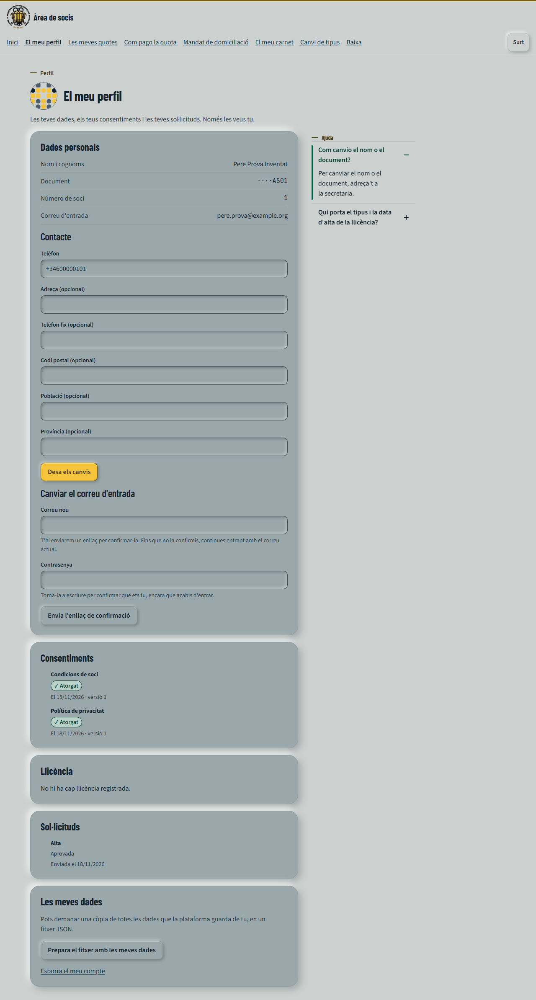

# T-DX-65 · Escriptori, PR 7a: pàgines del soci i formularis de l'administració

| Data i hora (Europa/Madrid) | Commit | Proves | CI |
|---|---|---|---|
| 18/11/2026 19:17 | 5a7988d6 | 2 e2e noves; 48 e2e, axe i 4.069 unitàries de socis i pagaments | [A comprovar] (PR #PR) |

**En tres línies:** setena PR (7a) del programa d'escriptori que el propietari va aprovar el 18/11/2026 (§3.9 i §4). El perfil, el mandat, el pagament i el rebut del soci, l'alta presencial i l'edició de les dades d'un soci porten la capçalera comuna i, a l'ordinador, el formulari a 40rem amb una columna al costat: el resum d'errors (Errata) i l'ajuda plegada. El pagament porta els passos de Tramite al costat i el rebut, les accions. El mòbil manté l'ordre.

## Què s'ha fet
- `static/css/disposicio.css`: `lateral-formulari` (amb `amb-columna-lateral`): columna principal (`columna-principal`) de 40rem com a màxim i la lateral just al costat; Errata a dalt de la columna lateral i l'ajuda a sota (fila 2 flexible); els blocs de la columna principal, amb el mateix espai que els fills del cos.
- `static/css/errata.css`: Errata d'una sola columna quan és a la columna lateral, com al mòbil.
- `static/css/tramite.css`: a partir de 56rem del cos, els passos en vertical al costat del pagament (`pagament-amb-passos`), sense tocar `_status.html`, que HTMX torna a demanar sencer.
- `static/css/ranura.css`: el rebut no passa de l'amplada de la ranura (`--amplada-text`) i les accions van al costat (`rebut-disposicio`, `rebut-document`, `rebut-costat`).
- Plantilles:
  - `personal_profile.html`: capçalera comuna; ajuda plegada amb «Com canvio el nom o el document?» i, amb soci, la de la llicència (textos que ja hi eren); un sol botó principal (el de la data de naixement, quan falta; si no, «Desa els canvis», D19).
  - `mandate.html`: capçalera comuna; Errata fora del formulari, abans de la columna principal.
  - `charge.html` i `receipt.html`: capçalera comuna; al rebut, «Desa com a PDF» és el botó principal.
  - `join_in_person.html`: capçalera comuna; Errata a la columna lateral (`_join_form.html` el deixa de posar amb `errata_outside`; la web pública, igual que abans).
  - `member_edit.html`: capçalera comuna; ajuda plegada «Què queda registrat?» amb la frase que hi havia.
- Sistema de disseny 1.32 (§5.3, §6.10, §6.13 i §6.14). Fila a [`estat/DX.md`](../estat/DX.md).

## Decisions i perquè
- **Errata primer al DOM i a la dreta a l'escriptori:** el propietari el volia a la columna lateral, però el focus i el lector de pantalla l'han de trobar primer. Es col·loca amb la graella, sense canviar l'ordre del DOM ni `errata.js`.
- **Ajuda només amb textos que ja hi eren**, i la primera pregunta oberta: es llegeix sense tocar res (la prova de l'edició ja demanava veure «El número de soci no es pot corregir»).
- **L'alta presencial, sense ajuda:** l'única ajuda possible era explicar el possible duplicat, i sense P3a la resposta ha de ser neutra. Ho va trobar `test_join.py::TestP2`.
- **El mandat, sense ajuda:** no té cap text d'ajuda de pàgina; el de l'IBAN és del camp i es queda al camp.
- **Tramite només amb CSS:** treure els passos de `_status.html` hauria trencat l'actualització amb HTMX.

## Problemes trobats
- **Espai perdut dins de la columna:** els blocs del perfil ja no eren fills directes del cos i perdien la graella; «Esborra el meu compte» quedava enganxat al botó. **Com s'ha vist:** axe `target-size` a `test_accessibilitat_028.py`. **Arreglo:** la mateixa regla sense pes a `.columna-principal`.
- **Errata massa estret** a 248 px amb el segell al costat: una paraula per línia. **Arreglo:** una sola columna, com al mòbil.
- **Passos estirats** quan el pagament és alt: `align-self: start`.
- **Ranura més estreta que el paper** a l'escriptori: el rebut ara fa l'amplada de la ranura.

## Com se sap que funciona
- `test_disposicio.py` (2 noves): a 1280 px, el formulari fa com a màxim 40rem i la columna lateral és al costat i a la mateixa alçada; a 390 px, una columna (Errata a sobre, l'ajuda a sota); a 320 px, res de costat. Errata amb el focus i abans del formulari al DOM. Els passos al costat del pagament a 1280 i a sobre a 390.
- e2e de les pàgines tocades (mandat, rebut, pagaments amb targeta, Bizum, transferència i convidat, edició, data de naixement, RGPD, Monograma, Errata, fer-se soci, altes, polítiques, exempció, fitxa) i axe (028, 05b i mandat) en clar i en fosc: passen; sense infraccions noves.
- Unitàries de `apps/members` i `apps/payments`: 4.069 passen.
- Comprovació de §15.5:
  - **B:** cap moviment nou; la ratlla de Recoveco en obrir una pregunta ja hi era.
  - **C:** container queries (C8); vores amb transparència.
  - **D:** un sol botó principal; títols concrets; imports tabulars; espai i no caixes (D15); cap animació d'entrada (D20).
  - **Tokens:** cap valor fora de `tokens.css`, cap `style=`.
  - **Captures** a 1280, 1024, 390 i 320 px, en clar i en fosc, mirades.

## Evidències
- El perfil a 1280 px, a 40rem amb l'ajuda al costat: `captures/2026-11-18_1841_T-DX-65_perfil-1280.png`

  

  *18/11/2026 18:41 (Europa/Madrid) · local, prova e2e, dades inventades · commit 5a7988d6*
- El mandat amb errors, tema fosc: Errata al costat: `captures/2026-11-18_1841_T-DX-65_mandat-errors-1280-fosc.png`
- El pagament en curs amb els passos al costat: `captures/2026-11-18_1841_T-DX-65_pagament-1280.png`

  *18/11/2026 18:41 (Europa/Madrid) · local, prova e2e, dades inventades · commit 5a7988d6*
