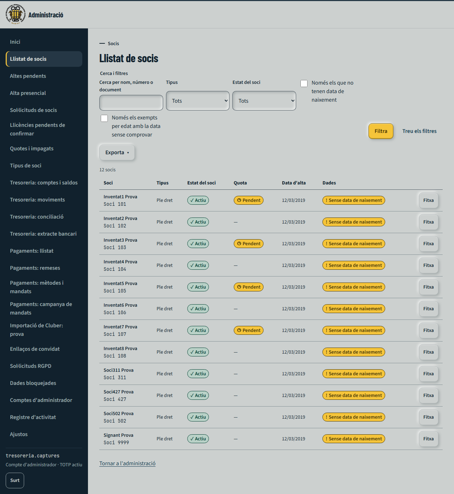

# T-DX-66 · Escriptori, PR 7b: llistats de l'administració

| Data i hora (Europa/Madrid) | Commit | Proves | CI |
|---|---|---|---|
| 18/11/2026 19:08 | 9584e172 | 1 e2e nova; 45 e2e dels llistats i axe; 7324 unitàries | [A comprovar] |

**En tres línies:** és la PR 7b del programa de l'escriptori que el propietari va aprovar el 18/11/2026. Els llistats de l'administració tenen una capçalera comuna, els filtres en una fila amb els botons al costat i la fila sencera clicable quan porta a una fitxa. Només plantilles i CSS: cap vista, cap dada ni cap enllaç nou. El mòbil queda com abans.

## Què s'ha fet
- 16 plantilles amb `capcalera-pagina`: socis, altes pendents, sol·licituds, llicències per confirmar, quotes i impagats, remeses i el detall d'una remesa, retornats, mètodes i mandats, comptes i moviments de tresoreria, registre d'activitat, comptes d'administrador, dades bloquejades, sol·licituds RGPD i enllaços de convidat.
- Peça nova `barra-filtres` (`disposicio.css`, §5.3):
  - el formulari de filtres fa tota l'amplada del cos;
  - els camps van en una fila que es parteix si no hi caben, i els botons al final;
  - al mòbil, apilats com abans.
- Fila sencera clicable (B14) amb `enllac-fila`, posat a l'enllaç que ja portava a la fitxa: socis, sol·licituds, remeses, RGPD i dades bloquejades.
- Comptadors de Deposito (§6.17) a retornats i a llicències per confirmar, amb la llista que la vista ja dona.
- Retornats:
  - un sol botó principal (D19);
  - els dos formularis l'un al costat de l'altre a l'escriptori.
- Imports de les quotes per revisar i dels enllaços de convidat amb `.import` a la dreta (D7).
- Sistema de disseny 1.33 (§5.3). Fila a [`estat/DX.md`](../estat/DX.md).

## Decisions i perquè
- **Fila clicable només on ja hi havia un sol enllaç a la fitxa.** No s'ha posat on la fila té una altra acció (la casella de les llicències, els formularis de quotes, retornats i convidats, i els dos enllaços dels comptes d'administrador): la capa taparia l'altra acció. El mateix motiu exclou mandats i moviments, on l'enllaç de la fila és una acció i no una fitxa.
- **Cap columna amagada a la tauleta.** Les columnes per rol les continua decidint el servidor (`vis.fees`, `vis.full`, `vis.birth_date`, `full`, `show_ip`).
- **Sense `overflow-x: auto` al voltant de les taules.** Un contenidor amb desplaçament de costat trencaria la capçalera fixa. Cap llistat no desborda a 1024 ni a 1280: el registre d'activitat parteix els valors llargs, com abans.
- **Comptadors només on la vista ja dona la llista.** A quotes, mandats i moviments no s'ha afegit cap comptador: caldria una consulta nova.

## Problemes trobats
- **La fila no s'obria en fer clic a una altra cel·la.** Al llistat de socis, l'enllaç és un `boto`, i els botons tenen `position: relative`: la capa de l'enllaç quedava dins del botó. A més, l'encongiment de `:active` (`transform`) la tornava a tancar dins del botó a mig clic.
  - **Com s'ha vist:** la prova nova fallava (la pàgina no canviava d'adreça).
  - **Arreglo:** dins de les taules, `enllac-fila` passa a `position: static` i sense transform a `:active`.
- **Secció sense espai dins de `graella-2`.** A retornats, el títol «Registra un retorn» quedava enganxat al primer camp: la secció ja no era fill directe del cos i perdia el `gap`.
  - **Com s'ha vist:** a la captura de 1280 px en fosc.
  - **Arreglo:** `.graella-2 > :where(section)` guarda el mateix espai.

## Com se sap que funciona
- e2e:
  - `test_disposicio.py`, prova nova: a 1280 px, socis, quotes i moviments fan més de 1000 px. A més:
    - els filtres van en una fila amb els botons al costat;
    - la capçalera de la taula és fixa (`sticky`);
    - un clic a la cel·la del tipus porta a la fitxa;
    - a 390 px la taula és apilada i a 320 px no desborda.
  - Altes, dades bloquejades, enllaços de convidat, mandats, quotes, remeses, retornats, RGPD, tresoreria, fumada, Solapas, Vigencia i l'axe del 01, de la tresoreria i del mandat: 44 passen.
  - `test_accessibilitat_05b.py` (pantalles del soci i del convidat, que aquesta tasca no toca): falla en obrir `/entrar/`, una vegada per un error de memòria compartida de PostgreSQL i una altra per temps esgotat, amb la màquina compartida carregada [A comprovar al CI].
- Unitàries de `members`, `payments`, `treasury`, `core` i `accounts`: 7324 passen. Ruff net.
- Comprovació de §15.5:
  - **B:** cap moviment nou. La fila sencera continua amb l'enllaç com a element enfocable.
  - **C:** container queries (C8).
  - **D:**
    - un sol botó principal a retornats (D19);
    - xifres tabulars als imports (D7);
    - blocs separats amb espai (D15);
    - cap animació d'entrada (D20).
  - **Tokens:** cap color ni espai nou fora de `tokens.css`; cap `style=`.
  - **Captures:** a 1280, 1024 i 390 px, en clar i en fosc, de socis, quotes, remeses, retornats, registre, moviments i mandats; mirades.

## Evidències
- Llistat de socis a 1280 px, amb els filtres en una fila: `captures/2026-11-18_1846_T-DX-66_socis-1280.png`

  

  *18/11/2026 18:46 (Europa/Madrid) · local, prova e2e, dades inventades · commit 9584e172*
- Retornats a 1280 px en fosc, amb el comptador i els dos formularis al costat: `captures/2026-11-18_1846_T-DX-66_retornats-1280-fosc.png`
- El llistat de socis a 390 px en fosc, apilat com abans: `captures/2026-11-18_1846_T-DX-66_socis-390-fosc.png`

  *18/11/2026 18:46 (Europa/Madrid) · local, prova e2e, dades inventades · commit 9584e172*
