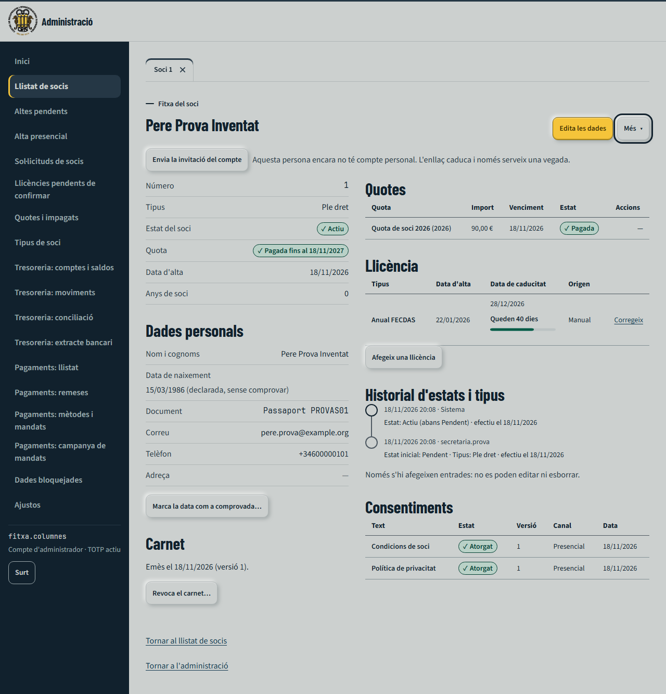

# T-DX-67 · Escriptori, PR 9a: fitxa del soci en dues columnes

| Data i hora (Europa/Madrid) | Commit | Proves | CI |
|---|---|---|---|
| 18/11/2026 20:10 | 8b2f1193 | 1 e2e nova; 28 e2e de la fitxa, disposició i axe; 2566 unitàries de socis | [A comprovar] |

**En tres línies:** és la PR 9a del programa de l'escriptori que el propietari va aprovar el 18/11/2026 (secció 3.8, «Fitxa del soci»). A l'ordinador, la fitxa del soci de l'administració té dues columnes: el resum, les dades personals i el carnet a l'esquerra, i les quotes, la llicència, l'historial i els consentiments a la dreta. Un sol botó principal, «Edita les dades»; les accions rares, dins de «Més». Només plantilles i CSS.

## Què s'ha fet
- `templates/members/member_detail.html`:
  - capçalera comuna (`capcalera-pagina`) amb l'etiqueta, el nom i les accions;
  - `graella-2 graella-5-7 fitxa-soci`: resum, dades personals i carnet (`fitxa-carnet`) i, a `fitxa-taules`, quotes, llicència, historial d'estats, correccions de la data d'alta i consentiments;
  - la invitació del compte, a sota de la capçalera (abans era a la inclusió dels enllaços).
- `templates/members/_member_edit_links.html`: «Edita les dades» és `boto-principal`; corregir la data d'alta, crear una baixa i restablir el doble factor van dins de «Més» (el `
` del llistat de socis, amb `menu-exporta.js`). Les condicions, les adreces i els formularis són els mateixos.
- `static/css/disposicio.css`:
  - `fitxa-soci`: a la tauleta (34rem) el resum i les dades al costat i la resta a tota l'amplada; a l'escriptori (56rem) 5/12 i 7/12, cada columna amb la seva alçada;
  - «Més» a la capçalera: la llista es col·loca respecte a la fila d'accions i, amb les accions a la dreta, s'obre cap a l'esquerra;
  - `historial-estats`: la línia de passos de Tramite en vertical, neutra i només de lectura.
- Sistema de disseny 1.35 (§5.2, §5.3 i §6.13). Fila a [`estat/DX.md`](../estat/DX.md).

## Decisions i perquè
- **Ordre al mòbil:** l'ordre del document és el de l'esquerra i després el de la dreta (§5.3: el mateix ordre a totes les mides). Les quotes passen de la segona posició a la quarta, després de les dades i el carnet. [A validar pel propietari si volia exactament l'ordre d'abans.]
- **Les dues columnes amb alçada pròpia:** la columna de les taules ocupa totes les files de la graella i una última fila `1fr` s'endú el que sobra; sense, el resum, les dades i el carnet se separaven.
- **Historial neutre:** la línia de Tramite és verda per als passos fets d'un pagament. Un estat antic no és cap pas fet (pot ser una baixa o un impagat): marca buida, línia `--c-linia-forta` i, l'estat d'ara, la marca en el color del text.
- **«Més» reutilitza `menu-exporta`:** ja tenia el `
` sense JavaScript i l'Esc, el clic fora i la sortida del focus. Cap peça nova.
- **La invitació queda fora de «Més»:** és un avís d'estat amb el seu text («encara no té compte personal»), no una acció rara.

## Problemes trobats
- **«Més» desbordava 12 px a 320 px:** la llista, de 12rem, s'obria des del botó «Més», que és a la dreta d'«Edita les dades».
  - **Com s'ha vist:** la revisió a 320 px de `test_point_5_create_a_leave_is_a_text_button`, amb «Més» obert, va fallar (`12 <= 0`).
  - **Arreglo:** la llista es col·loca respecte a la fila d'accions (`position: static` al `details`).
- **Proves que obrien enllaços amagats:** «Corregeix la data d'alta», «Crea una baixa» i el restabliment del doble factor ara són dins d'un `
` tancat. Les tres e2e obren «Més» abans (una, amb el teclat).

## Com se sap que funciona
- e2e: 28 passen (altes, carnet, edició, exempció, fitxa 081, flux fer-se soci, Solapas, Vigencia, revisió 045, disposició i axe de les pantalles de l'administració, sense infraccions noves).
- `test_member_record_in_two_columns` (nova):
  - a 1280 px, l'esquerra més estreta que la dreta i les dues a dalt;
  - a 800 px, el resum i les dades al costat i les taules a tota l'amplada;
  - a 390 px, una columna; a 320 px, res de costat;
  - un sol botó principal; «Més» s'obre amb Enter, conté «Corregeix la data d'alta» i «Crea una baixa», no desborda i Esc el tanca i torna el focus.
- Unitàries de socis: 2566 passen (una adaptada al botó principal). Tokens i recorreguts dels wireframes: 17 passen. Ruff net.
- Comprovació de §15.5:
  - **B:** cap moviment nou; «Més» amb el teclat i Esc (B15, B20); àrees dels botons de sempre.
  - **C:** container queries (C8); vores amb transparència de sempre.
  - **D:** un sol botó principal (D19); s'agrupa amb espai, no amb caixes (D15); cap insígnia nova.
  - **Tokens:** només `var(--…)` a `disposicio.css`; cap `style=`. Cap token nou.
  - **Captures** a 1280, 1024, 800 i 390 px, en clar i en fosc, mirades.

## Evidències
- La fitxa a 1280 px, en dues columnes: `captures/2026-11-18_2010_T-DX-67_fitxa-1280-light.png`

  

  *18/11/2026 20:10 (Europa/Madrid) · local, prova e2e, dades inventades · commit 8b2f1193*
- La fitxa a 800 px en fosc, amb el resum i les dades al costat: `captures/2026-11-18_2010_T-DX-67_fitxa-800-dark.png`
- La fitxa a 390 px, en una columna: `captures/2026-11-18_2010_T-DX-67_fitxa-390-light.png`

  *18/11/2026 20:10 (Europa/Madrid) · local, prova e2e, dades inventades · commit 8b2f1193*
