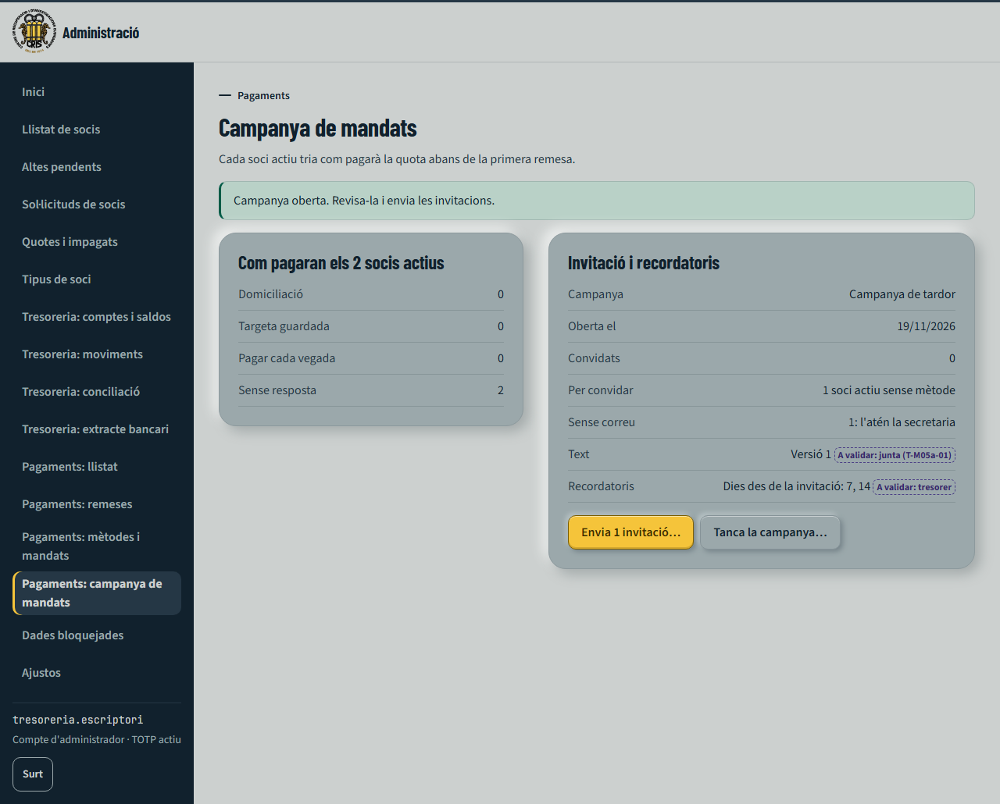

# T-DX-69 · Escriptori, PR 7c: pagaments i tresoreria

| Data i hora (Europa/Madrid) | Commit | Proves | CI |
|---|---|---|---|
| 19/11/2026 03:10 | d2c4d516 | 2 e2e noves; 35 e2e de disposició, tresoreria, pagaments i axe; 2190 unitàries | [A comprovar] (PR #259) |

**En tres línies:** és la PR 7c del programa de l'escriptori que el propietari va aprovar el 18/11/2026. Les pantalles de pagaments i de tresoreria tenen la capçalera comuna; tancar un intent o una liquidació «a revisar» i revocar un mandat porten la fitxa i el formulari a 40rem amb el resum d'errors al costat, com el mandat del soci, i la campanya de mandats va en dues columnes. Només plantilles: cap vista, cap dada, cap enllaç ni cap CSS nou. El mòbil queda com abans.

## Què s'ha fet
- 12 plantilles amb `capcalera-pagina` (etiqueta, títol i la frase que ja hi havia):
  - pagaments: llistat i «a revisar», tancar un intent, campanya de mandats i revocar un mandat;
  - tresoreria: «A revisar», liquidacions, tancar una liquidació, confirmar una liquidació, arqueig, pagament a mà, anul·lació i traspàs.
- Llistat de pagaments: els filtres amb `barra-filtres` (T-DX-66), en una fila amb els botons al costat.
- Tancar un intent, tancar una liquidació i revocar un mandat: `lateral-formulari` (T-DX-65). La fitxa i el formulari a la columna principal (40rem) i el resum d'Errata al costat, primer al DOM i amb el focus. Abans, Errata era dins del formulari.
- Campanya de mandats: `graella-2 graella-5-7`, el recompte a l'esquerra i la invitació a la dreta; al mòbil, l'un a sota de l'altre, en el mateix ordre.
- Pagament a mà: l'import amb `.import` (xifres tabulars, D7), com a la resta de pantalles.
- Sistema de disseny 1.41 (§5.3). Fila a [`estat/DX.md`](../estat/DX.md).

## Decisions i perquè
- **Cap fila clicable.** A pagaments, «A revisar» i liquidacions, l'enllaç de la fila és una acció («Tanca», «Casa a mà…», «Confirma…»), no una fitxa: la regla de la T-DX-66 l'exclou.
- **El text que explica què passa en confirmar no es plega.** A tancar i a revocar, el paràgraf diu què mou i què no mou diners. És la informació per decidir, no una ajuda: es queda al formulari, visible.
- **Traspàs, arqueig, anul·lació, pagament a mà i confirmació d'una liquidació: només la capçalera.** El formulari ja fa 40rem i no tenen ni Errata ni ajuda per posar al costat. Els errors hi surten com a avís dins del formulari; passar-los a Errata canviaria el comportament (el focus), i això no és disposició.
- **La confirmació d'una liquidació no va en dues columnes.** La taula del repartiment de comissions no cabria a la meitat del cos de la tauleta sense desbordar.
- **Seguretat i privacitat:** els permisos, els noms del pagador (P4), la nota d'un tancament i l'IBAN emmascarat els continua decidint el servidor. Els formularis, el CSRF i els POST són els mateixos. Res del que s'amaga és un control.

## Problemes trobats
- **A la campanya no hi havia cap botó principal.** La prova nova n'esperava un i en trobava zero.
  - **Com s'ha vist:** la prova fallava.
  - **Causa:** cap soci de les dades de prova tenia correu, i sense ningú per convidar «Envia…» no surt. No era un error de la pantalla.
  - **Arreglo:** la prova afegeix un soci inventat amb correu.

## Com se sap que funciona
- e2e:
  - `test_disposicio.py`, dues proves noves:
    - pagaments: el llistat fa més de 1000 px a 1280, amb els filtres en una fila; tancar un intent i revocar un mandat, amb Errata enfocat, la columna principal a 40rem i Errata al costat a la mateixa alçada (a 390, a sobre); la campanya, amb la columna esquerra més estreta que la dreta a 1280 i l'una a sota de l'altra a 390;
    - tresoreria: «A revisar» i liquidacions a més de 1000 px i sense cap botó principal; tancar una liquidació amb Errata al costat; la confirmació, el traspàs, l'arqueig, el pagament a mà i l'anul·lació amb la capçalera, el formulari a 40rem com a màxim i un sol botó principal;
    - a totes, captures a 1280, 1024, 390 i 320 px en clar i en fosc, i cap desbordament a 320.
  - Disposició, tresoreria (també entrades i exclusions), pagaments, campanya, remeses, retornats i l'axe de la tresoreria, del 05b i del mandat: 35 passen, sense cap infracció nova d'axe.
- Unitàries: `payments`, `treasury` i la navegació de l'administració, 2190 passen. Ruff net.
- Comprovació de §15.5:
  - **B:** cap moviment nou; el focus va a Errata com abans.
  - **C:** container queries (C8), amb les peces que ja hi havia.
  - **D:**
    - un sol botó principal per pantalla (D19);
    - xifres tabulars als imports (D7), també al pagament a mà;
    - blocs separats amb espai (D15);
    - cap animació d'entrada (D20).
  - **Tokens:** cap CSS nou, cap color ni espai fora de `tokens.css`; cap `style=`.
  - **Ordre:** el DOM és l'ordre de lectura (WCAG 1.3.2 i 2.4.3). Errata va primer, la fitxa després i el formulari al final; a la campanya, el recompte i després la invitació.
  - **Captures:** a 1280, 1024, 390 i 320 px, en clar i en fosc, de les 12 pantalles; mirades.

## Evidències
- La campanya de mandats a 1280 px, amb el recompte i la invitació l'un al costat de l'altre: `captures/2026-11-19_0257_T-DX-69_campanya-1280.png`

  

  *19/11/2026 02:57 (Europa/Madrid) · local, prova e2e, dades inventades · commit d2c4d516*
- Tancar un pagament a revisar a 1280 px en fosc, amb Errata al costat: `captures/2026-11-19_0256_T-DX-69_tancar-a-revisar-1280-fosc.png`
- El pagament a mà a 320 px en fosc, en una columna com abans: `captures/2026-11-19_0255_T-DX-69_pagament-a-ma-320-fosc.png`

  *19/11/2026 02:55-02:56 (Europa/Madrid) · local, prova e2e, dades inventades · commit d2c4d516*
