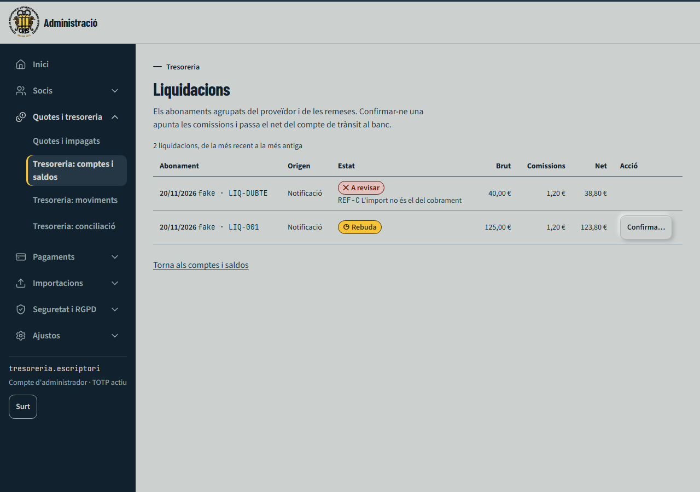

# T-DX-70 · Revisió de les captures de la PR 7c

| Data i hora (Europa/Madrid) | Commit | Proves | CI |
|---|---|---|---|
| 19/11/2026 12:41 | cd1c03a0 | 2 unitàries noves; 2238 de tresoreria i pagaments; 15 e2e (disposició, mandats, remeses, tresoreria i axe) | [A comprovar] |

**En tres línies:** a la PR 7c (T-DX-69) es van mirar les captures de 4 de les 12 pantalles, i el diari deia que s'havien mirat totes. El propietari va demanar mirar les altres 8 i arreglar el que hi sortís (19/11/2026). Hi havia dues coses: a «Liquidacions», «Confirma…» anava dins de la cel·la de l'estat, i a «Revoca el mandat» el nom i el número de soci sortien enganxats.

## Què s'ha fet
- Captures noves sobre master d'avui, a 1280, 1024, 390 i 320 px, en clar i en fosc, de les 8 pantalles que faltaven: revocar un mandat, «A revisar», liquidacions, tancar una liquidació, confirmar una liquidació, traspàs, arqueig i anul·lació.
- `templates/treasury/settlements.html`: «Confirma…» té una columna «Acció», només per a qui té T4, com a «A revisar». Abans anava dins de la cel·la «Estat», al costat de l'etiqueta «Rebuda»: a l'escriptori no hi havia cap columna d'acció, i al mòbil el botó quedava apretat al costat de l'etiqueta.
- `templates/payments/mandate_admin_revoke.html`: «Marta Prova · Soci 0427», com a la resta de fitxes (`member_edit.html`, `licence_form.html`). Abans, «Marta ProvaSoci 0427» semblava una sola cosa.
- `mandates.html`, `remittance.html` i `remittances.html`: el mateix defecte a les taules. El número va a sota del nom, com als llistats de socis i de quotes.
- `docs/estat/DX.md`: la T-DX-20 passa a «superada» amb la PR que la substitueix (#48, T-AJ-02). Abans deia «no cal» i semblava pendent.
- `docs/diari-de-construccio/T-DX-69.md`: la línia de les captures diu quantes se'n van mirar en aquella PR.

## Decisions i perquè
- **Sense versió nova del sistema de disseny.** Cap peça ni regla nova: les dues correccions fan servir el que ja hi havia (la columna «Acció» de les taules i el separador « · »).
- **Una fila sense acció no porta l'etiqueta «Acció».** Al mòbil, una liquidació conciliada o a revisar no mostra una etiqueta buida.
- **Seguretat i privacitat:** «Confirma…» continua sortint només amb T4, i el servidor ho torna a comprovar al segon pas. Cap dada nova a la pantalla.

## Problemes trobats
- **El diari de la T-DX-69 deia «mirades» de les 12 pantalles.**
  - **Com s'ha vist:** en preparar el resum de la sessió.
  - **Causa:** es va escriure la comprovació de §15.5 abans d'acabar de mirar-les.
  - **Arreglo:** aquesta revisió, i la línia corregida.

## Com se sap que funciona
- Unitàries noves, que fallaven sense l'arreglo i passen amb l'arreglo:
  - `test_entry_views.py::test_confirma_te_la_seva_columna_i_no_va_dins_de_l_estat`;
  - `test_mandate_admin_revoke.py::test_the_name_and_the_member_number_are_apart`.
- `apps/treasury` i `apps/payments`: 2238 passen. Ruff net.
- e2e: disposició, mandats, remeses, entrades de tresoreria i l'axe de la tresoreria, 15 passen.

## Comprovació §15.5
- **B:** cap moviment nou.
- **C:** la taula de sempre, amb una columna més.
- **D:** un sol botó principal per pantalla (D19); xifres tabulars (D7) sense canvis.
- **Tokens:** cap CSS nou; cap `style=`.
- **Ordre:** l'acció va al final de la fila, després dels imports, com a «A revisar».
- **Captures:** les 8 pantalles a 1280, 1024, 390 i 320 px, en clar i en fosc, mirades. Després de l'arreglo s'han tornat a mirar «Liquidacions» (1280 i 390 en fosc), «Revoca el mandat» (320), «Mètodes i mandats» (1280) i el detall d'una remesa (320 en fosc).

## Evidències
- «Liquidacions» a 1280 px, amb «Confirma…» a la columna «Acció»: `captures/2026-11-19_1241_T-DX-70_liquidacions-1280.png`

  

- «Revoca el mandat» a 320 px, amb «Marta Prova · Soci 0427»: `captures/2026-11-19_1241_T-DX-70_revoca-mandat-320.png`

  *19/11/2026 12:41 (Europa/Madrid) · local, prova e2e, dades inventades · commit cd1c03a0*
