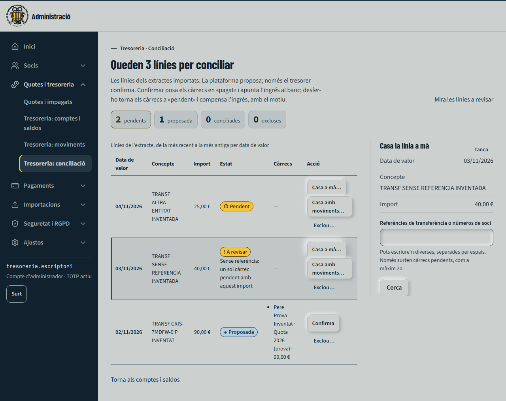

# T-DX-72 · Escriptori, PR 9b: conciliació amb panell lateral

| Data i hora (Europa/Madrid) | Commit | Proves | CI |
|---|---|---|---|
| 19/11/2026 12:58 | d339f424 | 10 unitàries noves; 1 e2e nova; 23 e2e de disposició, tresoreria i axe; 4707 unitàries (tresoreria, core, pagaments i pàgines de comptes) | [A comprovar] (PR #PR) |

**En tres línies:** és la PR 9b del programa de l'escriptori que el propietari va aprovar el 18/11/2026. La conciliació diu a dalt quantes línies queden i, a l'escriptori, «Casa a mà», «Casa amb moviments» i «Revisa i confirma» s'obren en un panell al costat de la taula, sense sortir de la pàgina; J i K passen de línia i Esc el tanca. Al mòbil, a la tauleta i sense JavaScript, tot va com abans.

## Què s'ha fet
- Títol amb el que queda: «Queden N línies per conciliar» (pendents i proposades; D13). A sota, els comptadors de Deposito: pendents (en ambre), proposades, conciliades i excloses, d'una sola consulta sobre les mateixes línies.
- Escriptori (cos de 56rem o més): la taula a 8/12 i el panell de la línia triada a 4/12, fix en baixar (peça `conciliacio` a `disposicio.css`).
- Els enllaços de la fila carreguen la mateixa vista amb HTMX i en reben només el títol i el cos (`treasury/_panell.html`, `_page` a `views.py`). Mentre carrega, l'esquelet; quan arriba, el focus va al títol.
- Dins del panell, la cerca i la revisió s'hi queden; la confirmació és el POST de sempre i torna a la conciliació sencera amb el missatge.
- Esc o «Tanca» el tanquen i el focus torna a l'enllaç. J i K passen de línia (`conciliacio.js`).
- `esquelet` passa al CSS (`comptes.css`): ja era al sistema de disseny (§15.4).
- A les línies «a revisar», la píndola diu «! A revisar» i el motiu va al costat, en text.
- Sistema de disseny 1.42 (§5.3, §6.22 i §15.4). Fila a [`estat/DX.md`](../estat/DX.md).

## Decisions i perquè
- **El panell el decideix el CSS, no el JavaScript.** El guió només l'obre si el panell es veu. A 1024 px el cos, al costat de la barra lateral, fa uns 45rem: la taula a 8/12 no hi cabria, i es comporta com la tauleta.
- **Totes les accions que són un enllaç s'obren al panell**, també «Casa amb moviments» (T-M04-12f), que va arribar després del programa: que unes s'obrissin al costat i altres no seria confús.
- **El panell té text quan no hi ha cap línia triada**, amb la pista de J, K i Esc. Així la taula no canvia d'amplada cada vegada que s'obre o es tanca.
- **Un pas que acaba a la conciliació respon amb `HX-Redirect`**, perquè la pàgina sencera no quedi dins del panell (per exemple, si una liquidació ja no és proposada).
- **J i K, només sense modificadors i fora dels camps**, i només amb el panell a la vista. Amb el panell obert, hi carreguen la línia nova si té enllaç; si no, el tanquen.
- **Seguretat i privacitat:** cap IBAN ni número de compte. Les vistes, el permís T4, el CSRF i les comprovacions d'estat són les mateixes; sense T4 no hi ha ni panell ni enllaços. El panell no és cap control.

## Problemes trobats
- **L'atribut `data-tanca` ja era de Solapas.**
  - **Com s'ha vist:** una prova unitària el trobava a la pàgina sencera.
  - **Causa:** la barra de pestanyes de l'administració fa servir el mateix nom per a un altre text.
  - **Arreglo:** `data-panell-tanca`.
- **HTMX escrivia l'error a la consola** quan la vista responia «no trobat» al panell, i la prova del navegador ho comptava com un problema.
  - **Arreglo:** el guió marca la resposta com a tractada a `htmx:beforeSwap` i mostra el seu error al panell.
- **El motiu «a revisar» dins de la píndola en feia un oval** a la columna estreta. Ara va fora, en text.

## Com se sap que funciona
- Unitàries, `apps/treasury/tests/test_reconciliation_panel.py` (10): el títol i els comptadors; sense línies, cap panell; el panell i els enllaços només amb T4; el fragment amb `HX-Request` i la pàgina sencera sense; la cerca i la revisió amb `hx-get` i `hx-post` i la confirmació sense; sense T4, «no trobat», i sense CSRF, 403; la línia que no es pot casar; la revisió que falla torna al panell amb el motiu; moviments i liquidació al panell; un pas que acaba a la conciliació, `HX-Redirect`.
- e2e, `test_disposicio.py::test_reconciliation_with_the_panel_of_the_chosen_line`:
  - a 1280 el panell s'obre al costat (taula i panell en proporció 2 a 1) amb el focus al títol i sense canviar d'adreça;
  - Esc i «Tanca» el tanquen i el focus torna a l'enllaç;
  - J i K mouen la línia triada, també amb el panell obert;
  - cerca, revisió i confirmació des del panell;
  - sense permís, l'error al panell;
  - a 390, la pàgina a part;
  - amb la sessió caducada, l'entrada;
  - captures a 1280, 1024, 390 i 320 en clar i en fosc, i cap desbordament a 320.
- L'axe de la tresoreria (`test_accessibilitat_tresoreria.py`) audita també el panell obert a 1280, i la pàgina a part a 1280 i 390: cap infracció.
- Les e2e de la tresoreria que casen des de la conciliació a 1280 ara passen pel panell, i passen.
- Ruff net.
- Comprovació de §15.5:
  - **B:** cap animació nova; Esc tanca (B19, Jakob); un sol focus; l'esquelet surt de seguida.
  - **C:** container query (C8); vora fina amb el token de línia; el panell es desplaça sol si és més alt que la pantalla (`dvh`).
  - **D:**
    - un sol botó principal (D19): la pàgina no en té i el panell en porta un quan toca;
    - títol concret (D17);
    - xifres tabulars als comptadors (D16);
    - esquelet al que carrega (D18).
  - **Tokens:** cap color, espai ni radi fora de `tokens.css`; cap `style=`; el JavaScript, en un fitxer propi.
  - **Ordre:** el DOM és l'ordre de lectura: capçalera, comptadors, taula i panell («Tanca» abans del títol, a la dreta).
  - **Captures:** a 1280, 1024, 390 i 320 px, en clar i en fosc, de la conciliació, el panell, la confirmació, l'error i la pàgina a part; mirades.

## Evidències
- El panell obert a 1280 px, al costat de la taula: `captures/2026-11-19_1249_T-DX-72_panell-1280.png`

  

  *19/11/2026 12:49 (Europa/Madrid) · local, prova e2e, dades inventades · commit d339f424*
- La confirmació al panell a 1280 px en fosc: `captures/2026-11-19_1249_T-DX-72_panell-confirma-1280-fosc.png`
- La conciliació a 390 px en fosc, sense panell, com abans: `captures/2026-11-19_1249_T-DX-72_conciliacio-390-fosc.png`

  *19/11/2026 12:49 (Europa/Madrid) · local, prova e2e, dades inventades · commit d339f424*
