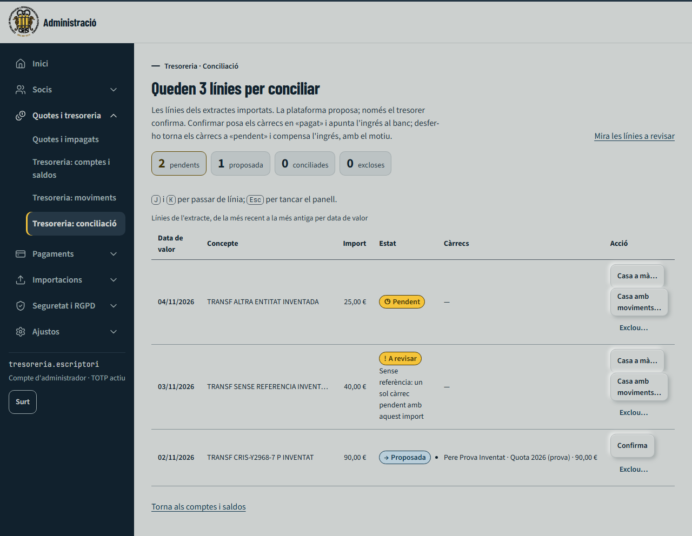

# T-DX-73 · Conciliació a 1280 px: el concepte i els càrrecs en una línia, i el focus després de cercar

| Data i hora (Europa/Madrid) | Commit | Proves | CI |
|---|---|---|---|
| 19/11/2026 14:49 | 2aaf39b4 | e2e de la conciliació ampliada; 23 e2e de disposició i tresoreria; 619 unitàries de tresoreria i tokens | [A comprovar] |

**En tres línies:** a la PR 9b (T-DX-72), a 1280 px la taula de la conciliació anava justa: el concepte i els càrrecs ocupaven diverses línies. A més, no hi havia cap prova que, després de cercar dins del panell, el focus quedés on toca. El propietari va demanar arreglar totes dues coses en una PR risc:baix i tancar la P-316 i la P-317 amb l'opció A (19/11/2026).

## Què s'ha fet
- **Sense cap línia oberta**, la taula fa tota l'amplada. Abans, el panell ocupava 4/12 encara que no hi hagués cap línia oberta i només deia «Cap línia triada». La pista de J i K passa a sobre de la taula.
- **Amb una línia oberta**, la taula a 8/12 i el panell a 4/12, com abans, però sense la columna «Càrrecs».
  - Les línies que s'obren al panell no tenen càrrecs o en tenen la liquidació, i el panell ja la mostra.
  - Les altres files els tornen a mostrar quan es tanca el panell.
- **El concepte, en una línia:** s'endú l'amplada que sobra i, si no hi cap, acaba amb «…». El concepte sencer és al panell en obrir la línia, al mòbil i a la tauleta.
- **Cada càrrec, sencer en una línia:** és el que es confirma, i no es retalla.
- **El focus després d'un pas dins del panell:**
  - el botó que ha enviat la cerca ja no hi és, i el focus anava al cos de la pàgina;
  - ara va al grup de càrrecs per triar, al missatge «Cap càrrec pendent…» o, després de revisar, al títol del panell;
  - les plantilles marquen el lloc amb `data-panell-focus` (`match.html` i `match_movements.html`).
- `docs/design-system.md` 1.43 (§6.22).
- `pendents.md` i el tauler: la P-316 i la P-317 passen a resoltes (opció A, propietari).

## Decisions i perquè
- **La taula a tota l'amplada quan no hi ha cap línia oberta.** Un panell buit a 4/12 deixava la taula a 8/12 sense donar res a canvi. El programa parla del «panell de la línia triada»: sense cap línia triada, no cal.
- **Retallar el concepte i no els càrrecs.** Amb les sis columnes, a 1280 px no hi cap tot en una línia: amb el concepte, els càrrecs i els botons sense partir, la pàgina es desplaçava 68 px de costat (vist a la primera captura). El concepte és el que es pot retallar, perquè es veu sencer en obrir la línia. Els càrrecs no, perquè són el que confirma «Confirma», que no obre el panell.
- **Els botons es poden partir en dues línies** («Casa amb / moviments…»): l'espai es dona al concepte.
- **El focus va als resultats i no al camp de cerca.** El lector de pantalla llegeix «Tria els càrrecs que sumen 40,00 €, grup» i, amb Tab, la primera casella. Si no n'hi ha cap, llegeix el missatge que ho diu.
- **Seguretat i privacitat:** cap canvi de vista ni de permís. Amagar la columna o retallar el concepte és només de presentació: les dades continuen al servidor i a la pàgina sencera, i el panell no és cap control.

## Problemes trobats
- **Desplaçament de costat a 1280 px.**
  - **Com s'ha vist:** a la primera captura amb el concepte i els càrrecs sense partir, la pàgina feia 1316 px d'ample.
  - **Causa:** el concepte, els càrrecs i els botons sense partir no cabien a la columna.
  - **Arreglo:** el concepte s'endú l'amplada que sobra (`max-width: 0` a la cel·la) i els botons es poden partir. La prova comprova que no hi ha desplaçament de costat amb el panell tancat i obert.

## Com se sap que funciona
- `test_disposicio.py::test_reconciliation_with_the_panel_of_the_chosen_line`, ampliada:
  - Primer va fallar sense l'arreglo: el panell es veia sense cap línia oberta.
  - Amb l'arreglo de la disposició i sense el del focus, va fallar a la comprovació del focus.
  - Passa amb tots dos arreglos.
  - Comprova:
    - la taula a tota l'amplada i el panell amagat;
    - el concepte i cada càrrec en una línia, i cap desplaçament de costat, amb el panell tancat i obert;
    - la columna «Càrrecs» amagada amb el panell obert i el concepte sencer al panell;
    - el focus al missatge després d'una cerca sense resultats i al grup després d'una amb resultats, amb el botó i amb Enter;
    - el focus al títol després de «Revisa el casament».
- e2e de disposició, tresoreria, moviments casats, exclusions, l'axe de la tresoreria i la transferència de principi a fi: 23 passen.
- Unitàries de tresoreria i tokens: 619 passen. Ruff net.

## Comprovació §15.5
- **B:** cap moviment nou; el focus segueix la tasca.
- **C:** container query (C8), la mateixa de la T-DX-72.
- **D:** cap botó principal nou (D19); blocs separats amb espai (D15).
- **Tokens:** cap color ni espai fora de `tokens.css`; cap `style=`.
- **Ordre:** la pista de J i K abans de la taula; el panell, després.
- **Captures mirades:**
  - conciliació, panell obert, confirmació, error i pàgina a part: 1280, 1024, 390 i 320 px, en clar i en fosc;
  - el panell després de cercar: 1280 px;
  - a 1024 px i al mòbil, com abans.

## Evidències
- La conciliació a 1280 px sense cap línia oberta: la taula a tota l'amplada, el concepte i el càrrec en una línia. `captures/2026-11-19_1449_T-DX-73_conciliacio-1280.png`

  

- El panell obert a 1280 px, en fosc: la taula a 8/12 sense «Càrrecs», el concepte retallat amb «…» i sencer al panell. `captures/2026-11-19_1449_T-DX-73_panell-1280-fosc.png`
- Després de cercar al panell, a 1280 px. `captures/2026-11-19_1449_T-DX-73_cerca-focus-1280.png`

  *19/11/2026 14:49 (Europa/Madrid) · local, prova e2e, dades inventades · commit 2aaf39b4*
