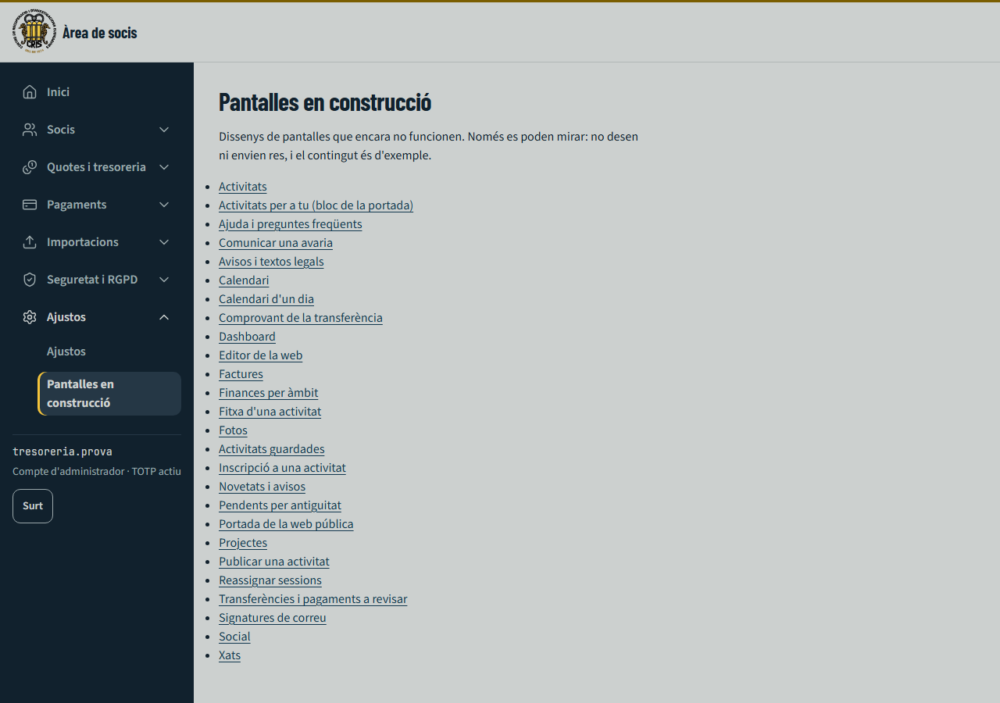

# T-DX-74 · Retirar la pantalla en construcció de rols i permisos

| Data i hora (Europa/Madrid) | Commit | Proves | CI |
|---|---|---|---|
| 19/11/2026 19:16 | 73322a58 | 1 unitària nova i 1 e2e ampliada; 86 unitàries i 27 e2e de les pantalles en construcció | [A comprovar] |

**En tres línies:** la T-RP-03 (#269) va posar l'editor de permisos dels rols en marxa a `/gestio/permisos/`, amb la peça de l'Avisador (T-DX-19). La pantalla d'exemple de `/en-construccio/rols-permisos/` es quedava al costat de la real, cosa que el §6.9 no permet. El propietari va demanar retirar-la en una PR risc:baix, sense tocar cap fitxer del pilot (19/11/2026).

## Què s'ha fet
- Fora `apps/previews/screens/rols_permisos.py` i `templates/previews/rols_permisos.html`. Les rutes, l'índex i les proves de les pantalles en construcció les troben soles, i no cal tocar res més.
- `static/css/avisador.css` es queda: la fa servir la pantalla real (`templates/core/permission_matrix.html`). Cap classe del CSS no quedava només per a la de prova.
- `docs/design-system.md` 1.44: la fitxa de la T-DX-19 apunta a `/gestio/permisos/`.
- `docs/estat/DX.md`: la fila de la T-DX-19 ho diu, i s'afegeix la de la T-DX-74.
- Cap canvi a `apps/accounts/navigation.py` ni a cap fitxer del pilot.

## Decisions i perquè
- **Esborrar i no deixar-la amagada.** Una pantalla en construcció al costat de la real confon (§6.9, com a la T-DX-20). El disseny ja és a la pantalla real i a la fitxa del sistema de disseny, i el codi antic és a l'historial.
- **Seguretat i privacitat:** cap canvi de vista ni de permís. La pantalla de prova no desava res i només tenia dades inventades.

## Com se sap que funciona
- `apps/previews/tests/test_screens.py::test_a_screen_that_already_works_is_no_longer_under_construction`: fallava abans d'esborrar la pantalla i ara passa.
- `apps/core/tests/e2e/test_previews.py::test_admin_with_dx1_reaches_the_screens_from_the_menu`, ampliada: l'índex no té cap enllaç «Rols i permisos», i en fa les captures.
- Unitàries de les pantalles en construcció: 86 passen. E2e de les pantalles en construcció: 27 passen. Ruff net.

## Comprovació §15.5
- **Cap peça nova** ni cap canvi de CSS; cap `style=`.
- **Captures mirades:** l'índex de les pantalles en construcció a 1280 i 390 px i a 320 px en clar i en fosc, sense «Rols i permisos» i sense desplaçament de costat.

## Evidències
- L'índex de les pantalles en construcció a 1280 px, sense «Rols i permisos». `captures/2026-11-19_1916_T-DX-74_index-en-construccio-1280.png`

  

  *19/11/2026 19:16 (Europa/Madrid) · local, prova e2e, dades inventades · commit 73322a58*
