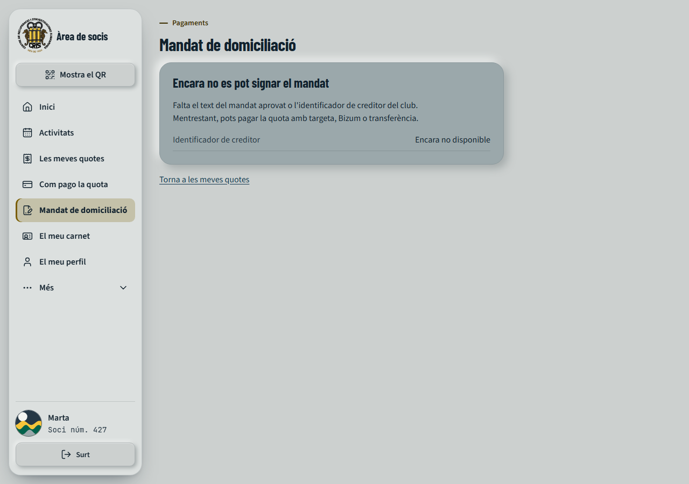
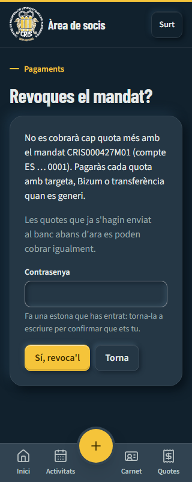

# T-DX-75 · Cap marca interna a les pantalles del soci (V17)

| Data i hora (Europa/Madrid) | Commit | Proves | CI |
|---|---|---|---|
| 20/11/2026 18:51 | 8d8a04e6 | 1 unitària nova, 1 unitària i 1 e2e ajustades; 1728 de pagaments i 3 e2e del mandat i la targeta | [A comprovar] |

**En tres línies:** la revisió final de la fase 1 (T-F1-01, V17) va trobar etiquetes internes («A validar: junta i banc (L-M05a-01)», «A verificar: P-45 punt 6»…) a les pantalles del mandat, de la revocació i de la targeta guardada. Un soci real les veuria. El propietari va demanar (20/11/2026) un text neutre o res al soci, i la marca només a la documentació i a l'administració.

## Què s'ha fet
- `templates/payments/mandate.html`: fora la marca de sota «Titular»; sense identificador de creditor, «Encara no disponible».
- `templates/payments/mandate_revoke.html` i `saved_card.html`: fora la marca; el text del costat es queda igual.
- `apps/core/tests/test_member_templates_no_review_marks.py`: cap plantilla que estengui `base.html` (àrea del soci), fora de les pantalles en construcció, no porta `a-validar`.
- `apps/core/tests/e2e/conftest.py`: amb `E2E_CAPTURES_ALL=1`, `review()` fa les captures a 1280, 1024, 390 i 320 px en clar i en fosc. El CI no posa la variable.
- `docs/design-system.md` (fila «Marca pendent»), `docs/estat/DX.md`, P-424 a `pendents.md` i al tauler.

## Decisions i perquè
- **La campanya i la remesa conserven la marca:** són de l'administració, i l'ordre ho permet.
- **«Encara no disponible» i no «—»:** el bloc ja explica que falta l'identificador; una ratlla semblaria un error.
- **Una prova sobre els fitxers i no sobre les pàgines:** cobreix totes les plantilles del soci, també les que vinguin, sense muntar cada pantalla.
- **P-424:** el text del mandat és una dada que publica l'administració, i l'esborrany porta «[A validar: junta]» a dins. No ho arregla cap plantilla. No s'implementa sense resposta (recomanació A: no deixar publicar un text amb marques).
- **Seguretat i privacitat:** cap canvi de vista, de permís ni de dades. Només text.

## Problemes trobats
- Les captures del flux de signar mostren «[A validar: junta]» dins del text del mandat: l'e2e publica l'esborrany tal qual. És la P-424.

## Com se sap que funciona
- La prova nova fallava amb les plantilles d'abans (`mandate.html`, `mandate_revoke.html`, `saved_card.html`) i ara passa.
- `test_mandate_signing.py`: sense identificador, la pàgina diu «Encara no disponible» i no porta ni «P-45» ni `a-validar`.
- Proves de pagaments: 1728 passen. E2e `test_mandat_signatura.py` i `test_targeta_guardada.py`: 3 passen. Ruff net.

## Comprovació §15.5
- **Cap peça nova** ni cap canvi de CSS; cap `style=`.
- **Captures mirades** a 1280, 1024, 390 i 320 px, en clar i en fosc: mandat (no disponible, signar amb error, país no admès, signat, actiu, revocar, revocat) i targeta (sense, esperant, guardada, esborrar, esborrada). Sense marques, sense desplaçament de costat. A la targeta guardada, el menú no marca «Com pago la quota»: és la V19, a part.

## Evidències
- El mandat sense identificador de creditor, a 1280 px: «Encara no disponible». `captures/2026-11-20_1851_T-DX-75_mandat-no-disponible-1280.png`

  

  *20/11/2026 18:51 (Europa/Madrid) · local, prova e2e, dades inventades · commit 8d8a04e6*

- Revocar el mandat a 320 px en fosc: el text de les quotes ja enviades al banc, sense «A verificar». `captures/2026-11-20_1851_T-DX-75_mandat-revoca-320-fosc.png`

  

  *20/11/2026 18:51 (Europa/Madrid) · local, prova e2e, dades inventades · commit 8d8a04e6*
