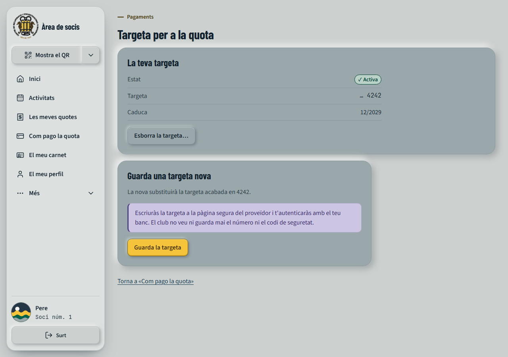
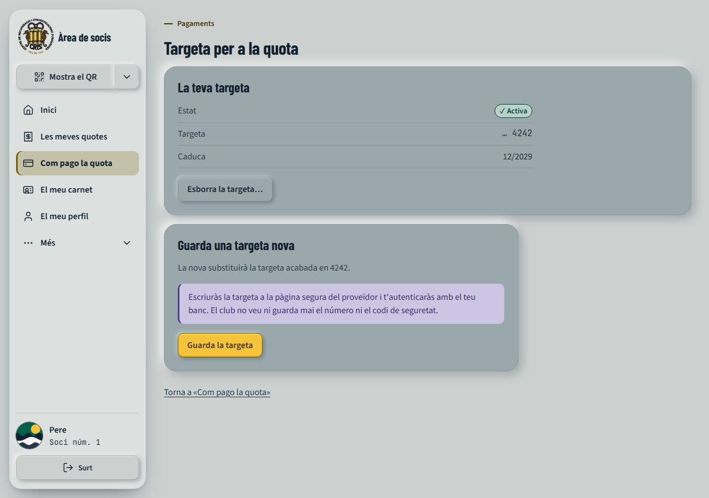

# T-DX-76 · El menú marca l'entrada de cada subpàgina i cap menú a les polítiques (V5, V19, V4)

| Data i hora (Europa/Madrid) | Commit | Proves | CI |
|---|---|---|---|
| 20/11/2026 19:44 | 2756b8c8 | 2 fitxers de proves nous (32 casos); 5 e2e ampliades; 611 de comptes i navegació | [A comprovar] |

**En tres línies:** la revisió final de la fase 1 (T-F1-01, V5 i V19) va trobar que el menú no marcava cap entrada a moltes subpàgines: eximir una quota i el doble factor de la fitxa, l'RGPD, la remesa i els retornats a l'administració; la targeta guardada, revocar el mandat i pagar una quota a l'àrea del soci. A la pàgina de les polítiques (V4), el menú oferia entrades que hi tornaven, i la barra d'un compte sense soci deixava «Més» a la vora. Ara cada subpàgina marca l'entrada d'on s'obre, les polítiques no porten menú i «Més» queda al centre.

## Què s'ha fet
- `apps/accounts/navigation.py`: totes les rutes `administration:` que no marcaven res pengen ara de la seva entrada a `ENTRIES` (fitxa del soci, quotes, altes, remeses i retornats, mandats, conciliació, extracte, enllaços de convidat, RGPD, textos legals).
- `apps/accounts/tests/test_navigation_subpages.py`: recorre totes les rutes de l'administració; cada una penja d'una entrada o és a la llista de pantalles sense menú. «Retornats» i «Textos legals» marquen la seva entrada.
- `templates/members/_personal_nav.html` i `_ramillete.html`: les subpàgines del soci marquen la seva entrada; a `members:accept_policies` no hi ha cap menú; sense soci, la segona pestanya passa després de «Més».
- `apps/core/tests/test_personal_nav_subpages.py` i asserts a 5 e2e (`test_exempcio_040`, `test_retornats`, `test_mandat_signatura`, `test_targeta_guardada`, `test_politiques_079`, aquesta amb una captura nova del perfil d'un compte sense soci).
- `docs/design-system.md` §6.12 i `docs/estat/DX.md`.

## Decisions i perquè
- **Els retornats marquen «Pagaments: remeses»:** s'hi obren des de la pantalla de remeses i no tenen entrada pròpia. Una entrada nova volia un permís i un grup nous, i això no és d'aquesta tasca.
- **Els textos legals marquen «Ajustos»:** s'obren des de l'índex d'ajustos.
- **Polítiques sense cap menú, ni el de la capçalera:** qualsevol enllaç hi tornava (ImportedPoliciesMiddleware). La pantalla ja té «Sortir sense acceptar».
- **Condicions `or` explícites a les plantilles i no una comparació per subcadena:** més llarg, però no pot marcar una entrada per error. La prova comprova que només en queda marcada una.
- **Una prova que recorre totes les rutes:** una pantalla nova de l'administració ha de dir de quina entrada penja, o la prova falla.
- **Seguretat i privacitat:** el menú no és cap control; cada vista torna a comprovar el permís. Cap canvi de permís, de vista ni de dades. Cap menú no queda visible on el servidor desvia.

## Problemes trobats
- En local, `SHOW_UNDER_CONSTRUCTION` és cert per defecte (`config/settings/dev.py`): `test_navigation.py` i `test_ramillete.py` fallen igual a `master`. Amb `SHOW_UNDER_CONSTRUCTION=false`, com al CI, passen. Les captures de després estan fetes així; les d'abans, amb «Activitats».
- La #318 també toca `test_politiques_079.py`: pot caldre resoldre un conflicte petit en fusionar.

## Com se sap que funciona
- Les dues proves noves i els 5 asserts e2e fallaven amb el codi d'abans i ara passen.
- Proves de `apps/accounts/tests/`, `test_member_nav.py` i la nova: 611 passen. E2e: 14 passen (les 5 tocades, `test_navegacio_soci`, `test_ramillete` i `test_accessibilitat_mandat`). Ruff net; gitleaks sense troballes.

## Comprovació §15.5
- **Cap peça nova** ni cap canvi de CSS; cap `style=`. La regla nova és a §6.12.
- **Captures mirades** a 1280, 1024, 390 i 320 px, en clar i en fosc: eximir la quota («Llistat de socis» marcada), retornats per decidir («Pagaments: remeses»), revocar el mandat (al panell, «Mandat de domiciliació»; a la barra és dins de «Més»), la targeta guardada («Com pago la quota»), les polítiques i les polítiques amb error (sense menú) i el perfil d'un compte sense soci (Inici, «Més» al centre i Perfil, també a 320 px). Sense desplaçament de costat.

## Evidències
- Abans: a la targeta guardada, el panell no marca cap entrada. `captures/2026-11-20_1944_T-DX-76_targeta-guardada-abans-1280.png`

  

  *20/11/2026 19:44 (Europa/Madrid) · local, prova e2e, dades inventades, amb les pantalles en construcció · commit 1424633f (master abans de la tasca)*

- Després: «Com pago la quota» marcada. `captures/2026-11-20_1944_T-DX-76_targeta-guardada-1280.png`

  

  *20/11/2026 19:44 (Europa/Madrid) · local, prova e2e, dades inventades · commit 2756b8c8*
