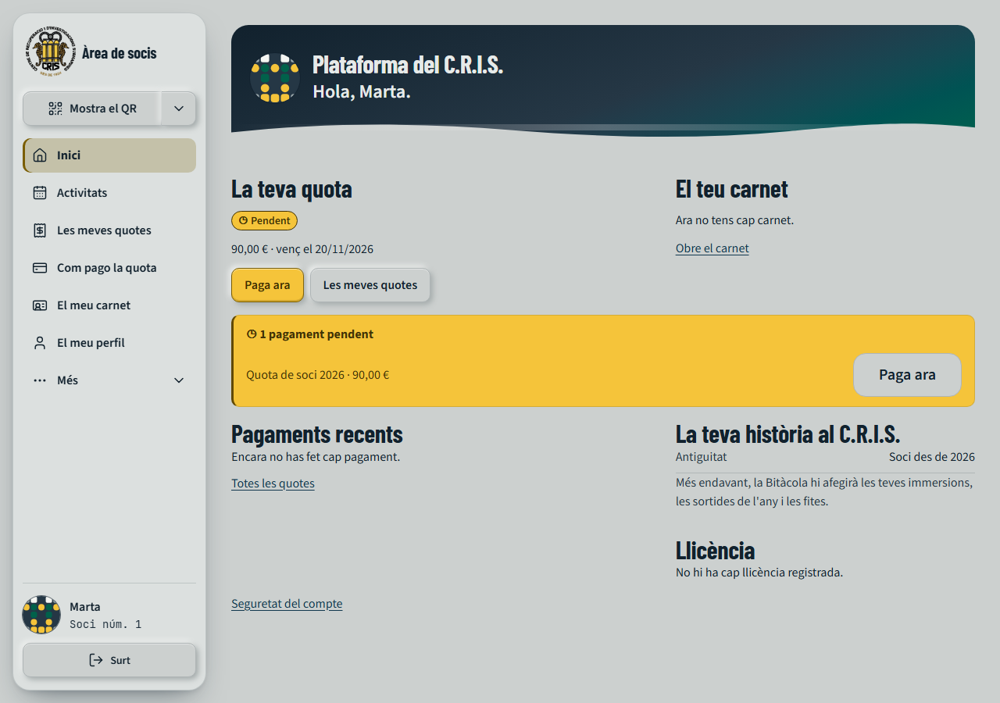
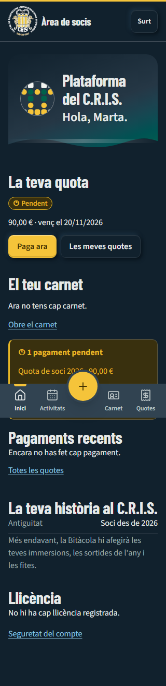

# T-DX-77 · Inici del soci: columnes alineades i quota pendent amb «Paga ara» (V8, V20)

| Data i hora (Europa/Madrid) | Commit | Proves | CI |
|---|---|---|---|
| 20/11/2026 19:24 | 9089f6f0 | 1 unitària nova; 2 e2e ampliades | [A comprovar] |

**En tres línies:** la revisió final de la fase 1 (T-F1-01, V8 i V20) va trobar dues coses a l'inici del soci. «La teva història» i «Llicència» no començaven on comença «El teu carnet» (8/4 a sota, 7/5 a dalt). I un soci nou, amb la quota pendent i sense carnet, veia «—» a «La teva quota», «El meu carnet» com a botó principal i un «Paga ara» d'un altre color.

## Què s'ha fet
- `static/css/oleaje.css`: `inici-graella` en 7/5, les mateixes columnes que `inici-portada`.
- `templates/core/home.html`: la quota pendent que encara no ha vençut mostra l'etiqueta «Pendent» del càrrec, l'import i «venç el dd/mm/aaaa» (o «vençuda el»). Amb un pendent, «Paga ara» és el `boto-principal`, al costat de l'import; «El meu carnet» passa a botó normal i, sense carnet, no hi és. A la franja, «Paga ara» és `boto boto-gran` (abans `boto-mari`).
- `docs/design-system.md` (§5.1, §6.5 i §6.18) i `docs/estat/DX.md`.

## Decisions i perquè
- **El botó principal a «La teva quota» i no a la franja:** a la primera prova el vaig posar a la franja. En clar, el groc de l'accent sobre el daurat de l'avís perdia la forma del botó. Al costat de l'import també és on el demana la B13.
- **Sense carnet, «El meu carnet» no hi és:** el bloc del carnet ja diu «Ara no tens cap carnet» i hi enllaça. Amb carnet i un pendent, es queda com a botó normal.
- **Sense consultes noves:** l'import i el venciment surten del primer pendent que ja calcula `member_home`; el «vençuda» compara amb la data del dia a la plantilla (``).
- **Seguretat i privacitat:** cap canvi de vista, de permís ni de dades. «Paga ara» porta a la pantalla de pagament del 05b, que torna a comprovar que el càrrec és del soci de la sessió.

## Problemes trobats
- `fee_state` no dona cap estat a una quota pendent que encara no ha vençut (regla del 079), i per això la plantilla mostrava «—». No es toca la regla: la plantilla fa servir l'estat del càrrec, com la franja.
- A 320 px, a les captures de pàgina sencera, la barra de baix fixa tapa una part de la franja. Passa a totes les pantalles del soci i no és d'aquesta tasca.

## Com se sap que funciona
- La unitària nova (`test_a_pending_fee_not_yet_due_without_card_makes_pay_now_the_main_action`) i les e2e ampliades (`test_oleaje.py`: la x de la història igual que la del carnet; «Paga ara» de la quota amb `boto-principal`, cap «El meu carnet», el de la franja sense `boto-principal`) fallaven abans i ara passen.
- `apps/members/tests/test_oleaje.py`: 9 passen. E2e `test_oleaje.py`: 2 passen, amb el contrast de 4,5:1 o més a totes les amplades. Ruff net.

## Comprovació §15.5
- **Un sol `boto-principal`** a l'inici (D19), també amb pendents. Cap peça nova ni cap token nou; cap `style=`.
- **Captures mirades** a 1280, 1024, 390 i 320 px, en clar i en fosc: inici al dia i inici amb una quota pendent sense carnet. A 1280 px, la història i la llicència comencen a la columna del carnet. Sense desplaçament de costat.

## Evidències
- Inici amb una quota pendent i sense carnet, a 1280 px: «Pendent», «90,00 € · venç el…» i «Paga ara» com a botó principal. `captures/2026-11-20_1924_T-DX-77_inici-pendent-1280.png`

  

  *20/11/2026 19:24 (Europa/Madrid) · local, prova e2e, dades inventades · commit 9089f6f0*

- El mateix a 320 px en fosc. `captures/2026-11-20_1924_T-DX-77_inici-pendent-320-fosc.png`

  

  *20/11/2026 19:24 (Europa/Madrid) · local, prova e2e, dades inventades · commit 9089f6f0*
