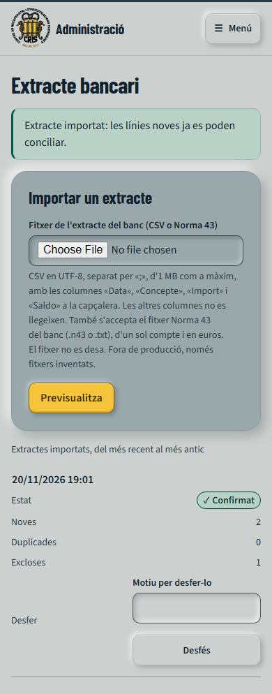
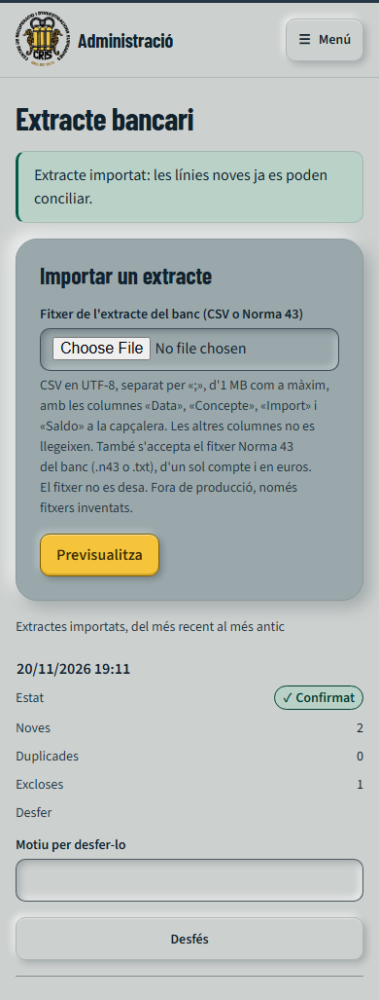

# T-DX-78 · La fila buida a l'esquerra i el formulari a tota l'amplada a la taula apilada (V13, V14)

| Data i hora (Europa/Madrid) | Commit | Proves | CI |
|---|---|---|---|
| 20/11/2026 19:13 | 323e9996 | 2 e2e ajustades (2 asserts nous); 5 e2e de tresoreria, extracte i pagaments | [A comprovar] |

**En tres línies:** la revisió final de la fase 1 (T-F1-01, V13 i V14) va trobar que, a la taula apilada del mòbil, les files buides («Cap moviment amb aquests filtres») sortien a la dreta i que el formulari del motiu de «Desfés» de l'extracte bancari quedava espremut a la meitat dreta de la cel·la. La causa era la mateixa: la cel·la apilada és flex i l'etiqueta (buida o no) ocupa l'esquerra. Una regla a `comptes.css` ho arregla per a totes les taules.

## Què s'ha fet
- `static/css/comptes.css`: la cel·la amb `colspan` i sense `data-etiqueta` no genera l'etiqueta buida (V13), i un `form` fill d'una cel·la apilada fa `flex-basis: 100%`, de manera que passa sota l'etiqueta i fa tota l'amplada (V14). A partir de 600 px no canvia res.
- `apps/core/tests/e2e/test_tresoreria.py` i `test_extracte_bancari.py`: a 390 px, el text de la fila buida comença a la vora esquerra de la cel·la, i el formulari del motiu fa l'amplada de la cel·la.
- `docs/design-system.md` (taula apilada) i `docs/estat/DX.md`.

## Decisions i perquè
- **Una regla compartida i no una classe a cada plantilla:** les files buides són a 13 plantilles; totes fan servir el mateix patró (`<td colspan>` sense etiqueta), i el selector només toca aquest cas. La fila protegida de la matriu de permisos porta `data-etiqueta=""` i no canvia.
- **El formulari sota l'etiqueta i no al costat:** a 390 px no hi ha lloc per a l'etiqueta, el camp i el botó en una fila; sota, el camp fa l'amplada tàctil completa. També val per als formularis de la conciliació, dels retorns i de les remeses dins de cel·les.
- **Seguretat i privacitat:** cap canvi de vista, de permís ni de dades. Només CSS i proves.

## Problemes trobats
- Cap. Les e2e del llistat de pagaments no tenen cap fila buida; la regla és la mateixa i ho cobreix la de moviments.

## Com se sap que funciona
- Les dues comprovacions noves fallaven abans (el text començava 155 px a la dreta; el formulari feia 184 px d'una cel·la de 358) i ara passen.
- E2e: `test_treasurer_sees_the_movement_and_the_balance`, `test_treasurer_imports_and_undoes_a_statement` i `test_pagaments_llistat.py` (5 passen). Ruff net, gitleaks net.

## Comprovació §15.5
- **Cap peça nova**: una regla de la taula apilada, documentada; cap `style=`, cap valor sense token.
- **Captures mirades** a 1280, 1024, 390 i 320 px, en clar i en fosc: moviments (sense filtre i filtrats), comptes i saldos, extracte bancari (buit, previsualització, importat, desfet), pagaments i «a revisar» (filtrats, tancats), tancar un pagament a revisar i quota no cobrada. Sense desplaçament de costat. A l'escriptori no canvia res.

## Evidències
- Abans: l'extracte importat a 390 px, amb el motiu de «Desfés» a la meitat dreta de la cel·la. `captures/2026-11-20_1913_T-DX-78_extracte-importat-abans-390.png`

  

  *20/11/2026 19:13 (Europa/Madrid) · local, prova e2e, dades inventades · commit a77bedff (abans del canvi)*

- Després: el motiu i el botó sota l'etiqueta «Desfer», a tota l'amplada. `captures/2026-11-20_1913_T-DX-78_extracte-importat-390.png`

  

  *20/11/2026 19:13 (Europa/Madrid) · local, prova e2e, dades inventades · commit 323e9996*
