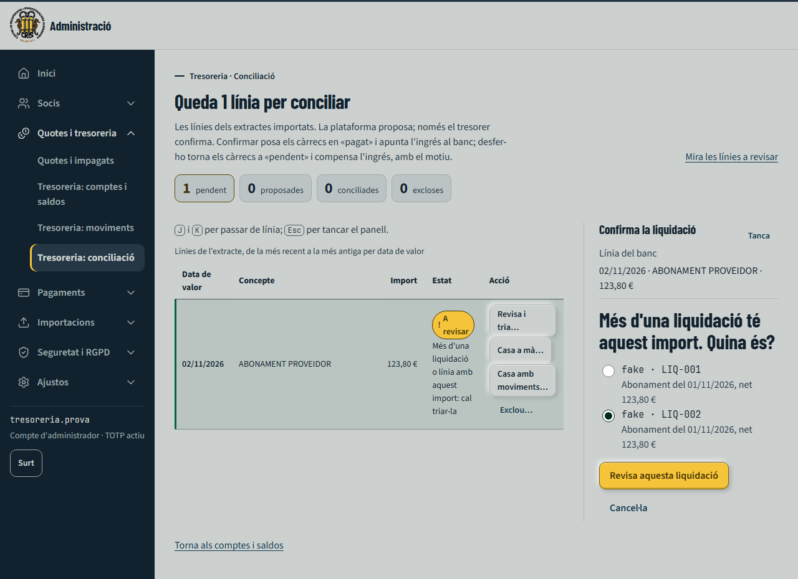

# T-DX-79 · Conciliació amb el panell obert: l'estat i les accions en una línia (V15)

| Data i hora (Europa/Madrid) | Commit | Proves | CI |
|---|---|---|---|
| 20/11/2026 19:18 | 3624c263 | 1 e2e ajustada (1 assert nou); 11 e2e de tresoreria, exclusions i escriptori de la conciliació | [A comprovar] |

**En tres línies:** la revisió final de la fase 1 (T-F1-01, V15) va trobar que, a la conciliació a 1280 px amb el panell de la línia obert, la columna «Estat» quedava molt estreta: «A revisar» es partia, el motiu ocupava sis línies i les accions s'amuntegaven partides. El concepte s'endú l'amplada que sobra (T-DX-73) i la resta de columnes queden a la mínima. Ara l'etiqueta i cada acció van en una línia i el motiu, a sota, en una línia amb «…».

## Què s'ha fet
- `templates/treasury/reconciliation.html`: el motiu d'«A revisar» dins del seu `span` (`conciliacio-motiu`).
- `static/css/disposicio.css`: amb el panell obert (`.amb-linia`), `white-space: nowrap` a l'etiqueta d'estat i a cada acció (botó, formulari de «Confirma» i «Exclou…»), i el motiu en un bloc d'amplada zero que s'estira a la de la cel·la, amb «…»: no eixampla la columna.
- `apps/core/tests/e2e/test_tresoreria.py`: amb el panell obert, cap etiqueta d'estat, motiu ni acció en més d'una línia.
- `docs/design-system.md` (§6.22) i `docs/estat/DX.md`.

## Decisions i perquè
- **Retallar el motiu i no amagar-lo:** la primera paraula orienta, el text sencer continua al DOM (el lector de pantalla el llegeix) i surt sencer sense panell, al mòbil i a «A revisar». És el mateix criteri que el concepte (T-DX-73).
- **Les accions apilades, una per línia, i no en fila:** en fila no hi caben amb el panell obert sense deixar el concepte en dues lletres. Moure-les al panell hauria tocat les vistes del panell, fora d'aquesta tasca.
- **Només amb el panell obert:** sense panell la taula té lloc i a 1024 px i al mòbil no canvia res.
- **Seguretat i privacitat:** cap canvi de vista, de permís ni de dades. El panell continua sense ser cap control.

## Problemes trobats
- La primera versió de la prova comptava el botó «Exclou la línia», que és dins del `details` tancat. Ara només mira els fills directes de la cel·la.

## Com se sap que funciona
- La comprovació nova fallava abans («! A revisar», el motiu i «Casa amb moviments…» en més d'una línia) i ara passa.
- E2e: `test_tresoreria.py`, `test_tresoreria_exclusions.py` i `test_reconciliation_with_the_panel_of_the_chosen_line` (11 passen). Ruff net, gitleaks net.

## Comprovació §15.5
- **Cap peça nova** fora de la classe `conciliacio-motiu`, documentada a §6.22; cap `style=`, cap valor sense token.
- **Captures mirades** a 1280, 1024, 390 i 320 px, en clar i en fosc: conciliació amb la tria de liquidació, conciliació i conciliació amb el panell de l'escriptori. Sense desplaçament de costat. A 1024 px i al mòbil no canvia res.

## Evidències
- Abans: a 1280 px amb el panell obert, «A revisar» partit, el motiu en sis línies i les accions partides. `captures/2026-11-20_1918_T-DX-79_conciliacio-tria-abans-1280.png`

  

  *20/11/2026 19:18 (Europa/Madrid) · local, prova e2e, dades inventades · commit a77bedff (abans del canvi)*

- Després: l'etiqueta i cada acció en una línia, el motiu a sota amb «…». `captures/2026-11-20_1918_T-DX-79_conciliacio-tria-1280.png`

  

  *20/11/2026 19:18 (Europa/Madrid) · local, prova e2e, dades inventades · commit 3624c263*
