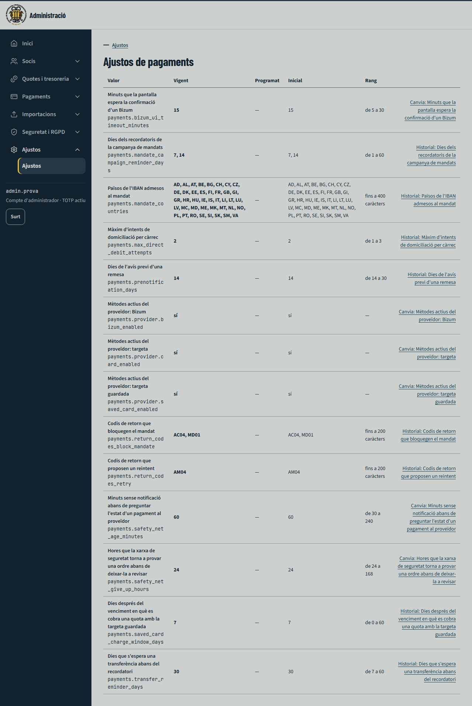
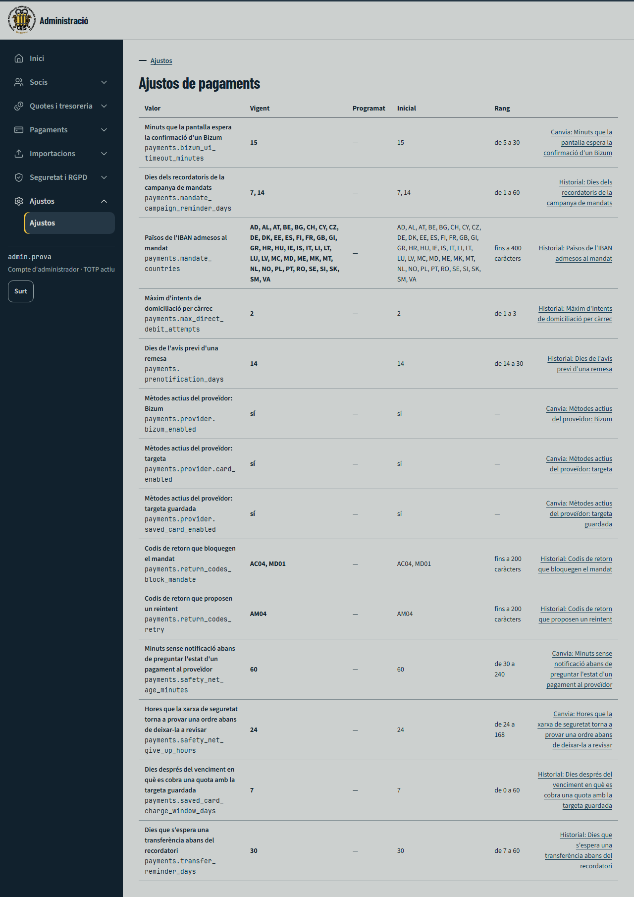

# T-DX-80 · Ajustos: la clau es parteix només després de «_» o «.» (V18)

| Data i hora (Europa/Madrid) | Commit | Proves | CI |
|---|---|---|---|
| 20/11/2026 19:23 | 24001e03 | 1 e2e ajustada (1 assert nou); 10 e2e d'ajustos | [A comprovar] |

**En tres línies:** la revisió final de la fase 1 (T-F1-01, V18) va trobar que, a «Ajustos de pagaments» a 1280 px, la clau de cada valor (`payments.bizum_ui_t` / `imeout_minutes`) es partia enmig de les paraules. La llista de països del mandat s'enduia l'amplada, i `codi` porta `overflow-wrap: anywhere`, de manera que la columna del nom es podia estrènyer fins a trencar la clau per qualsevol lletra. Ara la clau només es parteix després d'un «_» o d'un «.».

## Què s'ha fet
- `templates/core/settings_section.html`: la clau porta `<wbr>` després de cada «_» i «.» (un bucle de plantilla sobre els caràcters de la clau, autoescapat) i la classe `clau-partible`.
- `static/css/comptes.css`: `.codi.clau-partible { overflow-wrap: normal; }`, perquè la clau només es parteixi als `<wbr>`.
- `apps/core/tests/e2e/test_ajustos.py`: a 1280 px, cap clau de la llista partida entre dues lletres.
- `docs/design-system.md` (Ajustos) i `docs/estat/DX.md`.

## Decisions i perquè
- **`<wbr>` a la plantilla i no un filtre nou:** no es pot tocar el Python d'`apps/core` en aquesta tasca, i el bucle de plantilla fa el mateix sense cap codi nou. Les claus són formats de codi (lletres, «_» i «.»).
- **Cap amplada fixa a la columna:** amb la clau partible només per paraules, l'amplada mínima de la columna és la del tros més llarg i la taula reparteix la resta. A 320 px el tros més llarg hi cap.
- **Els valors llargs no canvien:** la llista de països ja es parteix per les comes, dins de la seva cel·la.
- **Seguretat i privacitat:** cap canvi de vista, de permís ni de dades. Cap dada personal.

## Problemes trobats
- Cap.

## Com se sap que funciona
- La comprovació nova fallava abans (15 parelles de lletres partides, com «ti» de `bizum_ui_timeout`) i ara passa.
- E2e: `test_ajustos.py` (10 passen). Ruff net, gitleaks net.

## Comprovació §15.5
- **Cap peça nova** fora de la classe `clau-partible`, documentada a l'apartat d'Ajustos; cap `style=`, cap valor sense token.
- **Captures mirades** a 1280, 1024, 390 i 320 px, en clar i en fosc: ajustos de pagaments, de socis, codis de retorn, textos, recordatori de transferència i les pantalles d'un valor (fora de rang, desat, només consulta). Sense desplaçament de costat.

## Evidències
- Abans: a 1280 px, la clau partida enmig de les paraules (`payments.bizum_ui_t` / `imeout_minutes`). `captures/2026-11-20_1923_T-DX-80_ajustos-pagaments-abans-1280.png`

  

  *20/11/2026 19:23 (Europa/Madrid) · local, prova e2e, dades inventades · commit a77bedff (abans del canvi)*

- Després: la clau es parteix només després de «_» o «.» i la llista de països es parteix dins de la seva cel·la. `captures/2026-11-20_1923_T-DX-80_ajustos-pagaments-1280.png`

  

  *20/11/2026 19:23 (Europa/Madrid) · local, prova e2e, dades inventades · commit 24001e03*
