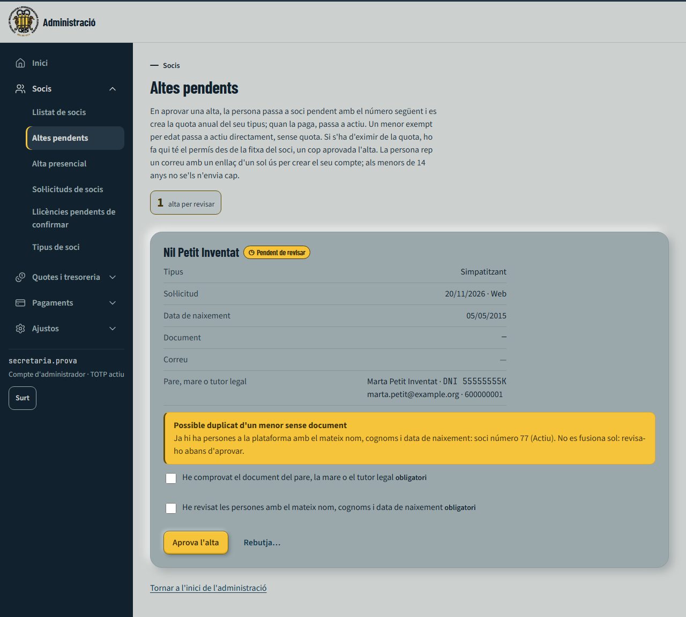

# T-DX-81 · «Rebutja…» al costat d'«Aprova l'alta» (V3)

| Data i hora (Europa/Madrid) | Commit | Proves | CI |
|---|---|---|---|
| 20/11/2026 19:29 | a0271f3a | 1 e2e ampliada | [A comprovar] |

**En tres línies:** la revisió final de la fase 1 (T-F1-01, V3) va trobar que, a «Altes pendents», una alta amb diverses caselles obligatòries deixava «Rebutja…» a la dreta de les caselles, lluny d'«Aprova l'alta». Deposito demana aprovar i rebutjar al costat (B13). Ara els dos botons van junts a sota de les caselles.

## Què s'ha fet
- `static/css/deposito.css`: el formulari d'aprovar amb caselles (`form:has(> .casella)`) es desfà dins la fila `deposito-accions` amb `display: contents`; les caselles ocupen tota l'amplada i «Aprova l'alta» i «Rebutja…» queden a la mateixa fila.
- `docs/design-system.md` (§6.17, Deposito) i `docs/estat/DX.md`.

## Decisions i perquè
- **CSS i no canviar la plantilla:** amb `display: contents` els camps continuen dins del `<form>` i l'enviament és el mateix. Moure les caselles fora del formulari (atribut `form=`) hauria tocat l'HTML i les proves de la vista.
- **Només els formularis amb caselles:** sense caselles el formulari ja era un sol botó, i les pantalles en construcció amb `deposito-accions` no porten formulari.
- **Seguretat i privacitat:** cap canvi de vista, de permís ni de dades. Les caselles obligatòries continuen sent `required` i el servidor les torna a comprovar.

## Problemes trobats
- Cap.

## Com se sap que funciona
- `test_minor_without_document_shows_the_possible_duplicate`: «Rebutja…» és a la dreta d'«Aprova l'alta», a menys de 64 px i a la mateixa alçada. Abans fallava (900 px de separació); ara passa, i l'aprovació amb les dues caselles continua funcionant.
- E2e `test_altes_079.py`: 2 passen. Ruff net.

## Comprovació §15.5
- **Un sol botó principal** («Aprova l'alta») per sol·licitud; cap peça nova ni cap token nou; cap `style=`.
- **Captures mirades** a 1280, 1024, 390 i 320 px, en clar i en fosc: altes pendents (adult i menor amb possible duplicat), alta aprovada, menor aprovat, invitació, invitació no vàlida, compte creat i fitxa amb invitació. Sense desplaçament de costat.

## Evidències
- Abans, a 1280 px: «Rebutja…» a la dreta de la primera casella, lluny del botó. `captures/2026-11-20_1929_T-DX-81_abans-menor-possible-duplicat-1280.png`

  

  *20/11/2026 19:29 (Europa/Madrid) · local, prova e2e, dades inventades · commit 1424633f (abans del canvi)*

- Després, a 1280 px: les dues caselles a tota l'amplada i, a sota, «Aprova l'alta» i «Rebutja…» al costat. `captures/2026-11-20_1929_T-DX-81_despres-menor-possible-duplicat-1280.png`

  

  *20/11/2026 19:29 (Europa/Madrid) · local, prova e2e, dades inventades · commit a0271f3a*
