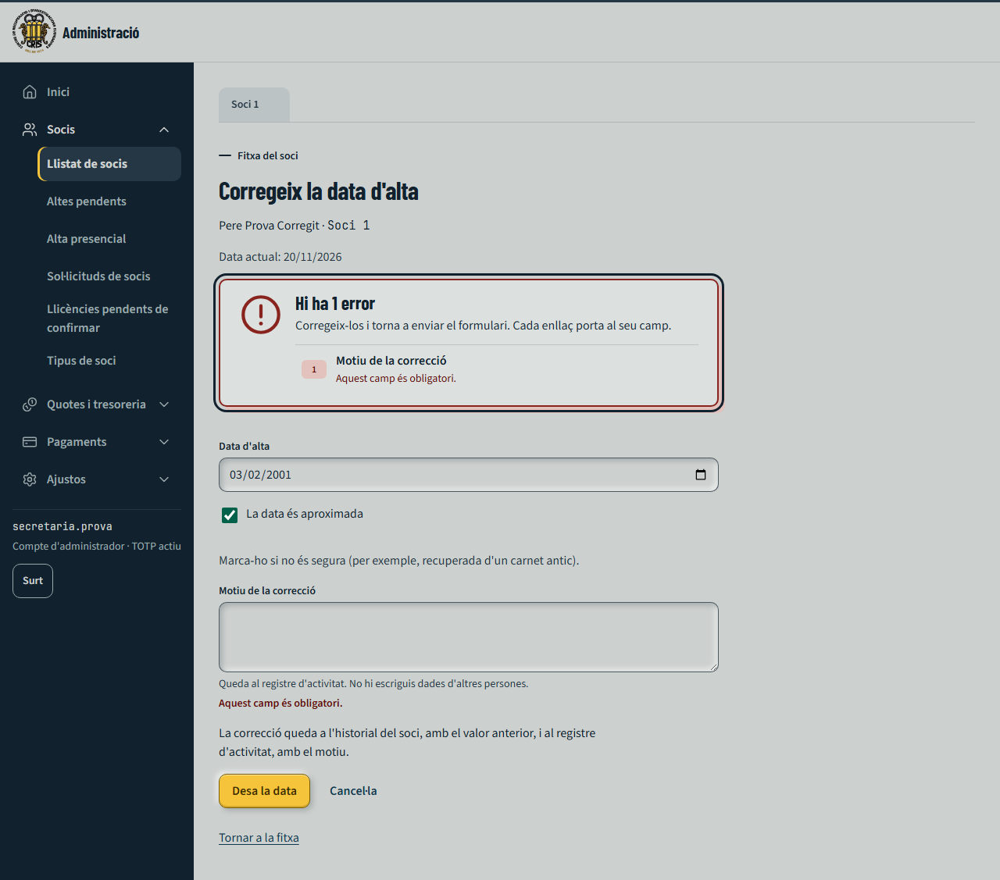
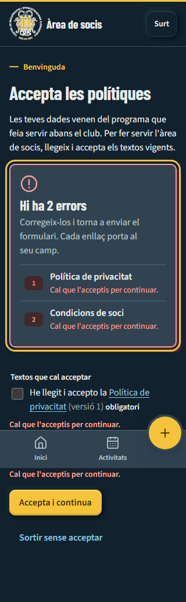

# T-DX-82 · Resum d'errors a la data d'alta i a les polítiques (V10)

| Data i hora (Europa/Madrid) | Commit | Proves | CI |
|---|---|---|---|
| 20/11/2026 19:35 | 35ca96b8 | 2 e2e ampliades; 84 unitàries de l'edició del soci i de les polítiques | [A comprovar] |

**En tres línies:** la revisió final de la fase 1 (T-F1-01, V10) va trobar que «Corregeix la data d'alta» mostrava els errors només al costat de cada camp, sense el resum d'Errata del formulari d'alta. «Accepta les polítiques» tenia el mateix buit, amb un avís general «Revisa els camps marcats.». Ara tots dos formularis porten el resum a dalt.

## Què s'ha fet
- `templates/members/member_join_date.html`: `` a dalt del formulari, en lloc de l'avís dels errors generals.
- `templates/members/accept_policies.html`: el mateix, en lloc de «Revisa els camps marcats.».
- `docs/estat/DX.md`.

## Decisions i perquè
- **A dalt del formulari i no a la columna lateral:** cap de les dues pantalles fa servir `lateral-formulari`; és el lloc que diu §6.10 per a un formulari d'una columna.
- **Fora els avisos d'abans:** Errata ja inclou els errors generals («Formulari») i el nombre d'errors; dos avisos seguits dirien el mateix.
- **Les altres pantalles amb «Revisa els camps marcats.»** (invitació, recuperació i canvi de contrasenya temporal) són d'`accounts` i no eren de la llista: no es toquen.
- **Seguretat i privacitat:** cap canvi de vista, de permís ni de dades. Els missatges són els mateixos del costat de cada camp i no diuen res de cap compte.

## Problemes trobats
- L'e2e de la data d'alta buscava l'error pel text, que ara surt dues vegades (resum i camp): es busca per `#id_reason_error`.
- A 320 px, a les captures de pàgina sencera, la barra de baix fixa de l'àrea del soci tapa una part del formulari de les polítiques. Passa a totes les pantalles del soci i no és d'aquesta tasca.

## Com se sap que funciona
- `test_edit_member_data_and_correct_the_join_date`: el resum té el focus i enllaça «Motiu de la correcció» (`#id_reason`). `test_imported_member_accepts_the_policies_at_first_login`: «Hi ha 2 errors» amb dos enllaços. Totes dues fallaven abans i ara passen.
- Unitàries `test_member_edit.py`, `test_member_edit_079.py` i `test_policies_079.py`: 84 passen. E2e: 3 passen. Ruff net.

## Comprovació §15.5
- **Cap peça nova** (Errata ja és al sistema, §6.10); un sol botó principal per pantalla; cap `style=`.
- **Captures mirades** a 1280, 1024, 390 i 320 px, en clar i en fosc: edita les dades, corregeix la data d'alta (amb i sense motiu), fitxa corregida, polítiques, polítiques amb errors i les dues de la prova de Cluber. Sense desplaçament de costat.

## Evidències
- «Corregeix la data d'alta» sense motiu, a 1280 px: «Hi ha 1 error» amb l'enllaç a «Motiu de la correcció». `captures/2026-11-20_1935_T-DX-82_data-alta-sense-motiu-1280.png`

  

  *20/11/2026 19:35 (Europa/Madrid) · local, prova e2e, dades inventades · commit 35ca96b8*

- «Accepta les polítiques» sense marcar res, a 320 px en fosc: «Hi ha 2 errors», un per casella. `captures/2026-11-20_1935_T-DX-82_politiques-error-320-fosc.png`

  

  *20/11/2026 19:35 (Europa/Madrid) · local, prova e2e, dades inventades · commit 35ca96b8*
