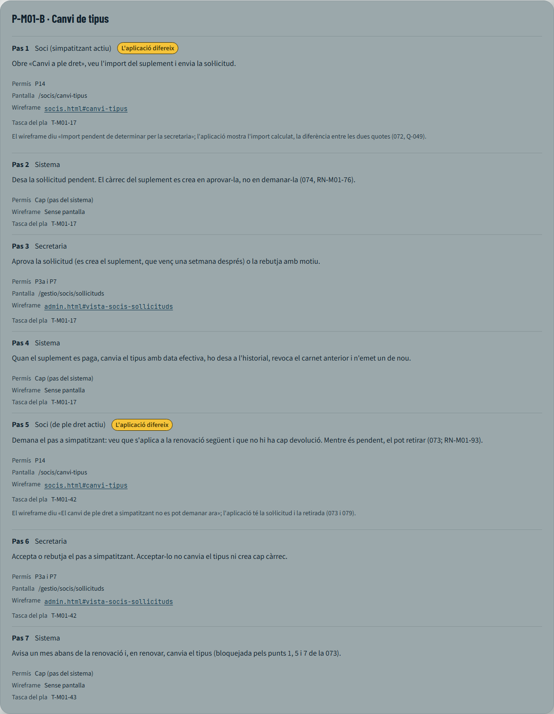
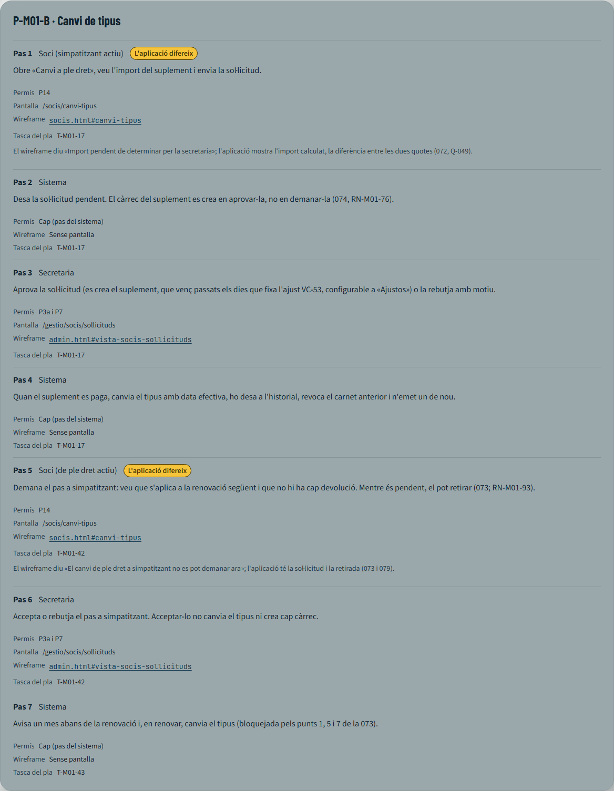

# T-DX-83 · El venciment del suplement és l'ajust VC-53 a l'índex de recorreguts (V11)

| Data i hora (Europa/Madrid) | Commit | Proves | CI |
|---|---|---|---|
| 20/11/2026 19:09 | f547dc0f | 1 unitària nova; 9 de recorreguts i 1 e2e | [A comprovar] |

**En tres línies:** la revisió final de la fase 1 (T-F1-01, V11) va trobar que l'índex de recorreguts (`design/recorreguts/`) deia que el suplement del canvi a ple dret «venç una setmana després». Des de la T-M01-32 ampliada, aquest termini és l'ajust VC-53, que el tresorer canvia a «Ajustos». El text ara ho diu.

## Què s'ha fet
- `design/recorreguts/recorreguts.json`: el pas 3 del P-M01-B diu que el suplement «venç passats els dies que fixa l'ajust VC-53, configurable a "Ajustos"».
- `design/recorreguts/dades.js`: regenerat amb `comprova.py --write` (és la còpia que llegeix `index.html` des del disc).
- `apps/core/tests/test_wireframe_journeys.py`: el pas 3 del P-M01-B no diu «setmana» i nomena VC-53.
- `docs/estat/DX.md`: fila de la tasca.

## Decisions i perquè
- **Sense el valor per defecte (7):** és al pla (`docs/planning.md#valors-configurables`); repetir-lo aquí tornaria a envellir quan algú el canviï.
- **Només el JSON:** és l'únic fitxer que s'edita; `dades.js` surt de l'eina, i la prova que ja hi havia comprova que coincideixen.
- **Seguretat i privacitat:** cap canvi de vista, de permís ni de dades. És un prototip de disseny que s'obre des del disc.

## Problemes trobats
- Cap.

## Com se sap que funciona
- La prova nova fallava amb el text d'abans i ara passa; les 9 de `test_wireframe_journeys.py` passen.
- `comprova.py`: «Recorreguts correctes: 7 recorreguts i 44 passos».
- E2e `test_recorreguts_048.py`: passa. Ruff net; gitleaks sense troballes.

## Comprovació §15.5
- **Cap peça nova** ni cap canvi de CSS; cap `style=`.
- **Captures mirades** a 1280, 1024, 390 i 320 px, en clar i en fosc: l'índex de recorreguts sencer, i el recorregut B a 1280 px abans i després. El text nou cap en una línia a 1280 px i s'ajusta sense desplaçament de costat a 320 px.

## Evidències
- Abans: el pas 3 diu «que venç una setmana després». `captures/2026-11-20_1909_T-DX-83_recorregut-b-abans-1280.png`

  

  *20/11/2026 19:09 (Europa/Madrid) · local, prova e2e, prototip de disseny · commit 1424633f (master abans de la tasca)*

- Després: el pas 3 diu que venç passats els dies de l'ajust VC-53, configurable a «Ajustos». `captures/2026-11-20_1909_T-DX-83_recorregut-b-1280.png`

  

  *20/11/2026 19:09 (Europa/Madrid) · local, prova e2e, prototip de disseny · commit f547dc0f*
