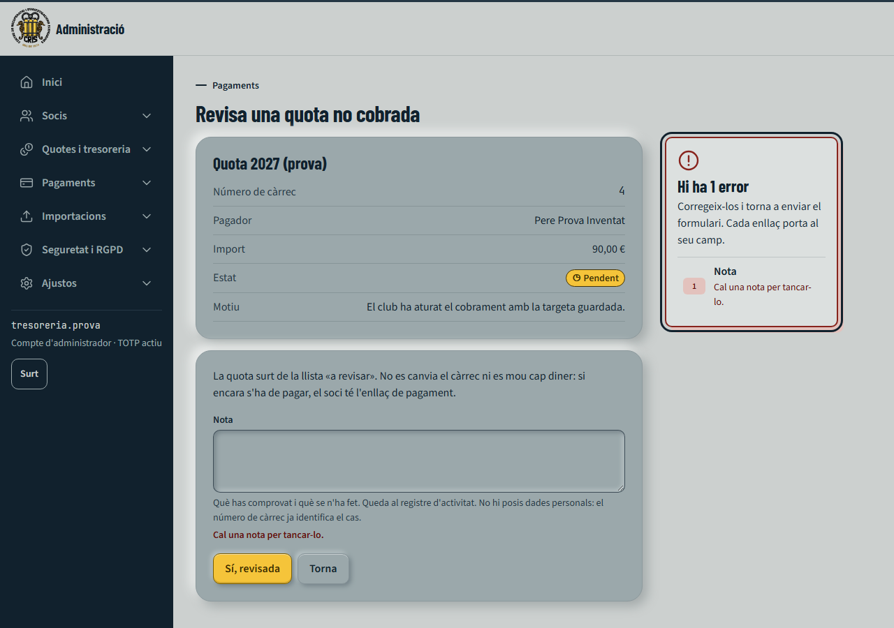
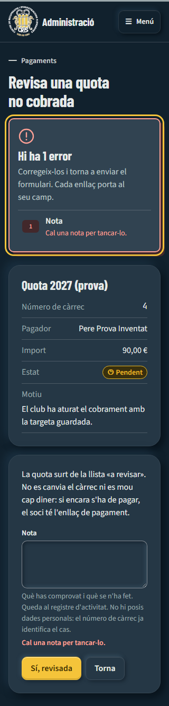

# T-DX-84 · L'estat «Pendent» amb l'etiqueta d'estat a «Revisa una quota no cobrada»

| Data i hora (Europa/Madrid) | Commit | Proves | CI |
|---|---|---|---|
| 20/11/2026 19:41 | 579acecb | 1 e2e ampliada; 17 unitàries de les revisions de càrrecs | [A comprovar] |

**En tres línies:** la volta final de la revisió de la fase 1 (T-F1-01, §8) va trobar que, a «Revisa una quota no cobrada», l'estat del càrrec sortia com a text pla («Pendent»). A la resta de pantalles, l'estat porta l'etiqueta d'estat (icona i color). Ara aquesta pantalla fa servir la mateixa etiqueta.

## Què s'ha fet
- `templates/payments/charge_review_close.html`: l'estat del càrrec amb `members/_charge_status.html` («◷ Pendent», `estat estat-avis`), en lloc de `get_status_display`.
- `docs/estat/DX.md`.

## Decisions i perquè
- **La peça de les quotes i no una de nova:** és la que fan servir «Les meves quotes», la fitxa del soci i l'inici, i aquesta pantalla només mostra quotes (la llista «a revisar» de la targeta guardada). Els textos de la peça («Pagada», «Retornada», en femení) són els d'una quota.
- **Seguretat i privacitat:** cap canvi de vista, de permís ni de dades; l'estat és el mateix que ja es mostrava.

## Problemes trobats
- A 1280 px en fosc, l'import de la targeta del càrrec surt d'un altre color que a 1024 px. No és d'aquesta tasca; queda per a la sessió de DISSENY [A comprovar].

## Com se sap que funciona
- `test_treasurer_marks_an_unpaid_saved_card_fee_as_reviewed`: l'estat és `.estat.estat-avis` amb «◷ Pendent». Fallava abans (no hi havia cap etiqueta) i ara passa.
- E2e `test_pagaments_llistat.py`: 3 passen. Unitàries `test_charge_reviews.py`: 17 passen. Ruff net.

## Comprovació §15.5
- **Cap peça nova** (insígnia d'estat amb significat, D1); un sol botó principal; cap `style=`.
- **Captures mirades** a 1280, 1024, 390 i 320 px, en clar i en fosc: pagaments a revisar, pagaments filtrats, tancar un intent, a revisar tancats, quota no cobrada a revisar i «Revisa una quota no cobrada» amb error. Sense desplaçament de costat.

## Evidències
- «Revisa una quota no cobrada» sense nota, a 1280 px: «Estat» amb l'etiqueta «◷ Pendent». `captures/2026-11-20_1941_T-DX-84_quota-no-cobrada-revisar-1280.png`

  

  *20/11/2026 19:41 (Europa/Madrid) · local, prova e2e, dades inventades · commit 579acecb*

- El mateix a 320 px en fosc. `captures/2026-11-20_1941_T-DX-84_quota-no-cobrada-revisar-320-fosc.png`

  

  *20/11/2026 19:41 (Europa/Madrid) · local, prova e2e, dades inventades · commit 579acecb*
